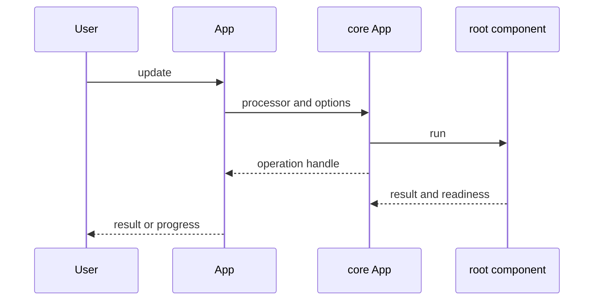

# App Execution and CLI

## Summary

A Python `App` binds a name, main function, arguments and environment; each update runs that function as the root processing component. The CLI loads a module to find registered apps, while the Rust SDK accepts a closure for each update. Both reach the shared engine’s app operation handles. [python/cocoindex/_internal/app.py:214-246] [python/cocoindex/_internal/app.py:294-314] [rust/sdk/cocoindex/src/app.rs:424-451]

## Construction and loading

Python constructs an `App` with either a name or `AppConfig`, a sync or async main function, and its arguments. The environment and core app are resolved lazily; if a lazy environment restarts, the cached core app is recreated for the new environment. [python/cocoindex/_internal/app.py:177-180] [python/cocoindex/_internal/app.py:196-269]

```python
    app = coco.App(
        coco.AppConfig(name="test_handle_result", environment=coco_env),
        _trivial_fn,
        "hello",
    )
    handle = app.update()
    result = await handle.result()
    assert result == "hello"
```

This test constructs an app and awaits its result. Python’s `UpdateHandle` initializes the core operation when `result()` or `watch()` first needs it; `stats()` returns `None` before then. [python/tests/core/test_update_handle.py:32-41] [python/cocoindex/_internal/app.py:70-89]

The CLI accepts `module_or_path[:app_name[@env_name]]`. Importing the module registers its apps; the CLI selects the sole app or requires a name and, when needed, an environment to resolve ambiguity. File paths inside packages are imported as package modules so relative imports work. Other files use their basename as the module name, consistent with the bare-module form for memo keys. [python/cocoindex/cli.py:111-119] [python/cocoindex/cli.py:315-381] [python/cocoindex/user_app_loader.py:49-71]

## Updating



Core creates an app store and root component for the app name, then runs the root processor in a spawned task. In live mode it signals initial readiness but waits for active descendants before signaling termination. [rust/core/src/engine/app.rs:91-105] [rust/core/src/engine/app.rs:150-175]

| Option | Effect |
|---|---|
| `full_reprocess` | Bypasses existing memoization to rerun work. |
| `live` | Allows live components to continue after initial readiness. |
| `preview` | Collects planned target actions instead of applying them. |
| Rust `timeout` | Sets a cooperative deadline for the update. |

Python offers `update()` and `update_blocking()`; the blocking form can report progress to stdout. Rust offers `update`, `update_with_options`, blocking variants and `start_update_with_options`; its closure receives a `Ctx`. See [Live Component Lifecycle](live-component-lifecycle.md) for readiness in live mode. [python/cocoindex/_internal/app.py:271-292] [python/cocoindex/_internal/app.py:322-344] [rust/sdk/cocoindex/src/app.rs:445-463] [rust/sdk/cocoindex/src/app.rs:707-723]

The CLI exposes `--full-reprocess`, `--live`, `--preview`, and `--reset`. Reset drops existing app state before updating and prompts unless `--force` is supplied. The CLI rejects `--preview` with either `--reset` or `--live`. [python/cocoindex/cli.py:1015-1066] [python/cocoindex/cli.py:1094-1115]

## Preview and drop

Python preview returns raw action objects instead of the main result; Rust `App::preview` returns `PreviewAction` values. Preview skips applying target actions and storing memo changes, but it does **not** preview deletion of child components omitted by the run. Child target preview also requires a sink with a child handler factory. [python/cocoindex/_internal/app.py:284-289] [rust/sdk/cocoindex/src/app.rs:494-508] [rust/core/src/engine/execution.rs:1667-1700] [rust/core/src/engine/execution.rs:2018-2034]

`App.drop()` and Rust `drop_state()` invoke core app deletion: live work is drained, the root component is deleted, and the app store is cleared. Python documents that user-managed containers are abandoned rather than removed. The CLI checks for persisted state and prompts before dropping unless forced. [rust/core/src/engine/app.rs:192-200] [rust/core/src/engine/app.rs:250-273] [python/cocoindex/_internal/app.py:372-384] [python/cocoindex/cli.py:1152-1177]

## Operation handles

Python `UpdateHandle.result()` awaits completion; the handle itself is awaitable. `watch()` yields progress snapshots, including initial readiness in live mode and a final result on termination; it is unavailable for preview. The underlying result is consumed when retrieved. [python/cocoindex/_internal/app.py:52-56] [python/cocoindex/_internal/app.py:91-105] [python/cocoindex/_internal/app.py:114-145] [rust/py/src/app.rs:102-113]

Rust’s `UpdateHandle` exposes snapshots, `changed()` and a consuming `result()`; preview handles provide `preview_actions()`. `DropHandle` supplies analogous progress and completion methods. See [Inspection, Progress, and Telemetry](inspection-progress-and-telemetry.md) for statistics. [rust/sdk/cocoindex/src/app.rs:805-861] [rust/sdk/cocoindex/src/app.rs:864-895]

## Terms

- **App**: A named runnable pipeline with an environment and root execution.
- **`APP_TARGET`**: CLI module or file specifier, optionally selecting an app and environment.
- **Preview**: An update that collects planned target actions without applying them.
- **Operation handle**: An object for observing progress and awaiting an update or drop.