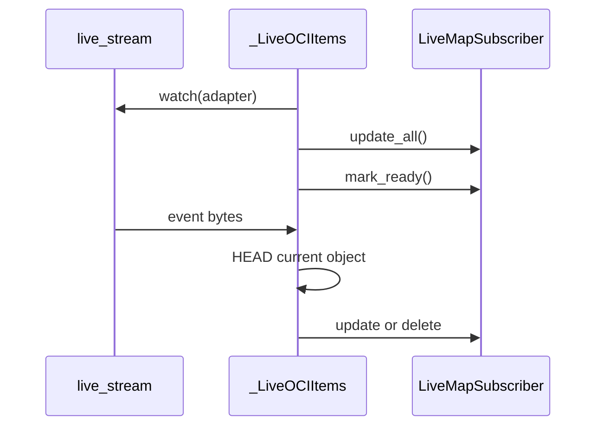

# Cloud File Sources

## Summary

S3, Azure Blob, OCI Object Storage, and Google Drive expose remote files for keyed pipeline processing. Object-store walkers use paths relative to a prefix; OCI can also combine a scan with an event stream for live updates. [python/cocoindex/connectors/amazon_s3/_source.py:294-365] [python/cocoindex/connectors/oci_object_storage/_source.py:254-259]

## Enumeration and identity

| Source | Discovery and `items()` key | File identity |
|---|---|---|
| S3 | Paginated bucket listing; prefix-relative object path. | Bucket plus relative path; `resolve()` returns the full object key. |
| Azure Blob | Container listing; prefix-relative blob path. | Account, container, and relative path; `resolve()` returns the full blob name. |
| OCI | Paginated bucket listing; prefix-relative object path. | Namespace, bucket, and relative path; `resolve()` returns the full object name. |
| Google Drive | Recursive folder listing with optional MIME filter. | `DriveFilePath.resolve()` returns the Drive file ID. |

The object walkers skip directory markers and apply path and maximum-size filters. Azure requires the client to expose account and container identity, either directly or through its URL. [python/cocoindex/connectors/amazon_s3/_source.py:294-340] [python/cocoindex/connectors/azure_blob/_source.py:93-104] [python/cocoindex/connectors/azure_blob/_source.py:266-309] [python/cocoindex/connectors/oci_object_storage/_source.py:300-343]

Python Drive’s `items()` key is built from `info.name`; its recursive listing does not add parent folder names. Files with the same name in different folders can therefore produce the same key. Rust’s Drive source builds a relative folder path instead. [python/cocoindex/connectors/google_drive/_source.py:94-97] [python/cocoindex/connectors/google_drive/_source.py:218-231] [python/cocoindex/connectors/google_drive/_source.py:257-263] [rust/sdk/cocoindex/src/connectors/gdrive.rs:650-681]

## Metadata and content

Listings supply metadata with the file when available; `FileLike` fetches missing metadata lazily. S3 and Azure use ETags as fingerprints; OCI listing summaries use MD5 when present, while OCI HEAD metadata uses an ETag. If metadata lacks a fingerprint, `FileLike` hashes the content. [python/cocoindex/connectors/amazon_s3/_source.py:337-346] [python/cocoindex/connectors/azure_blob/_source.py:107-112] [python/cocoindex/connectors/oci_object_storage/_source.py:223-250] [python/cocoindex/resources/file.py:159-169]

Object content is fetched on read; S3 and Azure support bounded reads. Drive exports Google Docs as Markdown, Sheets as CSV, and Slides as plain text; other files use media download. Python Drive rejects partial reads. [python/cocoindex/connectors/amazon_s3/_source.py:133-152] [python/cocoindex/connectors/azure_blob/_source.py:199-208] [python/cocoindex/connectors/google_drive/_source.py:65-75] [python/cocoindex/connectors/google_drive/_source.py:123-145]

For shared file caching and memo behavior, see [Filesystem and File Resources](filesystem-and-file-resources.md). The Drive example passes keyed files directly into processing: [examples/gdrive_text_embedding/main.py:116-121]

```python
    source = google_drive.GoogleDriveSource(
        service_account_credential_path=credential_path,
        root_folder_ids=root_folder_ids,
    )

    await coco.mount_each(process_file, source.items(), table)
```

[examples/gdrive_text_embedding/main.py:116-121]

## OCI live view

Passing `live_stream` changes `OCIWalker.items()` from a plain async iterator to a `LiveMapView`. A Kafka payload stream can supply OCI event bytes; see [Streaming Connectors](streaming-connectors.md). [python/cocoindex/connectors/oci_object_storage/_source.py:356-364] [python/cocoindex/connectors/oci_object_storage/_source.py:642-660]



The stream starts before the scan, but event dispatch waits until the full update has committed and readiness returns. Events are filtered by type, bucket, prefix, path, and a scan-time cutoff with five seconds of tolerance. Accepted events trigger a fresh HEAD: current existence decides update versus delete, even if the event type says otherwise. Oversized objects and non-404 HEAD failures are skipped. [python/cocoindex/connectors/oci_object_storage/_source.py:56-62] [python/cocoindex/connectors/oci_object_storage/_source.py:371-383] [python/cocoindex/connectors/oci_object_storage/_source.py:442-471] [python/cocoindex/connectors/oci_object_storage/_source.py:546-587]

`logic_version` optionally skips a later startup scan when the committed version matches. This requires a durable stream that replays downtime events and a version bump when processing logic changes. Rust exposes the same opt-in; its OCI live walker consumes its supplied event stream once. [python/cocoindex/connectors/oci_object_storage/_source.py:671-679] [rust/sdk/cocoindex/src/connectors/oci_object_storage.rs:1069-1079] [rust/sdk/cocoindex/src/connectors/oci_object_storage.rs:1201-1209]

Rust has feature-gated S3, OCI, and Drive connectors; Azure Blob is provided by the Python connector. [rust/sdk/cocoindex/src/connectors/mod.rs:1-10] [rust/sdk/cocoindex/src/connectors/mod.rs:17-20]

## Terms

- **Relative path**: Object name after the walker’s prefix is stripped, used as the `items()` key. [python/cocoindex/connectors/amazon_s3/_source.py:354-365]
- **`logic_version`**: An explicit version permitting OCI live view to reuse a committed scan on later runs. [python/cocoindex/connectors/oci_object_storage/_source.py:671-679]