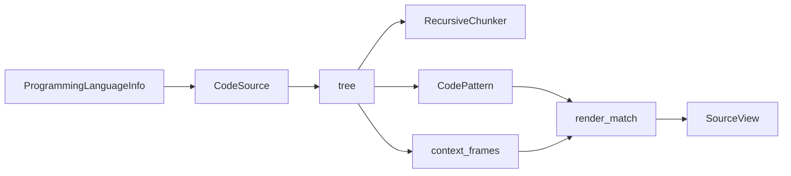

# Code Parsing and Context Views

## Summary

`CodeSource` holds text and a lazily cached tree-sitter parse that splitting and matching can share. Language registry entries identify grammars, while per-language structural knowledge supports semantic classification and context frames. A `SourceView` combines rendered text with segments that map it back to the original source. [rust/code_ast/src/source.rs:28-44] [rust/code_ast/src/elements/mod.rs:1-7] [rust/code_ast/src/view/mod.rs:48-57]

## Shared source and languages

A `CodeSource` resolves a language name, alias, or extension at construction; parsing occurs only when requested. It caches the tree, failed parse, line index, and tree hazards. `ParseOutcome::Parsed` can still contain tree-sitter error nodes, leaving consumers to decide whether the tree is usable. [rust/code_ast/src/source.rs:10-25] [rust/code_ast/src/source.rs:48-75] [rust/code_ast/src/source.rs:129-165]

The registry resolves names case-insensitively. Aliases share a singleton `ProgrammingLanguageInfo`, so its identity also identifies the grammar. A recognized language need not have a tree-sitter grammar, and filename detection uses the final extension. [rust/code_ast/src/prog_langs.rs:43-75] [rust/code_ast/src/prog_langs.rs:552-568]

Python’s `CodeSource` tolerates unknown languages at construction; consumers either fall back or raise when they need a parse. Rust’s SDK `CodeAst` instead parses and validates eagerly. Its `matches_with` rejects a pattern compiled for a different grammar. [python/cocoindex/ops/code.py:30-48] [rust/sdk/cocoindex/src/ops/code.rs:207-237] [rust/sdk/cocoindex/src/ops/code.rs:279-294]



[rust/code_ast/src/source.rs:69-75] [rust/ops_text/src/split/recursive.rs:632-670] [rust/code_ast/src/view/frames.rs:98-118] [python/cocoindex/ops/code.py:270-292]

## Semantic elements

The `elements` module stores grammar-specific node kinds, field names, and hooks alongside the language registry. Its configurations identify declarations, references, type lists, and namespaces; structural view classification also uses this knowledge. [rust/code_ast/src/elements/mod.rs:1-7] [rust/code_ast/src/elements/config.rs:47-66]

| Type | Information represented |
|---|---|
| `Declaration` | Namespace, qualified and base names, parent, normalized kind, AST kind, body flag, and positions |
| `Reference` | Referenced path and base name, enclosing entity, AST kind, and positions |
| `DeclarationKind` | Cross-language kinds such as class, function, method, and field |

[rust/code_ast/src/elements/types.rs:9-17] [rust/code_ast/src/elements/types.rs:117-164]

Kinds start with per-node defaults, can be refined by language hooks, and promote functions or variables directly inside type scopes to methods or fields. A supplied `ExtractorConfig` spec replaces node-kind maps for selected built-in languages while retaining their grammars and hooks. [rust/code_ast/src/elements/types.rs:9-17] [rust/code_ast/src/elements/config.rs:187-208]

## Syntax-aware splitting

`RecursiveSplitter.split` accepts either text plus a language or a `CodeSource` carrying its own language. Custom regex language configurations take precedence; otherwise the chunker uses a parsed tree when available and falls back to default regex splitting when there is no grammar or parse. For chunk sizing and positions, see [Text Splitting and Provenance](text-splitting-and-provenance.md). [python/cocoindex/ops/text.py:155-180] [rust/ops_text/src/split/recursive.rs:632-676]

The code-embedding example detects a language from each filename, splits the file, and embeds each chunk with its line positions: [examples/code_embedding/main.py:71-106]

```python
    text = await file.read_text()
    language = detect_code_language(filename=str(file.file_path.path.name))
    chunks = _splitter.split(
        text,
        chunk_size=1000,
        min_chunk_size=300,
        chunk_overlap=300,
        language=language,
    )
    id_gen = IdGenerator()
    await coco.map(process_chunk, chunks, file.file_path.path, id_gen, table)
```

[examples/code_embedding/main.py:96-106]

## Source-grounded views

`render_match(source, match)` renders the matched ranges verbatim with enclosing scope headers and cues for omitted material. Frames are ordered outermost first; a declaration’s own line is not repeated as its frame. Unsupported languages or shallow parse errors yield no frames. Pattern details are covered in [Structural Matching and Prefilters](structural-matching-and-prefilters.md). [python/cocoindex/ops/code.py:270-292] [rust/code_ast/src/view/frames.rs:98-125]

Each `ViewSegment` records its source positions, `frame` or `content` kind, optional replacement `summary`, and offsets in the rendered text. The view text is the ordered concatenation of summaries or verbatim source slices. Python’s `start` and `end` select content rather than frames for citations; an empty rendered view has no segments, so those properties require a nonempty view. [python/cocoindex/resources/view.py:14-43] [python/cocoindex/resources/view.py:46-70] [rust/code_ast/src/view/render.rs:82-104]

## Terms

- **CodeSource**: Text with a fixed language and lazily cached parse and positions. [rust/code_ast/src/source.rs:28-44]
- **CodeElements**: Declarations and references represented with names, kinds, and source positions. [rust/code_ast/src/elements/types.rs:117-164]
- **ContextFrame**: Source line identifying a structure enclosing a range. [rust/code_ast/src/view/frames.rs:20-29]
- **SourceView**: Rendered text and source-grounded segments. [rust/code_ast/src/view/mod.rs:48-57]