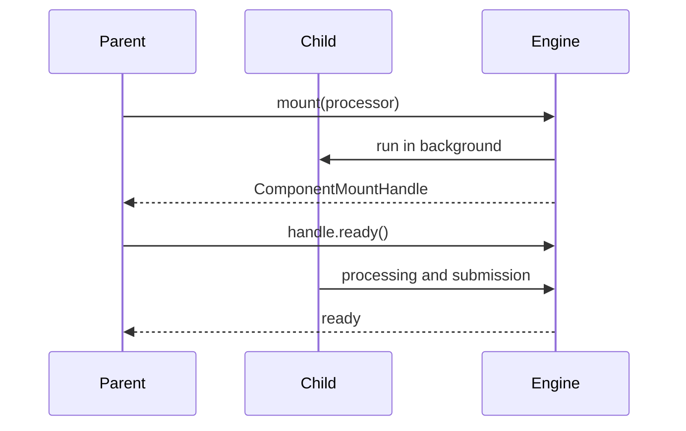

# Component Mounting and Identity

## Summary

A mount creates a child processing component at a stable path, allowing the engine to match it with previous runs and track its target-state ownership. Python’s `mount()` schedules independent work; `use_mount()` waits for a result. `mount_each()` uses item keys to create one child per item. [docs/src/content/docs/programming_guide/processing_component.mdx:16-27] [python/cocoindex/_internal/api.py:234-253] [python/cocoindex/_internal/api.py:450-471]

## Foreground and background mounts

| Python API | Result | Dependency |
|---|---|---|
| `await mount(...)` | A `ComponentMountHandle` | Background child; the caller does not consume its return value. |
| `await use_mount(...)` | The child’s return value | Foreground child; refreshing it requires rerunning the parent. |
| `await mount_each(...)` | One handle covering the children | Background child per keyed item. |

`mount()` returns after dispatch, not after target synchronization. Await `handle.ready()` when subsequent work needs the child’s targets to be applied. The parent also waits for its children’s readiness before submitting its own target states and reconciling child existence. [python/cocoindex/_internal/api.py:358-373] [python/cocoindex/_internal/api.py:151-175] [rust/core/src/engine/component.rs:1254-1265]



Foreground failures propagate through `use_mount()` to the caller. Background failures use the configured exception handler; by default they are logged, while a handler that raises can propagate through `ready()`. Both mount paths inherit the parent’s live setting. [rust/core/src/engine/component.rs:777-808] [rust/core/src/engine/component.rs:811-832] [docs/src/content/docs/programming_guide/processing_component.mdx:249-263]

## Stable paths

A component path is a sequence of typed `StableKey` parts. Python supports keys including strings, integers, UUIDs, symbols and tuples; core represents the root as an empty path and constructs descendants by concatenation. `Symbol("process_file")` and the string `"process_file"` are distinct key variants. [python/cocoindex/_internal/stable_path.py:7-13] [rust/core/src/state/stable_path.rs:5-16] [rust/core/src/state/stable_path.rs:306-332]

By default, Python derives a subpath from the processor name as `Symbol(fn.__name__)`. Use explicit subpaths when mounting the same function multiple times or when names collide. A `component_subpath` context manager extends the path for nested mount calls and restores the previous context on exit. [python/cocoindex/_internal/api.py:384-400] [docs/src/content/docs/programming_guide/processing_component.mdx:62-76] [python/cocoindex/_internal/component_ctx.py:295-314]

Choose a key that remains stable for the same source item, such as a file path or primary key. If a path disappears from the component tree, its owned target states and descendants are cleaned up; changing a key therefore changes the identity being reconciled. See [Ownership, Submission, and Cleanup](ownership-submission-and-cleanup.md). [docs/src/content/docs/programming_guide/processing_component.mdx:18-27] [docs/src/content/docs/programming_guide/processing_component.mdx:233-243]

## Keyed fan-out

For static input, `mount_each` accepts synchronous or asynchronous `(key, value)` iterables. It appends each key to the selected subpath, passes the value as the processor’s first argument, and returns a handle covering all children. [python/cocoindex/_internal/api.py:450-471] [python/cocoindex/_internal/api.py:493-542]

This repository example mounts one component per file: [docs/src/content/docs/programming_guide/processing_component.mdx:127-135]

```python
files = localfs.walk_dir(sourcedir, path_matcher=PatternFilePathMatcher(included_patterns=["**/*.md"]))
await coco.mount_each(process_file, files.items(), target)
```

The default item path is `parent / Symbol("process_file") / key`. For a `LiveMapFeed`, `mount_each` instead creates an internal live component that watches and dispatches keyed changes; see [Live Maps and Change Feeds](live-maps-and-change-feeds.md). [docs/src/content/docs/programming_guide/processing_component.mdx:135-137] [python/cocoindex/_internal/api.py:496-504]

## Rust SDK

Rust’s `Ctx::scope` is a foreground child scope keyed by a `Display` value. `Ctx::mount_each` runs child closures concurrently and returns their results after all started work completes; it rejects duplicate stringified keys. The `mount_each!` runtime can also attach component memo fingerprints to its per-item mounts. [rust/sdk/cocoindex/src/ctx.rs:1005-1033] [rust/sdk/cocoindex/src/ctx.rs:1224-1228] [rust/sdk/cocoindex/src/ctx.rs:1264-1291] [rust/sdk/cocoindex/src/ctx.rs:1132-1136]

## Terms

- **Component path**: Stable hierarchical identity used to match a processing component across runs.
- **ComponentSubpath**: Relative path parts appended to the current component path.
- **`ComponentMountHandle`**: Python handle for awaiting background processing readiness.
- **`use_mount`**: Foreground mount that returns the child’s result.