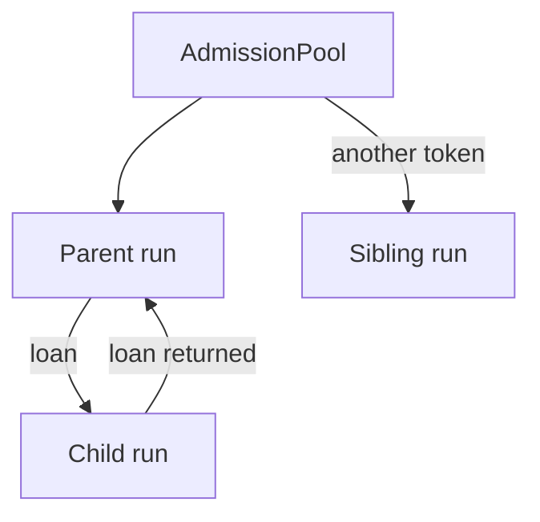

# Concurrency, Batching, and Rate Limits

## Summary

Component admission bounds in-flight runs while token lending lets nested components make progress. Shared batch queues aggregate function calls and target actions, with separate failure-isolation rules for each. A token-bucket `RateLimiter` controls the pace of outbound work. [rust/core/src/engine/admission.rs:1-19] [rust/utils/src/batching.rs:41-46] [rust/py/src/ratelimit.rs:1-15]

## Component admission

A component holds an admission token through its body, children, and commit. It can borrow its parent’s token or take one from the app pool. A parent lends to one child at a time, allowing a waiting parent’s child to run even when the pool is empty; consequently, a limit of one does not deadlock a component tree. [rust/core/src/engine/admission.rs:1-19]



A loan chain can contain several running components, so `max_inflight_components` is not a strict count of all runs: the number in flight is bounded by pool size times tree depth. If a live parent ends while lending, its token stays parked until the loan returns. [rust/core/src/engine/admission.rs:14-24]

In Python, `AppConfig.max_inflight_components` takes precedence over `COCOINDEX_MAX_INFLIGHT_COMPONENTS`; absent both, the default is 1024. Core can also construct an unbounded pool with `None`. [python/cocoindex/_internal/app.py:48-49] [python/cocoindex/_internal/app.py:177-181] [python/cocoindex/_internal/app.py:233-240] [rust/core/src/engine/admission.rs:33-34]

The separate `ConcurrencyController` utility uses optional row-count and weighted byte permits. When bytes are initially unknown it reserves a minimum permit, then can acquire the remaining weight; `CombinedConcurrencyController` acquires both local and global permits. [rust/utils/src/concur_control.rs:50-53] [rust/utils/src/concur_control.rs:67-110] [rust/utils/src/concur_control.rs:121-155]

## Shared queues and function batches

A `BatchQueue` can serve multiple batchers, but each pending batch belongs to its own batcher and runner. An idle queue executes the first input immediately; while work is ongoing, inputs accumulate. Reaching `max_batch_size` flushes a pending batch immediately, so a shared queue is not an unconditional one-at-a-time limit. Otherwise, the next pending batch starts in FIFO order when ongoing work finishes. [rust/utils/src/batching.rs:32-46] [rust/utils/src/batching.rs:172-212] [rust/utils/src/batching.rs:258-277]

A batch runner must return one output per input. A length mismatch fails every caller in that batch; a runner error is also distributed to its callers. A running batch is cancelled when all its callers have cancelled. [rust/utils/src/batching.rs:92-138]

Python functions opt in through `@coco.fn.as_async(batching=True)`. For composition-dependent failures, a body can ask for smaller batches:

```python
@coco.fn.as_async(batching=True)
async def _batch_fn(inputs: list[int]) -> list[int]:
    if len(inputs) > 2:
        raise coco.RetryWithSmallerBatch() from _BatchLimitError("too big")
    return [x * 2 for x in inputs]
```

[python/tests/core/test_function_batching.py:1078-1082]

`RetryWithSmallerBatch` recursively halves the inputs; successful sub-batches retain their results, and a single-item failure surfaces the underlying cause to that caller. Transient failures should first be retried at the same size. [python/cocoindex/_internal/batching.py:1-19] [python/cocoindex/_internal/batching.py:124-156]

A Python execution `Runner` determines where the function runs. Batching with a runner shares its queue; runner-only functions use per-function queues. For GPU allocation and subprocess execution, see [Execution Runners and GPU Pools](runtime-and-shared-mechanisms-execution-runners-and-gpu-pools.md). [python/cocoindex/_internal/function.py:1713-1732]

## Target action batches

Each target action sink has a batcher. Components finishing while an earlier sink call is in flight can have their actions merged, grouped by compatible host context. If a merged call fails, the engine retries halves along component boundaries, preserving each component’s actions as a unit. Cancellation and deadline errors are reported without splitting. Sink actions must tolerate reapplication after a failed call. [rust/core/src/engine/target_state.rs:144-154] [rust/core/src/engine/target_state.rs:165-186] [rust/core/src/engine/target_state.rs:300-334] [rust/core/src/engine/target_state.rs:371-389]

For the sink contract and reconciliation failure handling, see [Custom Target Handlers and Sinks](custom-target-handlers-and-sinks.md).

## Rate limiting

`cocoindex.resources.rate_limit.RateLimiter` exposes the Rust token bucket to Python. `max_rows_per_second` must be positive; `burst_window_secs` defaults to one second and determines burst capacity. `await acquire(n)` draws tokens individually, so requests larger than the bucket can still complete. A semaphore keeps concurrent acquisitions in FIFO order. [python/cocoindex/resources/rate_limit.py:1-13] [rust/py/src/ratelimit.rs:21-45] [rust/utils/src/ratelimit.rs:24-33] [rust/utils/src/ratelimit.rs:50-64] [rust/utils/src/ratelimit.rs:74-91]

## Terms

- **AdmissionPool**: The app’s pool of component execution tokens. [rust/core/src/engine/admission.rs:33-43]
- **BatchQueue**: A shared queue of pending batches, each associated with a batcher. [rust/utils/src/batching.rs:32-46]
- **RetryWithSmallerBatch**: A signal that asks a batched Python function to retry subsets of its inputs. [python/cocoindex/_internal/batching.py:31-38]