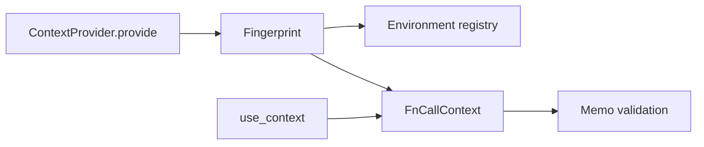

# Context, Resources, and Identity

## Summary

A `ContextKey[T]` names a shared resource, and a context provider makes its value available to processing components. Optional change tracking records resource dependencies for memo validation. Python carries the current component context through a `ContextVar`; Rust passes a `Ctx` explicitly. [python/cocoindex/_internal/context_keys.py:99-110] [python/cocoindex/_internal/component_ctx.py:395-424] [rust/sdk/cocoindex/src/ctx.rs:325-341]

## Provide and retrieve resources

Define Python keys once, normally at module scope: constructing another `ContextKey` with the same name in the process raises `ValueError`. A lifespan can provide a value directly or enter a resource context manager with `provide_with` or `provide_async_with`. [python/cocoindex/_internal/context_keys.py:99-110] [python/cocoindex/_internal/context_keys.py:238-246]

```python
@coco.lifespan
async def default_lifespan(
    builder: coco.EnvironmentBuilder,
) -> AsyncIterator[None]:
    builder.settings.db_path = _env_db_path
    await builder.provide_async_with(_RESOURCE_KEY, _acquire_resource())
    yield
```

[python/tests/core/test_default_env_async.py:33-39]

Inside a component, `coco.use_context(key)` returns the provided value; a missing key raises `KeyError`, and calling it without a component context raises `RuntimeError`. Outside component execution, `env.get_context(key)` accesses the provider directly. Resource cleanup and environment ownership are covered in [Environment Configuration and Lifecycle](environment-configuration-and-lifecycle.md). [python/cocoindex/_internal/component_ctx.py:395-424] [python/cocoindex/_internal/environment.py:298-304]

A key can also be a persistent resource identity. For example, the PostgreSQL table target includes `db.key` in its target key, while the provided pool can change. Renaming that key changes the resource identity used by such targets. [python/cocoindex/connectors/postgres/_target.py:1607-1611] [docs/src/content/docs/programming_guide/context.mdx:38-49]

## Track changes

Change detection is opt-in. With `detect_change=True`, `ContextProvider.provide()` fingerprints the key name and value; `use_context()` records that fingerprint in the current function-call context. Context dependencies propagate to callers, including across function logic-tracking modes. [python/cocoindex/_internal/context_keys.py:177-199] [python/cocoindex/_internal/component_ctx.py:419-424] [rust/core/src/engine/context.rs:1277-1285]



Tracked values can also have memo state functions. Python collects initial states at `provide()` and uses their functions to validate stored state on a cache hit. An async state function cannot be initially collected by `provide()` inside a running event loop; use a synchronous state function or provide the value outside that loop. See [Memoization and State Reuse](memoization-and-state-reuse.md) for validation semantics. [python/cocoindex/_internal/context_keys.py:72-96] [python/cocoindex/_internal/context_keys.py:200-225]

## Component context and threads

Python’s `ComponentContext` carries the environment, stable path, core processor context, and function-call context. Entering a component installs it in a `ContextVar`; on exit the function-call dependencies are joined into the processor context. [python/cocoindex/_internal/component_ctx.py:64-81] [python/cocoindex/_internal/component_ctx.py:342-371]

For a `ThreadPoolExecutor`, capture the context inside the component with `coco.get_component_context()` and enter `with ctx.attach():` in the worker. Attachment restores the previous thread context on exit. It does not extend the component’s lifetime: a retained context cannot declare target state after the component has finished. [python/cocoindex/_internal/component_ctx.py:225-246] [python/cocoindex/_internal/component_ctx.py:427-449] [python/tests/core/test_component_ctx_release.py:89-105]

## Rust context

Rust’s `Environment` builder supports type-keyed `provide(value)` and named `provide_key(&key, value)`. Named keys allow multiple resources of the same type; `Ctx::get_key()` records a dependency for a change-tracked key. `ContextKey::new_detect_change` uses the value’s `MemoInput` implementation for identity and optional state validation. [rust/sdk/cocoindex/src/app.rs:162-188] [rust/sdk/cocoindex/src/ctx.rs:167-177] [rust/sdk/cocoindex/src/ctx.rs:562-585]

The `context_key!` macro creates a process-wide key. Its default stable name is the Rust identifier; specify `key = "..."` to retain the persisted identity across an identifier rename. [rust/sdk/cocoindex/src/ctx.rs:40-66]

Stable generated IDs are another component-scoped identity mechanism. See [Stable ID Generation](runtime-and-shared-mechanisms-stable-id-generation.md) for memoized IDs, UUIDs, and repeated dependencies. [python/cocoindex/resources/id.py:1-15]

## Terms

- **ContextKey**: A typed, named identifier for a provided resource. [python/cocoindex/_internal/context_keys.py:99-110]
- **ComponentContext**: Python’s current component execution context. [python/cocoindex/_internal/component_ctx.py:64-81]
- **Ctx**: The Rust SDK context passed through pipeline execution. [rust/sdk/cocoindex/src/ctx.rs:325-341]