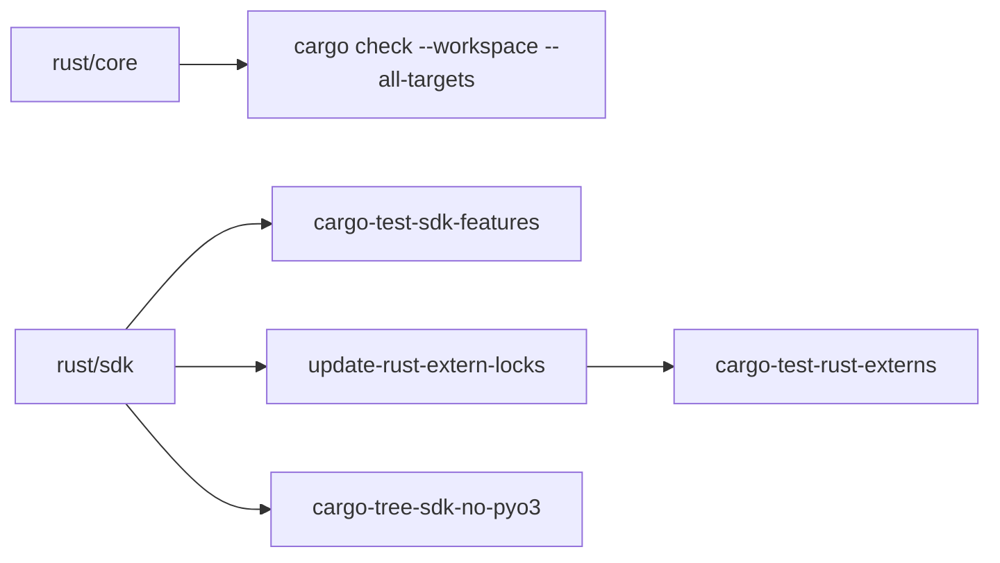

# Contribution and Quality Checks

## Summary

Contributions follow the repository’s API and type conventions, then pass the checks configured in `.pre-commit-config.yaml`. Run `prek run --all-files` before pushing; changes to core or the Rust SDK need checks across both workspace crates and standalone consumers. [AGENTS.md:38-59]

## Contribution workflow

The contributor guide recommends coordinating larger features first. Fork the repository, create a branch, make and test the change, run prek, and open a pull request explaining the change, motivation, breaking effects and related issues. Installing the hooks makes them run on commit. [docs/src/content/docs/contributing/guide.mdx:19-46]

## Code conventions

External Python modules use `__all__` for public exports and underscore-prefix non-public names, including imports. Internal modules have looser import rules. Keep new public APIs small, use concrete types, validate weak inputs early, and remove dead code when behavior changes. [AGENTS.md:223-254]

Rust guidelines favor types that carry meaning, such as `Duration` and named structs, and require library code to return errors for fallible runtime conditions rather than panic. See [Testing and Performance](testing-and-performance.md) for test design and fixtures. [dev/rust-guidelines.md:12-24] [dev/rust-guidelines.md:39-51] [AGENTS.md:258-264]

## Hooks and generated files

Use the pinned prek Ruff hooks for Python formatting and linting: an independently installed Ruff can differ from CI’s version. The full suite also covers tests, dependency locks and generated files. Some hooks require `protoc`. [AGENTS.md:24-47]

| Check | Purpose |
|---|---|
| `ruff-check`, `ruff-format`, `cargo-fmt` | Python and Rust linting or formatting |
| `mypy-check`, `pytest`, `cargo-test` | Type checking and tests |
| `cargo-clippy`, `cargo-test-sdk-features` | Rust linting and SDK feature coverage |
| `update-rust-extern-locks`, `cargo-test-rust-externs` | Refresh and check standalone Rust consumers |
| `generate-cli-docs` | Regenerate the CLI reference |

[.pre-commit-config.yaml:35-50] [.pre-commit-config.yaml:59-110] [.pre-commit-config.yaml:119-135]

The CLI generator replaces the marked subcommand section of `cli.mdx`. Its hook also watches the generated page itself, so a hand edit triggers regeneration. For the docs build, see [Documentation Site and Agent Exports](documentation-site-and-agent-exports.md). [dev/generate_cli_docs.py:240-253] [.pre-commit-config.yaml:127-135]

CI runs the build-test hooks on the pull request diff, while other events run them on all files. The local all-files run catches issues outside the diff before submission. [.github/workflows/_test.yml:177-195]

## Core and SDK checks

After changing a `rust/core` API, run `cargo check --workspace --all-targets`: both the Python bindings and native Rust SDK call core directly. Standalone Rust examples and benchmarks have their own workspaces, so the external-workspace hook checks them separately with `--locked`. [AGENTS.md:59-59] [dev/run_cargo_test_rust_externs.sh:1-15]

[AGENTS.md:59-59] [.pre-commit-config.yaml:80-116]

The SDK has no default features, so its feature script checks all features and targets, then tests a selected set that needs no external server. Clippy checks the workspace with default features and the SDK with all features, treating warnings as errors. [dev/run_cargo_test_sdk_features.sh:1-22] [dev/run_cargo_clippy.sh:1-11]

The lock refresh uses `cargo update --workspace` for standalone examples and benchmarks, preserving registry versions unless constraints require changes. A separate dependency-tree check rejects PyO3 in the SDK’s normal dependencies so Rust consumers do not pull in Python bindings. [dev/update_rust_extern_locks.sh:16-25] [dev/check_sdk_no_pyo3.sh:1-15]

## Terms

- **prek**: Runner for the repository’s configured pre-commit checks. [docs/src/content/docs/contributing/guide.mdx:28-37]
- **External Rust workspace**: Standalone example or benchmark workspace that consumes the SDK like a downstream project. [dev/run_cargo_test_rust_externs.sh:1-6]
- **`generate-cli-docs`**: Hook that updates the generated CLI reference. [.pre-commit-config.yaml:127-135]