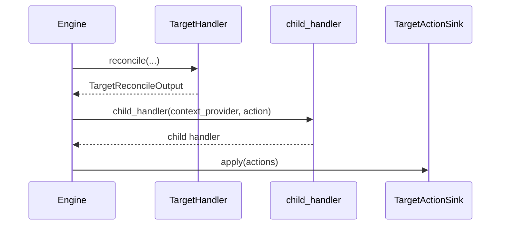

# Custom Target Handlers and Sinks

## Summary

A `TargetHandler` compares a desired target state with possible previous tracking records and returns an action for a `TargetActionSink`. Reconciliation must be side-effect free; the sink performs external writes and must tolerate retries. Container sinks also supply child handlers through a factory. [python/cocoindex/_internal/target_state.py:508-554] [rust/core/src/engine/target_state.rs:144-162]

## Handler contract

`reconcile()` receives a stable key, the desired value or `NON_EXISTENCE`, previous tracking records, and a flag indicating whether the external state might be missing. It returns `None` when no action is required, or a `TargetReconcileOutput` containing an action, sink, tracking record, and optional child invalidation. Annotate `prev_possible_records` with the tracking-record type so Python can reconstruct persisted records. [python/cocoindex/_internal/target_state.py:508-554] [docs/src/content/docs/advanced_topics/custom_target_connector.mdx:54-71]

```python
    def reconcile(
        self,
        key: StableKey,
        desired_target_state: ValueT_contra | NonExistenceType,
        prev_possible_records: Collection[TrackingRecordT],
        prev_may_be_missing: bool,
        /,
    ) -> TargetReconcileOutput[Any, TrackingRecordT, OptChildHandlerT_co] | None: ...
```

[python/cocoindex/_internal/target_state.py:547-554]

`reconcile()` runs during precommit, which can be retried. It must be non-blocking and free of side effects; only the output of the committed attempt is applied. Interrupted updates can leave multiple possible previous records, so skipping an action requires considering all of them and whether the target might be missing. [rust/core/src/engine/target_state.rs:461-470] [docs/src/content/docs/advanced_topics/custom_target_connector.mdx:694-704]

A tracking record stores what the handler needs for future comparisons. The local filesystem connector stores a file-content fingerprint and skips a write only when every previous fingerprint matches and the file cannot be missing. For directories it emits an action and uses a `None` fingerprint. See [State Diffs and Schema Evolution](state-diffs-and-schema-evolution.md) for shared comparison helpers and child invalidation. [python/cocoindex/connectors/localfs/_target.py:141-165]

For eligible leaf handlers whose record is exactly `fingerprint_object(value)`, `tracks_value_fingerprint = True` lets the engine skip `reconcile()` for unchanged values. The handler still needs its own comparison for values that cannot use that shortcut. [docs/src/content/docs/advanced_topics/custom_target_connector.mdx:717-749]

## Sinks and child handlers

A sink callback receives a `ContextProvider` and a sequence of actions. Construct it with `TargetActionSink.from_fn()` or `from_async_fn()`; resolve external connections through the context when applying actions, including cleanup actions that may run after the original declaration disappears. [python/cocoindex/_internal/target_state.py:156-169] [docs/src/content/docs/advanced_topics/custom_target_connector.mdx:675-675]



For child-bearing actions, the engine builds child handlers before applying the sink; a preview calls the factory in place of applying actions. Leaf actions do not require a factory call. [rust/core/src/engine/execution.rs:752-776] [docs/src/content/docs/advanced_topics/custom_target_connector.mdx:437-439]

A Python `child_handler` factory must be synchronous and side-effect free, even for an async sink. It can run concurrently on an engine thread, so protect any shared cache. A container handler generally emits an action while declared so the factory can build its child handler. The older child-slot and `ChildTargetDef` sink contracts are deprecated and cannot be previewed. [python/cocoindex/_internal/target_state.py:213-225] [python/cocoindex/_internal/target_state.py:242-251] [docs/src/content/docs/advanced_topics/custom_target_connector.mdx:437-439]

The local filesystem connector shares one sink between files and directories. Its factory builds an entry handler from a directory action; its callback applies both file and directory actions. [python/cocoindex/connectors/localfs/_target.py:93-114]

## Batching and failure isolation

Python sinks share an identity when their callbacks have the same type and compare equal, and their child factories do too. Reusing a function or the same bound method enables sharing; newly constructed bound objects do not automatically compare equal. Callbacks must support weak references. [python/cocoindex/_internal/target_state.py:228-240]

The core runner can merge actions from components with compatible host contexts. If a merged call fails, it recursively retries subsets along component boundaries, keeping each component’s actions together. Cancellation and deadline errors are reported to the failed batch without splitting. [rust/core/src/engine/target_state.rs:292-325] [rust/core/src/engine/target_state.rs:371-389]

Actions must therefore be idempotent: a failed call may already have applied an action before the retry. The filesystem sink uses operations such as `unlink(missing_ok=True)` and `mkdir(exist_ok=True)`. The failure-isolation test verifies that unaffected components commit and that a later update retries the failed component. [rust/core/src/engine/target_state.rs:144-154] [python/cocoindex/connectors/localfs/_target.py:58-80] [python/tests/core/test_target_sink_failure_isolation.py:209-231]

## Terms

- **TargetHandler**: Computes reconciliation output for one kind of target state. [python/cocoindex/_internal/target_state.py:526-554]
- **Tracking record**: Persisted information used to compare a target with later declarations. [docs/src/content/docs/advanced_topics/custom_target_connector.mdx:48-59]
- **TargetActionSink**: Applies batches of reconciled actions to an external system. [python/cocoindex/_internal/target_state.py:228-232]
- **Child handler factory**: Builds a container’s child handler from its action. [python/cocoindex/_internal/target_state.py:213-225]