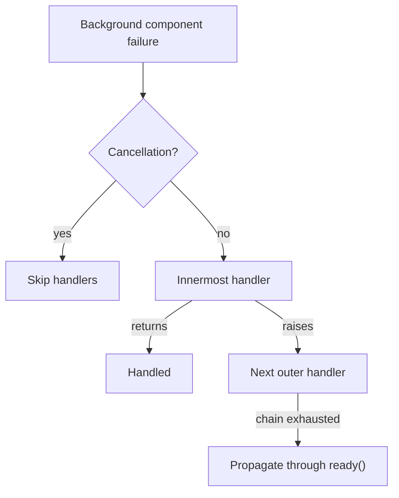

# Deadlines, Cancellation, and Failures

## Summary

Deadlines are cooperative: CocoIndex checks them at engine and function checkpoints, rather than interrupting arbitrary work immediately. Background components have isolated deadlines and route failures through exception handlers; app and global cancellation use separate cancellation tokens. Retry helpers classify transient errors and apply their own limits. [rust/core/src/engine/deadline.rs:1-7] [rust/core/src/engine/component.rs:990-1028] [python/cocoindex/_internal/deadline.py:134-166]

## Deadline propagation

`coco.timeout()` sets a Python `ContextVar` containing a core `DeadlineContext`. The core value holds an absolute monotonic deadline; nested timeouts preserve the earlier deadline. `coco.check_cancellation()` raises `DeadlineExceededError` when that deadline has expired. Long-running user code can call it explicitly between units of work. [python/cocoindex/_internal/deadline.py:21-23] [python/cocoindex/_internal/deadline.py:35-58] [rust/core/src/engine/deadline.rs:27-65]

```python
@contextlib.contextmanager
def timeout(duration: timedelta) -> Iterator[None]:
    """Apply a cooperative timeout deadline to CocoIndex checkpoints."""
    if not isinstance(duration, timedelta):
        raise TypeError("timeout() requires a datetime.timedelta")

    token = _current_deadline.set(
        _current_deadline.get().with_timeout(duration.total_seconds())
    )
    try:
        yield
    finally:
        _current_deadline.reset(token)
```

[python/cocoindex/_internal/deadline.py:35-47]

| Operation | Deadline behavior |
| --- | --- |
| App update and `use_mount` | Pass the captured deadline to the root or foreground child processor. |
| `mount` and `mount_each` | Run background children without the caller’s deadline. |
| `handle.ready()` | Checks the caller’s deadline before and after waiting. |
| `process_live` | Runs without the ambient deadline. |

[python/tests/core/test_deadline.py:171-202] [python/tests/core/test_deadline.py:340-362] [python/cocoindex/_internal/api.py:165-179] [python/tests/core/test_deadline.py:404-429]

A foreground child result is checked before the parent continues, so a late result cannot be used to declare further target states. `coco.map()` drains already-started siblings on a deadline failure instead of cancelling them; when multiple inputs fail, it reports the failure in input order. [python/tests/core/test_deadline.py:296-337] [python/tests/core/test_deadline.py:457-465] [python/tests/core/test_deadline.py:502-525]

## Cancellation and failure routing

Global cancellation propagates to app and component tasks. A component races its work against the app token; dropping the work future cancels the underlying Python task. `App.drop()` also cancels the app token, interrupting a concurrent update; a later operation can receive a fresh app token. [rust/core/src/engine/runtime.rs:45-69] [rust/core/src/engine/component.rs:990-999] [python/tests/core/test_cancellation.py:78-84] [rust/core/src/engine/app.rs:128-131]



Cancellation is filtered before background error handlers run. A scoped `coco.exception_handler` handles failures from background mounts within its dynamic scope; handlers run innermost first and may be synchronous or asynchronous. A returning handler swallows the failure; a raising handler passes its new exception outward. If every handler raises, the final exception propagates through `ready()`. With no handler, the failure is logged and swallowed. [rust/core/src/engine/component.rs:1001-1028] [python/cocoindex/_internal/component_ctx.py:143-172] [python/cocoindex/_internal/component_ctx.py:180-221] [python/cocoindex/_internal/component_ctx.py:493-504]

`ExceptionContext` supplies the path, processor, mount kind, and source. If a handler itself fails, the next handler receives `source="handler"` and the original component exception. Python-originated failures retain their exception object and traceback. [python/cocoindex/_internal/component_ctx.py:52-61] [python/cocoindex/_internal/component_ctx.py:188-216] [python/tests/core/test_exception_handlers.py:168-171]

Cleanup has its own boundary: root orphan-delete failures during update are logged while tombstones remain for a later reconcile, whereas explicit `app.drop()` installs a raising handler for delete failures. See [Ownership, Submission, and Cleanup](ownership-submission-and-cleanup.md) for the cleanup process. [rust/core/src/engine/app.rs:142-147] [rust/core/src/engine/app.rs:232-235]

## Retrying transient errors

Python’s internal `retry_transient` accepts an exception-type tuple or predicate as `retry_on`. It supports an attempt limit and a timeout merged with the ambient deadline. Deadline errors are never retried; cancellation and other `BaseException` subclasses propagate. Backoff sleeps are clipped to the remaining time, and `bound_attempt=True` also cancels an in-flight attempt at the deadline. [python/cocoindex/_internal/deadline.py:29-32] [python/cocoindex/_internal/deadline.py:134-166] [python/cocoindex/_internal/deadline.py:191-218] [python/cocoindex/_internal/deadline.py:227-244]

Rust’s `retryable::run` uses `IsRetryable` and a separate retry timeout with jittered backoff. Its `reqwest::Error` implementation classifies HTTP 429 as retryable; an ordinary core error converted to `retryable::Error` defaults to non-retryable. [rust/utils/src/retryable.rs:7-16] [rust/utils/src/retryable.rs:36-40] [rust/utils/src/retryable.rs:59-65] [rust/utils/src/retryable.rs:112-157]

## Terms

- **DeadlineContext**: An immutable optional monotonic deadline checked at engine checkpoints. [rust/core/src/engine/deadline.rs:27-55]
- **ExceptionContext**: Metadata supplied to a background component failure handler. [python/cocoindex/_internal/component_ctx.py:52-61]
- **IsRetryable**: Rust trait used to classify an error for retry. [rust/utils/src/retryable.rs:7-9]