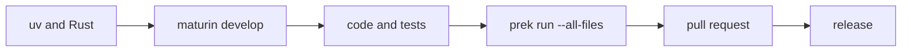

# Development

## Summary

CocoIndex development spans a Rust workspace, a Python package backed by a PyO3 extension, and a native Rust SDK. Build the extension, make and exercise a change, run the applicable tests and the full prek suite, then submit a pull request. Tagged releases synchronize versions, build and validate distributions, publish to PyPI, and deploy documentation. [Cargo.toml:1-13] [pyproject.toml:59-69] [AGENTS.md:38-59] [.github/workflows/release.yml:203-244]

## From checkout to contribution

The build step connects the Python package to the Rust workspace. Maturin builds `rust/py` into `cocoindex._internal.core`; both the Python binding and the Rust SDK call the core engine, so core API changes can affect both interfaces. [pyproject.toml:59-69] [AGENTS.md:59-59]

1. **Prepare the checkout.** Install Rust and uv, run `uv run prek install`, and build with `uv run maturin develop`. Repeat the build after Rust changes. Optional dependencies can be installed with `uv sync --all-extras`. [docs/src/content/docs/contributing/setup_dev_environment.mdx:12-56]
2. **Implement and exercise the change.** Keep the public API small, follow the Python and Rust conventions, and prefer tests through user-facing APIs. Examples can run against the editable checkout through `coco-dev-run`. [AGENTS.md:223-260] [docs/src/content/docs/contributing/setup_dev_environment.mdx:58-77]
3. **Validate the affected layers.** Run Python type checks and tests for Python changes; rebuild and run Rust tests for Rust changes. A core API change also needs `cargo check --workspace --all-targets` because both language interfaces call core directly. [AGENTS.md:49-59]
4. **Run `prek run --all-files` and submit.** The suite includes formatting, linting, tests and generated artifacts. The pull request should explain the change, motivation, breaking effects and related issues. [AGENTS.md:38-47] [docs/src/content/docs/contributing/guide.mdx:26-46]



[docs/src/content/docs/contributing/setup_dev_environment.mdx:12-56] [docs/src/content/docs/contributing/guide.mdx:23-40] [.github/workflows/release.yml:1-11]

[Local Setup and Builds](local-setup-and-builds.md) covers dependency selection, free-threaded builds and running examples with the checkout. [Contribution and Quality Checks](contribution-and-quality-checks.md) explains conventions and the individual hooks.

## Entry points in the code

These types and functions are useful starting points when moving between an application, its tests and the tools that ship it.

| Type or function | Role | Definition |
|---|---|---|
| `App`, `AppConfig` | Bind a Python main function and arguments to an app configuration. | [python/cocoindex/_internal/app.py:177-204] |
| `mount_each` | Mount one independent component per keyed item. | [python/cocoindex/_internal/api.py:450-458] |
| `EnvironmentBuilder` | Holds settings and provides context values during environment setup. | [python/cocoindex/_internal/environment.py:113-130] |
| `Ctx` | Carries the Rust SDK pipeline context into app closures. | [rust/sdk/cocoindex/src/ctx.rs:323-336] |
| `create_test_env` | Creates a test environment with a path derived from the test file and optional suffix. | [python/tests/common/environment.py:17-34] |
| `generate_command_docs` | Produces the generated CLI subcommand reference from Click commands. | [dev/generate_cli_docs.py:197-210] |
| `update_version.py:main` | Applies a release tag’s version to Cargo and Python package files. | [.github/scripts/update_version.py:107-134] |

## Validate behavior and performance

The Python test setup supports isolated environments and Docker-backed service fixtures. CI runs build-test hooks across Linux, macOS and Windows, including free-threaded Python, while a separate workflow type-checks Python versions 3.11–3.14. Docker-marked tests skip when no daemon is available. [.github/workflows/_test.yml:23-34] [.github/workflows/e2e_type_check.yml:23-47] [python/tests/conftest.py:146-160]

SDK coverage needs extra attention: its crate has no default features, so the feature script checks all features and targets and tests a selected set. Separate example and benchmark workspaces are checked as SDK consumers. [dev/run_cargo_test_sdk_features.sh:1-22] [dev/run_cargo_test_rust_externs.sh:1-15]

[Testing and Performance](testing-and-performance.md) explains fixtures, CI coverage and benchmark workflows. For example, the file-summarization benchmark compares Python and Rust output hashes through cold, warm and changed-input phases before reporting timings. [benchmarks/file_summarization/README.md:53-71] [benchmarks/file_summarization/README.md:129-132]

## Use examples and update docs

The text-embedding example shows the intended application shape: a memoized file processor splits input and maps over chunks; the app mounts a table and fans out over files. Its source also provides a practical place to exercise changes through the public API. [examples/text_embedding/main.py:91-123]

```python
@coco.fn(memo=True)
async def process_file(
    file: FileLike,
    table: postgres.TableTarget[DocEmbedding],
) -> None:
    text = await file.read_text()
    chunks = _splitter.split(
        text, chunk_size=2000, chunk_overlap=500, language="markdown"
    )
    id_gen = IdGenerator()
    await coco.map(process_chunk, chunks, file.file_path.path, id_gen, table)
```

[examples/text_embedding/main.py:91-101]

[Example Application Patterns](example-application-patterns.md) connects this pattern to document conversion, graph construction and streaming. For documentation changes, the Astro build also validates agent-facing output; CLI changes trigger regeneration of the marked reference in `cli.mdx`. [docs/package.json:9-12] [.pre-commit-config.yaml:127-135] [dev/generate_cli_docs.py:240-244]

[Documentation Site and Agent Exports](documentation-site-and-agent-exports.md) explains navigation, diagrams, generated references and Markdown routes.

## Release the result

A `v*` tag starts the release workflow. It derives Cargo and Python versions from the tag, generates notices, builds wheels and an sdist, and checks imports of the Linux standard and free-threaded wheels. Only after those jobs succeed does the tag-gated release job attest and upload artifacts; docs deployment follows. A manual branch run is a build-only dry run. [.github/scripts/update_version.py:107-134] [.github/workflows/release.yml:1-11] [.github/workflows/release.yml:142-206] [.github/workflows/release.yml:224-244]

[Packaging and Releases](packaging-releases-and-running-apps.md) details version conversion, build variants and publication.

## Terms

- **Maturin**: Build backend that packages the Python project and its PyO3 extension. [pyproject.toml:1-3] [pyproject.toml:59-66]
- **prek**: Runner for the repository’s configured pre-commit checks. [docs/src/content/docs/contributing/guide.mdx:28-37]
- **`coco-dev-run`**: Helper that runs an example with the local checkout as an editable dependency. [docs/src/content/docs/contributing/setup_dev_environment.mdx:66-77]