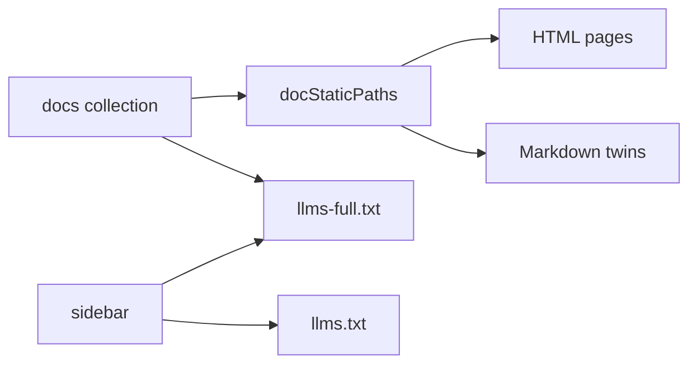

# Documentation Site and Agent Exports

## Summary

The Astro site builds documentation under `/docs`, using a hand-maintained sidebar for navigation and machine-readable indexes. The same content also produces Markdown routes for agents, while diagrams and the generated CLI reference have their own authoring workflows. [docs/astro.config.mjs:15-18] [docs/src/data/docs-sidebar.ts:1-4] [docs/src/lib/raw-markdown.ts:124-130]

## Build and navigation

The docs package requires Node 22.12 or later. Its build runs Astro and then checks the generated agent-facing output. CI installs dependencies with `npm --prefix docs ci`, builds the site, and checks that `docs/dist` contains HTML. [docs/package.json:6-13] [.github/workflows/docs_test.yml:38-58]

The configuration applies the same remark plugins to Markdown and MDX. In particular, the link checker validates and rewrites source-relative links to `/docs/<slug>/`; trailing slashes match Astro’s directory output. [docs/astro.config.mjs:19-33] [docs/astro.config.mjs:35-59]

```js
export default defineConfig({
  site: 'https://cocoindex.io',
  base: BASE,
  // `trailingSlash: 'always'` matches `build.format: 'directory'`: every
  // page lives at `<slug>/index.html` and is canonical at `<slug>/`. In
  // dev, requests without the trailing slash 404, so every href must carry
  // it: the remark plugin rewrites relative markdown/MDX links that way,
  // and scripts/check-agent-output.mjs fails the build on any root-relative
  // link in the output that lacks it, from markdown or from `.astro`
  // components (sidebar, breadcrumb, pager, future pieces). External /
  // legacy links without the slash still resolve in production via GitHub
  // Pages's own 301 redirect, so this doesn't break inbound traffic.
  trailingSlash: 'always',
```

[docs/astro.config.mjs:35-47]

`docs-sidebar.ts` represents navigation as documents and nested categories. Slugs match content URLs without extensions or `/index`; `flatten()` supplies the previous/next order and also orders the full-text export. [docs/src/data/docs-sidebar.ts:1-20] [docs/src/data/docs-sidebar.ts:136-150] [docs/src/pages/llms-full.txt.ts:40-42]

## Diagrams and CLI reference

Docs diagrams are inline Astro SVG components under `docs/src/components/diagrams/`. Shared primitives encode meaning: `DataBox` represents data, `LogicBox` represents logic, and `TargetBullet` represents target state. Shared CSS and `ShapeGroup` keep styling and state behavior consistent. [docs/src/components/diagrams/README.md:3-21] [docs/src/components/diagrams/README.md:23-34] [docs/src/components/diagrams/README.md:74-87]

The CLI generator reads Click commands, sorts subcommands, and derives descriptions, usage and options. It replaces the content between sentinel markers in `cli.mdx`, keeping headings in the page’s own MDX so Astro can extract them for the table of contents. The prek hook reruns the generator when the CLI, generator or generated page changes. See [App Execution and CLI](app-execution-and-cli.md) for command behavior. [dev/generate_cli_docs.py:197-210] [dev/generate_cli_docs.py:240-253] [.pre-commit-config.yaml:127-136]

## Agent-facing routes

The site builds several outputs from the same sources. [docs/src/pages/llms.txt.ts:1-3] [docs/src/pages/llms-full.txt.ts:1-10]

| Route | Contents |
|---|---|
| `/docs/llms.txt` | Sidebar-based index with page descriptions and a catalog of runnable examples. |
| `/docs/llms-full.txt` | Converted docs and example walkthroughs, ordered by sidebar first; includes remaining docs afterward. |
| `/docs/<slug>.md` | Markdown twin of a docs page; shares the HTML route’s static path map. |
| `/docs/examples/<slug>.md` | Markdown twin of an example walkthrough. |
| `/docs/skill.md` | Hosted `SKILL.md`, with its references available under `/docs/references/`. |

[docs/src/pages/llms.txt.ts:18-25] [docs/src/pages/llms.txt.ts:64-83] [docs/src/pages/llms-full.txt.ts:31-58] [docs/src/pages/[...slug].md.ts:1-15] [docs/src/pages/examples/[slug].md.ts:1-17] [docs/src/pages/skill.md.ts:1-17]



`docStaticPaths()` keeps the HTML and Markdown page sets aligned; `llms-full.txt` uses `flatten()` for its initial ordering. [docs/src/lib/raw-markdown.ts:124-130] [docs/src/pages/llms-full.txt.ts:18-20] [docs/src/pages/llms-full.txt.ts:40-42] [docs/src/pages/llms.txt.ts:45-60]

`mdxToMarkdown()` protects fenced and inline code before stripping MDX imports, comments and component tags. It converts admonitions to text and resolves relative links. Self-closing components therefore disappear from Markdown exports, so prose should carry information that an agent needs independently of a diagram. Markdown twins also receive a v1 guard and links to the source, index and skill. [docs/src/lib/raw-markdown.ts:1-19] [docs/src/lib/raw-markdown.ts:69-108] [docs/src/lib/raw-markdown.ts:132-145]

## Terms

- **Sidebar**: Hand-maintained tree of documentation categories and page slugs. [docs/src/data/docs-sidebar.ts:1-20]
- **Markdown twin**: Agent-facing Markdown route generated for a docs page or example walkthrough. [docs/src/pages/[...slug].md.ts:1-5] [docs/src/pages/examples/[slug].md.ts:1-4]
- **`llms-full.txt`**: Concatenated, converted documentation and example walkthroughs. [docs/src/pages/llms-full.txt.ts:1-4]
- **Sentinel markers**: Comments delimiting the generated CLI subcommand reference in `cli.mdx`. [dev/generate_cli_docs.py:240-244]