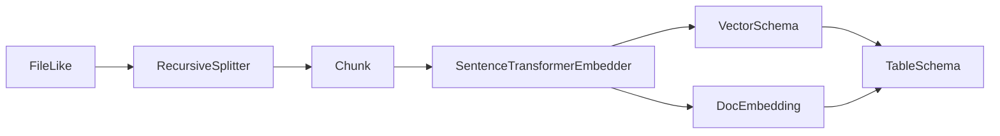

# Embedding Models and Vector Types

## Summary

An embedder turns text into vectors; a separate schema provider supplies the element type and dimension connectors need to store them. Python and Rust provide local text embedders, while Rust also exposes a local image embedder. Pipelines can derive target schemas from these providers and reuse embeddings in retrieval or [Entity Resolution](entity-resolution.md). [python/cocoindex/resources/embedder.py:14-25] [rust/sdk/cocoindex/src/resources/schema.rs:1-12] [rust/sdk/cocoindex/src/ops/mod.rs:11-24]

## Embedder interfaces

Python’s `Embedder` protocol requires one asynchronous `embed(text)` method returning a NumPy `float32` vector. Rust’s `Embedder` trait also offers `embed_batch`; its default implementation calls `embed` sequentially, while implementations can override it. Any Rust `Embedder` also implements `EntityEmbedder`. [python/cocoindex/resources/embedder.py:14-25] [rust/sdk/cocoindex/src/resources/embedder.rs:13-37]

```rust
#[async_trait]
pub trait Embedder: Send + Sync {
    /// Embed a single text into a dense vector.
    async fn embed(&self, text: &str) -> Result<Vec<f32>>;

    /// Embed a batch of texts. The default fans out to [`embed`](Self::embed);
    /// implementations with a native batch path should override it.
    async fn embed_batch(&self, texts: &[String]) -> Result<Vec<Vec<f32>>> {
```

[rust/sdk/cocoindex/src/resources/embedder.rs:14-21]

## Vector schema metadata

Vector length and element type are needed beyond the language’s array type. A provider can resolve this information asynchronously, and a fixed schema is itself a provider. Python also resolves a `ContextKey` before checking for a provider. [python/cocoindex/resources/schema.py:16-39] [rust/sdk/cocoindex/src/resources/schema.rs:56-70]

| Resource | Python | Rust |
|---|---|---|
| `VectorSchema` | NumPy `dtype` and `size` | `VectorElementType` and `size`; constructors support `f32` and `f16` |
| `MultiVectorSchema` | Wraps a `VectorSchema` | Wraps the schema shared by vectors in a list |
| Provider | `__coco_vector_schema__` or `__coco_multi_vector_schema__` | `vector_schema` or `multi_vector_schema` |

[python/cocoindex/resources/schema.py:16-63] [rust/sdk/cocoindex/src/resources/schema.rs:19-53] [rust/sdk/cocoindex/src/resources/schema.rs:73-94]

A PostgreSQL record can annotate an `NDArray` with a context key for an embedder. During table schema construction, the connector resolves that annotation to obtain vector metadata. The text embedding example provides the embedder through its lifespan, declares one row per chunk, and embeds query text with the same model. [examples/text_embedding/main.py:45-69] [python/cocoindex/connectors/postgres/_target.py:404-425] [examples/text_embedding/main.py:72-87] [examples/text_embedding/main.py:138-159]



[examples/text_embedding/main.py:62-101] [examples/text_embedding/main.py:104-115] [python/cocoindex/ops/sentence_transformers.py:193-203]

## Local models

| Implementation | Loading and execution | Batching and reuse |
|---|---|---|
| Python `SentenceTransformerEmbedder` | Lazily loads `sentence-transformers` under a lock; accepts a model name or path and optional device. | Memoized single-text calls feed batches of up to 64 through the GPU runner. |
| Rust `SentenceTransformerEmbedder` | Loads a supported `fastembed` ONNX model on a blocking thread; model names are matched against its registry. | `embed(&ctx, text)` memoizes and batches up to 64; `embed_batch` is the explicit raw batch path. |
| Rust `ImageEmbedder` | Loads a `fastembed` image model and accepts encoded image bytes. | Explicit image batches run on a blocking thread. |

[python/cocoindex/ops/sentence_transformers.py:53-65] [python/cocoindex/ops/sentence_transformers.py:108-128] [python/cocoindex/ops/sentence_transformers.py:167-191] [rust/sdk/cocoindex/src/ops/sentence_transformers.rs:60-74] [rust/sdk/cocoindex/src/ops/sentence_transformers.rs:114-132] [rust/sdk/cocoindex/src/ops/image.rs:32-45] [rust/sdk/cocoindex/src/ops/image.rs:83-103]

Python normalizes text embeddings by default and supports a `prompt_name` for models with different query and document prompts. An out-of-memory error clears accelerator caches where possible and asks the engine to retry smaller batches; other model errors propagate. [python/cocoindex/ops/sentence_transformers.py:122-164]

For cross-modal retrieval, the image-search example uses CLIP’s image and text features: it stores image vectors in Qdrant and embeds text queries for search. Its collection schema uses the model’s projection dimension and cosine distance. [examples/image_search/pipeline.py:48-75] [examples/image_search/pipeline.py:88-115] [examples/image_search/api.py:69-83]

Hosted embeddings and their request behavior are covered in [Model Calls and Multimodal Processing](model-calls-and-multimodal-processing.md). [python/cocoindex/ops/litellm.py:328-332]

## Terms

- **Embedder**: Interface for asynchronously turning text into a dense vector. [python/cocoindex/resources/embedder.py:14-25]
- **VectorSchemaProvider**: Object that supplies a vector’s element type and dimension. [rust/sdk/cocoindex/src/resources/schema.rs:56-64]
- **MultiVectorSchema**: Schema for a list of vectors sharing one vector schema. [rust/sdk/cocoindex/src/resources/schema.rs:73-80]