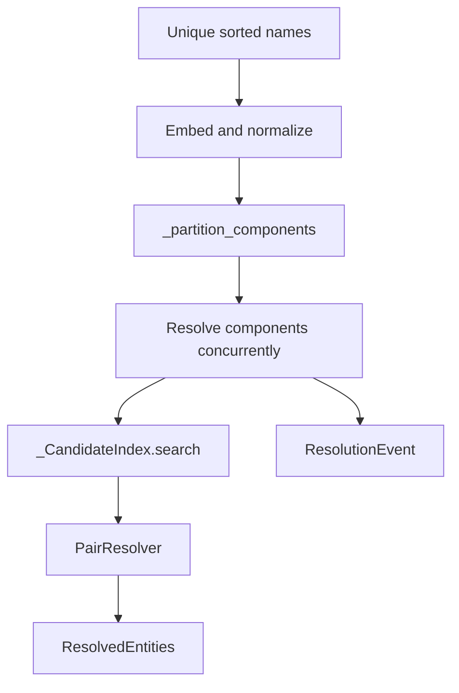

# Entity Resolution

## Summary

`resolve_entities` groups names using embedding similarity to select candidates and a `PairResolver` to decide whether they refer to the same entity. It returns a `ResolvedEntities` map whose chains lead to canonical names. Python and Rust partition the similarity graph into independent components and resolve those components concurrently. [python/cocoindex/ops/entity_resolution/__init__.py:491-514] [rust/sdk/cocoindex/src/entity_resolution.rs:220-229]

## Resolution process

The Python API accepts an embedder and a resolver; Rust exposes corresponding `EntityEmbedder` and `PairResolver` traits and a `ResolveOptions` struct. Both default to `max_distance=0.3`, `top_n=5`, and the pinned policy. [python/cocoindex/ops/entity_resolution/__init__.py:491-501] [rust/sdk/cocoindex/src/entity_resolution.rs:107-132]

```python
async def resolve_entities(
    entities: _Iterable[str],
    *,
    embedder: _Embedder,
    resolve_pair: PairResolver,
    is_existing_canonical: _Callable[[str], bool] | None = None,
    existing_policy: ExistingCanonicalPolicy = ExistingCanonicalPolicy.PINNED,
    on_resolution: _Callable[[ResolutionEvent], None] | None = None,
    max_distance: float = 0.3,
    top_n: int = 5,
) -> ResolvedEntities:
```

[python/cocoindex/ops/entity_resolution/__init__.py:491-501]



[python/cocoindex/ops/entity_resolution/__init__.py:520-547] [python/cocoindex/ops/entity_resolution/__init__.py:559-575] [python/cocoindex/ops/entity_resolution/__init__.py:394-423]

1. **Embed and partition.** Duplicate names are removed, names are sorted, and embeddings are computed concurrently and normalized. The partition graph includes every pair with cosine similarity at least `1 - max_distance`; its connected components conservatively contain all possible candidate comparisons. [python/cocoindex/ops/entity_resolution/__init__.py:520-547] [python/cocoindex/ops/entity_resolution/__init__.py:427-443]
2. **Resolve each component greedily.** Components run concurrently, but their names are processed in sorted order. Python uses FAISS inner-product indexes; Rust scores indexed vectors directly. Each search follows previously indexed names to their current canonicals, removes duplicates, and returns at most `top_n` candidates. Setting `top_n` to zero disables candidate searches. [python/cocoindex/ops/entity_resolution/__init__.py:200-261] [rust/sdk/cocoindex/src/entity_resolution.rs:400-448]
3. **Apply the decision.** With no candidates, a name becomes canonical without a resolver call. Otherwise, the resolver returns a `PairDecision`: `matched` must be one of the supplied candidates or `None`. An invalid custom decision fails resolution. [python/cocoindex/ops/entity_resolution/__init__.py:394-416] [python/cocoindex/ops/entity_resolution/__init__.py:273-286]

Python’s partitioning accounts for FAISS range search’s strict boundary by searching just below the threshold; this keeps pairs exactly at the inclusive candidate threshold in the same component. Rust checks pairs directly against the inclusive threshold. [python/cocoindex/ops/entity_resolution/__init__.py:451-463] [rust/sdk/cocoindex/src/entity_resolution.rs:451-466]

## Canonical selection

A positive decision can retain the matched canonical or promote the new name, repointing the former canonical to it. `ResolvedEntities.canonical_of()` follows the resulting chain; `groups()` collects all names under their final canonical. [python/cocoindex/ops/entity_resolution/__init__.py:289-313] [python/cocoindex/ops/entity_resolution/__init__.py:124-162]

| Policy | Effect of `is_existing_canonical` |
|---|---|
| `PINNED` / `Pinned` | Seed existing names independently before other names. They never merge with each other, and a matching existing canonical cannot be displaced. |
| `PREFERRED` / `Preferred` | Resolve names in sorted order. If exactly one side is existing, it wins; otherwise the resolver’s `canonical` choice applies. |

Without an existing-canonical predicate, no names are marked existing, so the policy does not override the resolver’s choice. [python/cocoindex/ops/entity_resolution/__init__.py:57-67] [python/cocoindex/ops/entity_resolution/__init__.py:382-392] [python/cocoindex/ops/entity_resolution/__init__.py:640-659]

## Resolvers and events

Custom resolvers must tolerate concurrent calls from different components. Python’s built-in `LlmPairResolver` uses Instructor and LiteLLM for structured decisions and memoizes calls. Rust’s `LlmPairResolver` uses an OpenAI-compatible JSON chat endpoint. Both retry an out-of-list match and ultimately return no match if those retries are exhausted; their default retry counts differ: two in Python and five in Rust. [python/cocoindex/ops/entity_resolution/__init__.py:100-121] [python/cocoindex/ops/entity_resolution/llm_resolver.py:56-85] [python/cocoindex/ops/entity_resolution/llm_resolver.py:93-142] [rust/sdk/cocoindex/src/ops/api.rs:435-460] [rust/sdk/cocoindex/src/ops/api.rs:546-580]

Each `ResolutionEvent` records the entity, canonical at that step, candidates, raw decision, any repointed name, and whether it was seeded. Delivery is deterministic: pinned seeds first, then other events, each sorted by name; preferred events are globally sorted. On a component failure, sibling work is cancelled and completed events are delivered before the error propagates. In Rust, use `resolve_entities_with_events` to provide the callback. [python/cocoindex/ops/entity_resolution/__init__.py:69-97] [python/cocoindex/ops/entity_resolution/__init__.py:577-605] [python/cocoindex/ops/entity_resolution/__init__.py:616-637] [rust/sdk/cocoindex/src/entity_resolution.rs:171-182]

## Terms

- **PairResolver**: Async callable or trait that selects a matching canonical candidate and recommends which name wins. [python/cocoindex/ops/entity_resolution/__init__.py:100-121]
- **ExistingCanonicalPolicy**: Rule governing how existing status affects canonical selection. [python/cocoindex/ops/entity_resolution/__init__.py:57-67]
- **ResolutionEvent**: Record of one entity’s resolution step, including the raw decision and any repointing. [python/cocoindex/ops/entity_resolution/__init__.py:69-97]