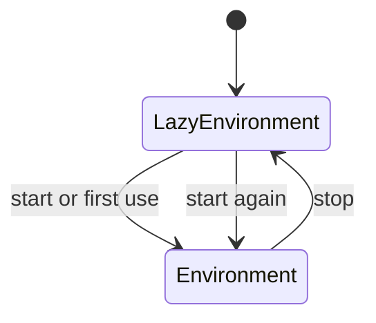

# Environment Configuration and Lifecycle

## Summary

An environment owns storage and shared runtime context for its apps. Python apps use a lazily started default environment unless given an explicit one. Lifespans configure the default environment and manage resources; explicit environments require their own settings and closure. [rust/core/src/engine/environment.rs:17-34] [python/cocoindex/_internal/app.py:177-181] [python/cocoindex/_internal/environment.py:306-315]

## Settings

The default environment starts with `Settings.from_env()`. A lifespan can change those settings before the environment opens; its `db_path` takes precedence over `COCOINDEX_DB`, which is the fallback when no path was supplied. Startup fails if neither exists. An explicit `Environment` requires `settings.db_path` directly. [python/cocoindex/_internal/environment.py:120-123] [python/cocoindex/_internal/environment.py:431-440] [python/cocoindex/_internal/environment.py:238-249]

| Setting | Environment variable | Default |
| --- | --- | --- |
| `db_path` | `COCOINDEX_DB` for the default environment | Required |
| `db_settings.max_dbs` | `COCOINDEX_LMDB_MAX_DBS` via `from_env()` | 1024 |
| `db_settings.map_size` | `COCOINDEX_LMDB_MAP_SIZE` via `from_env()` | 4 GiB initially |

[python/cocoindex/_internal/setting.py:12-20] [python/cocoindex/_internal/setting.py:23-32] [python/cocoindex/_internal/setting.py:121-142]

`Settings(...)` uses its supplied values and defaults; `Settings.from_env(...)` reads the LMDB variables. The legacy `lmdb_max_dbs` and `lmdb_map_size` keywords cannot be combined with `db_settings`. The map can grow after a full-map error; see [LMDB Transactions and Write Batching](lmdb-transactions-and-write-batching.md). [python/cocoindex/_internal/setting.py:68-89] [python/cocoindex/_internal/setting.py:121-142] [python/cocoindex/_internal/setting.py:23-28]

## Default environment

The default `LazyEnvironment` starts on first use or through `coco.start()` / `start_blocking()`. A synchronous or asynchronous `@coco.lifespan` generator configures its builder before `yield` and resumes for cleanup on stop. `provide_with` and `provide_async_with` enter context managers whose cleanup is registered with the provider. [python/cocoindex/_internal/environment.py:380-429] [python/cocoindex/_internal/context_keys.py:238-246]

```python
@coco.lifespan
async def default_lifespan(
    builder: coco.EnvironmentBuilder,
) -> AsyncIterator[None]:
    builder.settings.db_path = _env_db_path
    await builder.provide_async_with(_RESOURCE_KEY, _acquire_resource())
    yield
```

[python/tests/core/test_default_env_async.py:33-39]



Stopping closes the lifespan’s exit stack and then the environment database. A later start creates a new `Environment`; apps resolve it again and replace their old core app binding. `coco.runtime()` wraps start and stop in either `with` or `async with`; synchronous use inside a running event loop raises an error. [python/cocoindex/_internal/environment.py:468-489] [python/cocoindex/_internal/app.py:260-267] [python/cocoindex/_internal/api.py:705-739]

## Explicit environments and loops

Construct `Environment(Settings(...))` and pass it through `AppConfig` to isolate apps using separate database paths. App names must be unique within one core environment, but the same name can be used in different environments. [docs/src/content/docs/advanced_topics/multiple_environments.mdx:15-48] [rust/core/src/engine/environment.rs:173-177]

An environment uses a supplied event loop, the currently running loop, or a shared background loop when called from synchronous code. A supplied loop that is not running is started on a daemon thread. Python’s `AsyncContext` carries the chosen loop across the extension boundary for callbacks. [python/cocoindex/_internal/environment.py:238-268] [python/cocoindex/_internal/environment.py:640-649] [rust/py/src/runtime.rs:101-103]

Call `env.close()` when finished with an explicit environment. It waits for in-flight database writes and permits the path to be reopened; later operations fail. It does not close context values supplied by the caller. [python/cocoindex/_internal/environment.py:306-315]

## Runtime startup and shutdown

Python package initialization registers serialization and target-state helpers with the Rust extension and connects PyO3 async support to the shared Tokio runtime. The core runtime is initialized lazily and uses `RUST_LOG` for tracing configuration. [python/cocoindex/_internal/__init__.py:18-30] [rust/py/src/runtime.rs:46-71] [rust/core/src/engine/runtime.rs:9-21]

At interpreter exit, Python shuts down Tokio before stopping the shared background asyncio loop. The core runtime shutdown is idempotent and waits up to five seconds, preventing runtime threads from outliving Python finalization. [python/cocoindex/_internal/environment.py:584-604] [rust/core/src/engine/runtime.rs:73-87]

## Terms

- **Environment**: Shared storage and runtime context for a set of apps. [rust/core/src/engine/environment.rs:17-22]
- **LazyEnvironment**: An environment initialized on demand through a lifespan. [python/cocoindex/_internal/environment.py:324-326]
- **EnvironmentBuilder**: The object used by a lifespan to configure settings and provide resources. [python/cocoindex/_internal/environment.py:113-141]