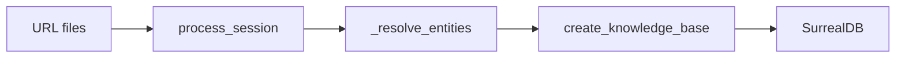

# Example Application Patterns

## Summary

The examples connect source data to declared targets: Markdown and PDFs become searchable embeddings, conversations become graph records, and Kafka messages become LanceDB rows. Python and Rust text-embedding examples implement the same retrieval workflow with their respective SDKs. [examples/text_embedding/main.py:91-123] [examples/pdf_embedding/main.py:116-147] [examples/conversation_to_knowledge/conv_knowledge/app.py:295-348] [examples/kafka_to_lancedb/main.py:80-114] [examples/rust/text_embedding/src/main.rs:96-133]

## Choose a pipeline

| Example | Input → output | External requirements |
|---|---|---|
| `text_embedding` | Markdown → PostgreSQL/pgvector rows | PostgreSQL with pgvector |
| `pdf_embedding` | PDF → Markdown → PostgreSQL/pgvector rows | PostgreSQL with pgvector |
| `conversation_to_knowledge` | YouTube transcripts → SurrealDB records and relations | SurrealDB, transcription and model credentials |
| `kafka_to_lancedb` | Kafka messages → product and employee tables | Kafka broker; LanceDB stores tables locally |
| `rust/text_embedding` | Markdown → PostgreSQL/pgvector rows | PostgreSQL with pgvector and Rust |

[examples/text_embedding/README.md:31-40] [examples/pdf_embedding/main.py:4-11] [examples/conversation_to_knowledge/README.md:83-92] [examples/kafka_to_lancedb/README.md:76-86] [examples/rust/text_embedding/README.md:1-6]

## Retrieval from files

The Python Markdown example mounts a PostgreSQL table and vector index, watches matching files, and mounts `process_file` for each item. The memoized file processor splits Markdown into overlapping chunks; each chunk gets an ID, offsets, text and an embedding in a declared row. [examples/text_embedding/main.py:62-101] [examples/text_embedding/main.py:104-123]

```python
@coco.fn(memo=True)
async def process_file(
    file: FileLike,
    table: postgres.TableTarget[DocEmbedding],
) -> None:
    text = await file.read_text()
    chunks = _splitter.split(
        text, chunk_size=2000, chunk_overlap=500, language="markdown"
    )
    id_gen = IdGenerator()
    await coco.map(process_chunk, chunks, file.file_path.path, id_gen, table)
```

[examples/text_embedding/main.py:91-101]

The separate query path embeds the query with the same model and orders PostgreSQL rows by cosine distance. Run `cocoindex update main` to build the index, or add `-L` to keep watching; `python main.py "your query"` searches it. [examples/text_embedding/main.py:4-9] [examples/text_embedding/main.py:138-170]

The PDF example adds Docling conversion before the same chunk-and-embed pattern. Its converter selects Docling’s CPU accelerator, while `pdf_to_markdown` is wrapped with `coco.fn.as_async(runner=coco.GPU)`; the configured converter behavior and the execution runner are separate choices. It requires `POSTGRES_URL`. [examples/pdf_embedding/main.py:55-70] [examples/pdf_embedding/main.py:83-94] [examples/pdf_embedding/main.py:116-126]

The Rust example uses `Ctx`, `mount_each!`, and a `SchemaFields` row type. Its file function returns rows, which `app_main` then declares on the mounted table; the vector dimension comes from the embedder. Run `cargo run -- index` and `cargo run -- query "your query"` from the example directory. See [Native Rust SDK](native-rust-sdk.md) for the API. [examples/rust/text_embedding/src/main.rs:37-49] [examples/rust/text_embedding/src/main.rs:96-133] [examples/rust/text_embedding/README.md:24-30]

## Conversations into a knowledge graph

`conversation_to_knowledge` reads YouTube URLs from text files and mounts `process_session` at a path containing each video ID. Each session fetches a transcript, extracts metadata and statements in two passes, and declares session and statement records with relations. [examples/conversation_to_knowledge/conv_knowledge/app.py:118-159] [examples/conversation_to_knowledge/conv_knowledge/app.py:295-319]

After collecting session results, the app resolves entities per type using embeddings and an LLM pair resolver. A final component declares canonical entity records and relationships, deduplicating speakers and mentions after resolution. [examples/conversation_to_knowledge/conv_knowledge/app.py:48-59] [examples/conversation_to_knowledge/conv_knowledge/app.py:186-230] [examples/conversation_to_knowledge/conv_knowledge/app.py:321-348]



[examples/conversation_to_knowledge/conv_knowledge/app.py:260-293] [examples/conversation_to_knowledge/conv_knowledge/app.py:295-348]

## Streaming into tables

`kafka_to_lancedb` mounts separate typed tables keyed by `sku` and `emp_id`, turns a Kafka topic into a map, and mounts `process_message` for its items. The processor decodes JSON and selects a table by field; a null value or a message matching neither shape declares no row. [examples/kafka_to_lancedb/main.py:60-77] [examples/kafka_to_lancedb/main.py:80-114]

The consumer disables Kafka auto-commit and starts at the earliest offset when needed. The example’s documented workflow commits offsets after rows are written; `-L` keeps consuming after catch-up. See [Streaming Connectors](streaming-connectors.md) for the feed and acknowledgment mechanisms. [examples/kafka_to_lancedb/main.py:96-100] [examples/kafka_to_lancedb/README.md:69-69] [examples/kafka_to_lancedb/README.md:95-102]

## Terms

- **`process_file`**: Per-file processor used by the embedding examples. [examples/text_embedding/main.py:91-101]
- **`process_session`**: Conversation processor that extracts and declares session data. [examples/conversation_to_knowledge/conv_knowledge/app.py:118-159]
- **`topic_as_map`**: Kafka source used to supply keyed items to `mount_each`. [examples/kafka_to_lancedb/main.py:112-114]