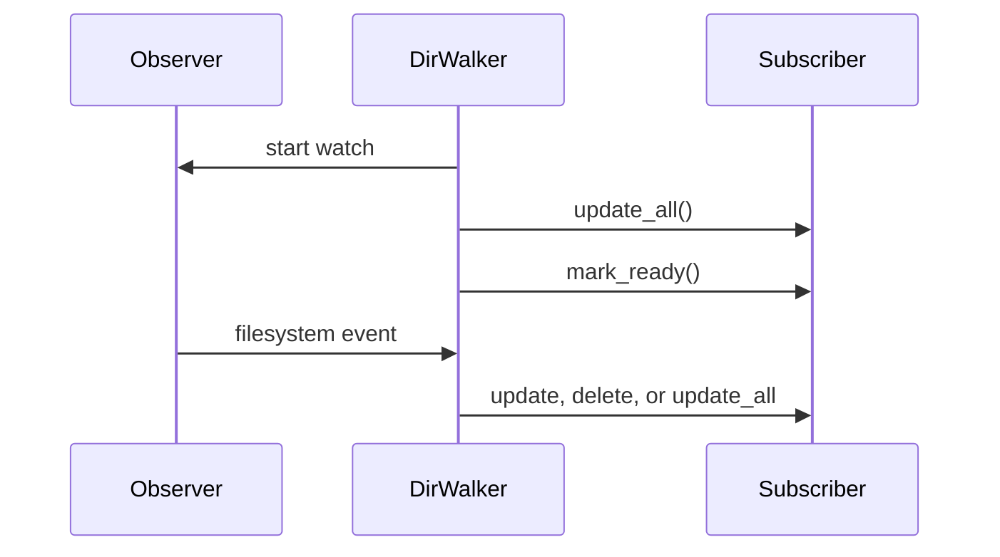

# Filesystem and File Resources

## Summary

`FilePath` gives files a stable logical identity, while `FileLike` caches metadata, content, and fingerprints for incremental processing. Local directory walkers produce keyed files and optional live changes; directory targets reconcile declared files and directories on disk. [python/cocoindex/resources/file.py:159-200] [python/cocoindex/connectors/localfs/_source.py:164-178] [python/cocoindex/connectors/localfs/_target.py:281-286]

## Paths and file content

A local `FilePath` combines a relative path with an optional `ContextKey` for its base directory. Resolution uses the current context value, while the memo key uses the context key’s name and relative path, allowing the base directory to move without changing that identity. Rust’s `FilePath::with_base_dir` uses the same distinction. [python/cocoindex/connectors/localfs/_common.py:36-62] [python/cocoindex/resources/file.py:506-511] [rust/sdk/cocoindex/src/resources/file.rs:19-21] [rust/sdk/cocoindex/src/resources/file.rs:38-62]

`FileLike` caches metadata and full reads; a partial read uses cached content if available. Its fingerprint uses backend metadata when supplied, otherwise hashes the content. Python memo validation first compares modification time, then compares fingerprints if the time changed. [python/cocoindex/resources/file.py:93-97] [python/cocoindex/resources/file.py:121-140] [python/cocoindex/resources/file.py:159-200]

## Walk and watch

`walk_dir` is non-recursive by default. Its matcher filters relative paths and can prune directories; `PatternFilePathMatcher` supports glob patterns and negated exclusions. Python follows directory entries while tracking ancestor device and inode pairs to avoid cycles. An invalid root raises `ValueError`; inaccessible directories and entries that cannot be statted are skipped. [python/cocoindex/connectors/localfs/_source.py:90-110] [python/cocoindex/connectors/localfs/_source.py:112-159] [python/cocoindex/resources/file.py:226-247]

```python
def walk_dir(
    path: FilePath | Path | ContextKey[Path],
    *,
    live: bool = False,
    recursive: bool = False,
    path_matcher: FilePathMatcher | None = None,
    rescan_interval: datetime.timedelta | None = _DEFAULT_RESCAN_INTERVAL,
) -> DirWalker:
```

[python/cocoindex/connectors/localfs/_source.py:362-369]

`items()` yields `(relative_path, File)` pairs. With `live=True`, Python arms a Watchdog observer before the initial full scan, then signals readiness. Moves become delete plus create; directory deletions trigger a full rescan. The default hourly rescan replaces the watcher to recover from missed events. [python/cocoindex/connectors/localfs/_source.py:164-178] [python/cocoindex/connectors/localfs/_source.py:254-290] [python/cocoindex/connectors/localfs/_source.py:302-333] [python/cocoindex/connectors/localfs/_source.py:385-388]



Rust’s feature-gated `LiveDirWalker` uses a polling watcher and rescans after arming it and after coalesced events. Its walker returns an empty result for a missing root, unlike Python’s invalid-root error. [rust/sdk/cocoindex/src/resources/fs.rs:67-70] [rust/sdk/cocoindex/src/resources/fs.rs:130-170] [rust/sdk/cocoindex/src/resources/fs.rs:306-314]

## Filesystem targets

Python `DirTarget` declares files and nested directory targets. File contents are fingerprinted so unchanged declarations need no write; disappearing files are removed. Removing a declared directory uses recursive removal, including its contents. Root directory creation defaults to creating parents; child file and directory declarations default to not doing so. [python/cocoindex/connectors/localfs/_target.py:58-80] [python/cocoindex/connectors/localfs/_target.py:117-164] [python/cocoindex/connectors/localfs/_target.py:299-348] [python/cocoindex/connectors/localfs/_target.py:355-368]

Rust’s `DirTarget` declares file leaves keyed by directory and relative name. It rejects absolute names and `..`; its sink creates parent directories when writing and ignores a missing file on deletion. For ownership and cleanup across components, see [Ownership, Submission, and Cleanup](ownership-submission-and-cleanup.md). [rust/sdk/cocoindex/src/resources/fs.rs:486-515] [rust/sdk/cocoindex/src/resources/fs.rs:588-609]

## Terms

- **`FilePath`**: A path with an optional stable base identity. [python/cocoindex/resources/file.py:316-325]
- **`FileLike`**: A file abstraction with cached metadata, reads, and content fingerprints. [python/cocoindex/resources/file.py:91-97] [python/cocoindex/resources/file.py:121-126] [python/cocoindex/resources/file.py:171-175]
- **`DirTarget`**: A provider for declaring filesystem output states. [python/cocoindex/connectors/localfs/_target.py:281-289]