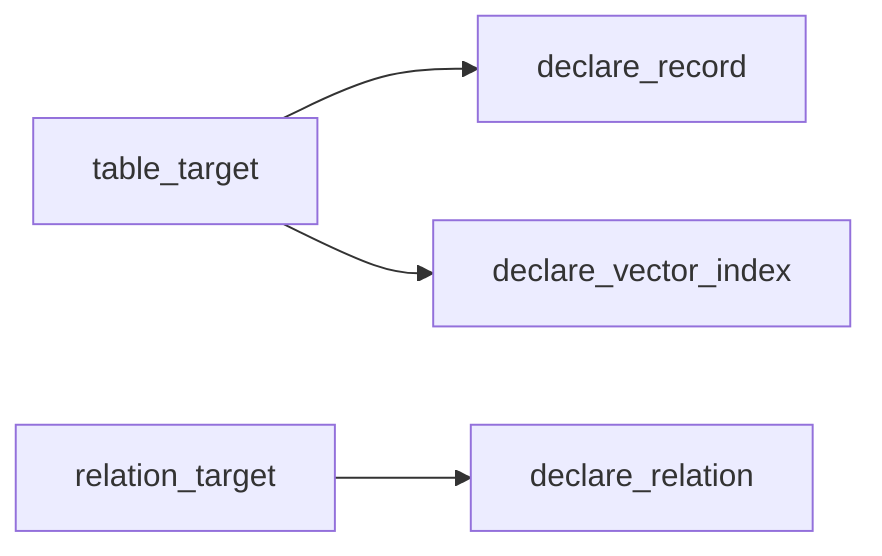

# Graph Database Targets

## Summary

Neo4j, FalkorDB, and SurrealDB expose table targets for records and relation targets for edges. Each connector reconciles keyed declarations and vector-index attachments, but their schema and ownership behavior differs. [python/cocoindex/connectors/neo4j/_target.py:1525-1552] [python/cocoindex/connectors/falkordb/_target.py:1561-1591] [python/cocoindex/connectors/surrealdb/_target.py:1293-1319]

## Connections and targets

Python applications provide a `ConnectionFactory` through a `ContextKey`. Each factory reuses a driver or connection per event loop; its memo identity describes where data lives rather than the open connection or credentials. [python/cocoindex/connectors/neo4j/_target.py:152-162] [python/cocoindex/connectors/falkordb/_target.py:127-142] [python/cocoindex/connectors/surrealdb/_target.py:141-155]

| Connector | Connection destination | Table and relation model |
|---|---|---|
| Neo4j | URI and database | Node label and relationship type |
| FalkorDB | URI and named graph | Node label and relationship type |
| SurrealDB | URL, namespace, and database | Normal table and relation table |

Neo4j and FalkorDB relations specify one source and one destination table. SurrealDB also accepts collections of endpoint tables; polymorphic declarations specify the applicable table. [python/cocoindex/connectors/neo4j/_target.py:1605-1615] [python/cocoindex/connectors/falkordb/_target.py:1561-1571] [python/cocoindex/connectors/surrealdb/_target.py:1407-1437] [python/cocoindex/connectors/surrealdb/_target.py:1552-1561]

The Python `table_target` constructors return a target state; `declare_table_target` returns a pending handle and `mount_table_target` returns a ready handle. For example, Neo4j exposes: [python/cocoindex/connectors/neo4j/_target.py:1525-1533] [python/cocoindex/connectors/neo4j/_target.py:1555-1563] [python/cocoindex/connectors/neo4j/_target.py:1582-1590]

```python
async def mount_table_target(
    db: ContextKey[ConnectionFactory],
    table_name: str,
    table_schema: TableSchema[RowT] | None = None,
    *,
    primary_key: str = "id",
    managed_by: target.ManagedBy = target.ManagedBy.SYSTEM,
) -> TableTarget[RowT]:
```

[python/cocoindex/connectors/neo4j/_target.py:1582-1589]

## Ownership and schema

Table reconciliation creates a child handler for records; record declarations are keyed independently under that handler. The graph connectors use fingerprints to skip unchanged records. [python/cocoindex/connectors/surrealdb/_target.py:1043-1060] [python/cocoindex/connectors/neo4j/_target.py:915-950]



In Python, Neo4j and FalkorDB use a single primary-key field for nodes. SurrealDB uses the record’s `id` and additionally offers `declare_fields` for a named group on an existing record. A removed field group unsets its owned fields; SurrealDB relations are single-owner and replaced as whole edges. [python/cocoindex/connectors/neo4j/_target.py:422-426] [python/cocoindex/connectors/falkordb/_target.py:1330-1338] [python/cocoindex/connectors/surrealdb/_target.py:1293-1309] [python/cocoindex/connectors/surrealdb/_target.py:849-867]

`managed_by=SYSTEM` is the Python default. For Neo4j and FalkorDB, removing a system-managed table removes all nodes with its label or relationships of its type, including data written by others; use user management for shared labels. SurrealDB’s table action can remove the table itself. [python/cocoindex/connectors/neo4j/_target.py:1525-1532] [python/cocoindex/connectors/falkordb/_target.py:1197-1207] [python/cocoindex/connectors/surrealdb/_target.py:1166-1170]

Neo4j and FalkorDB schemas describe fields and one primary key; SurrealDB can define typed fields from a `TableSchema`. For implementation and evolution details, see [Neo4j and FalkorDB Targets](source-and-target-connectors-cypher-graph-targets.md) and [SurrealDB Target](source-and-target-connectors-surrealdb.md). [python/cocoindex/connectors/falkordb/_target.py:358-385] [python/cocoindex/connectors/surrealdb/_target.py:425-477]

## Vector indexes and Rust

Each Python `TableTarget` declares vector indexes as attachments. Neo4j offers cosine and euclidean metrics; FalkorDB also exposes `ip`; SurrealDB exposes cosine, euclidean, and manhattan with HNSW. SurrealDB’s Rust options have a different default method, `mtree`. [python/cocoindex/connectors/neo4j/_target.py:1398-1415] [python/cocoindex/connectors/falkordb/_target.py:1357-1374] [python/cocoindex/connectors/surrealdb/_target.py:1340-1365] [rust/sdk/cocoindex/src/connectors/surrealdb.rs:288-309]

The Rust SDK shares Neo4j and FalkorDB target APIs through `cypher_graph`; SurrealDB has its own `Graph` and target implementation. Rust `declare_record` accepts the record ID separately, including for SurrealDB. [rust/sdk/cocoindex/src/cypher_graph.rs:1576-1585] [rust/sdk/cocoindex/src/cypher_graph.rs:275-281] [rust/sdk/cocoindex/src/connectors/surrealdb.rs:118-120] [rust/sdk/cocoindex/src/connectors/surrealdb.rs:226-233]

## Terms

- **`TableTarget`**: A target that declares records in a node label or database table. [python/cocoindex/connectors/neo4j/_target.py:1341-1344] [python/cocoindex/connectors/surrealdb/_target.py:1270-1273]
- **`RelationTarget`**: A target that declares edges between records. [python/cocoindex/connectors/falkordb/_target.py:1385-1388]
- **`managed_by`**: The setting that determines whether CocoIndex manages the target container. [python/cocoindex/connectors/falkordb/_target.py:1197-1207]