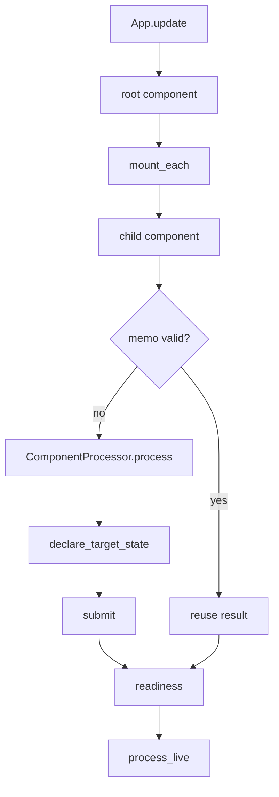

# Incremental Execution

## Summary

An app update runs a root processing component that can mount children at stable paths and declare desired target states. The engine checks prior work at each component or memoized function boundary, executes what cannot be reused, and reconciles declarations when processing finishes. In live mode, components can continue delivering keyed updates after initial readiness. [rust/core/src/engine/app.rs:150-175] [rust/core/src/engine/component.rs:1129-1146] [rust/core/src/engine/component.rs:1245-1287]

## The execution path

The `files_transform` example shows the boundary between enumeration and per-file processing. Each file is mounted separately; its processor reads the file and declares the desired HTML output. [examples/files_transform/main.py:11-25]

```python
@coco.fn(memo=True)
async def process_file(file: FileLike, outdir: pathlib.Path) -> None:
    html = _markdown_it.render(await file.read_text())
    outname = "__".join(file.file_path.path.parts) + ".html"
    localfs.declare_file(outdir / outname, html, create_parent_dirs=True)


@coco.fn
async def app_main(sourcedir: pathlib.Path, outdir: pathlib.Path) -> None:
    files = localfs.walk_dir(
        sourcedir,
        path_matcher=PatternFilePathMatcher(included_patterns=["**/*.md"]),
        live=True,
    )
    await coco.mount_each(process_file, files.items(), outdir)
```

The update proceeds through these steps:

1. **Start the root.** Python adapts the app’s main function and arguments to a root processor. Core creates a build context and runs that processor in a spawned task, with an operation handle for progress and completion. [python/cocoindex/_internal/app.py:294-320] [rust/core/src/engine/app.rs:128-163]
2. **Mount children.** `mount_each` appends each item’s key to its subpath and schedules a processor for that child. A stable key lets the engine identify the same component on a later run, even if enumeration order changes. [python/cocoindex/_internal/api.py:493-534] [docs/src/content/docs/programming_guide/processing_component.mdx:127-137]
3. **Check prior work.** Before executing a memoized component, the engine checks its processor fingerprint and stored dependencies. A valid hit returns the prior result without running or submitting that component; a miss runs its processor. [rust/core/src/engine/execution.rs:100-115] [rust/core/src/engine/component.rs:1129-1146]
4. **Declare and submit.** A running processor records desired target states in its build context. After its children are ready, the component submits its own declarations and reconciles child existence. Missing component paths trigger cleanup of their owned states. [rust/core/src/engine/execution.rs:262-298] [rust/core/src/engine/component.rs:1254-1287] [docs/src/content/docs/programming_guide/processing_component.mdx:233-243]
5. **Finish or continue.** Catch-up updates terminate after processing. With live processing enabled, the initial root run can become ready while live descendants remain active and react to later changes. [rust/core/src/engine/app.rs:165-175] [rust/core/src/engine/live_component.rs:814-838]



The live branch applies only when the pipeline mounts a live component and the update runs in live mode; setting `live=True` does not itself create a watcher. [rust/core/src/engine/app.rs:169-175] [docs/src/content/docs/programming_guide/live_mode.mdx:12-17]

## Key interfaces

| Type or function | Role | Defined in |
|---|---|---|
| `App` / `AppOpHandle` | Own the root component and expose update progress and result. | [rust/core/src/engine/app.rs:36-44] [rust/core/src/engine/app.rs:87-105] |
| `ComponentProcessor` | Runs host-language processing and supplies an optional component memo fingerprint. | [rust/core/src/engine/component.rs:63-79] |
| `StablePath` / `StableKey` | Identify components with typed path parts. | [rust/core/src/state/stable_path.rs:5-16] [rust/core/src/state/stable_path.rs:306-332] |
| `mount`, `use_mount`, `mount_each` | Create background, foreground and keyed child executions in Python. | [python/cocoindex/_internal/api.py:234-253] [python/cocoindex/_internal/api.py:358-373] [python/cocoindex/_internal/api.py:450-471] |
| `LiveComponentOperator` | Requests full or keyed live updates and signals readiness. | [python/cocoindex/_internal/live_component.py:292-320] [python/cocoindex/_internal/live_component.py:322-328] [python/cocoindex/_internal/live_component.py:401-403] |

## Why reuse remains correct

A component memo is more than an input match: the engine also validates stored logic and target-provider dependencies and can ask a state handler whether external data is still fresh. On a hit, stored dependencies still propagate to the parent, so a parent rebuilt around a reused child does not lose its dependency on that subtree. `full_reprocess` bypasses the previous-run component fast path. [rust/core/src/engine/execution.rs:100-137] [rust/core/src/engine/component.rs:673-695] [rust/core/src/engine/component.rs:1134-1146]

A memoized function call has a separate entry inside its component. Its cached entry records target-state paths and nested memo dependencies; finalization walks those dependencies to retain declarations even though the function body did not run. A directly called memoized function cannot mount child components, so mount that function as a component when it needs children. [rust/core/src/engine/function.rs:11-27] [rust/core/src/engine/execution.rs:2142-2202] [rust/core/src/engine/function.rs:111-124]

Submission is a separate boundary from processing. Target backends may apply their own batches atomically, but changes across different backends are not one transaction. Foreground `use_mount` failures propagate to the caller; background mount failures are logged by default or handled by an exception handler. [docs/src/content/docs/programming_guide/processing_component.mdx:239-258]

## Responding to changes

A `LiveComponent` has `process()` for a full pass and `process_live()` for ongoing coordination. Its operator can rerun the full pass or update and delete individual subpaths; rapid queued operations on the same subpath can be coalesced. In catch-up mode, `mark_ready()` ends the live task; in live mode, it returns and processing may continue. [python/cocoindex/_internal/live_component.py:203-207] [rust/core/src/engine/live_component.rs:635-660] [rust/core/src/engine/live_component.rs:814-838]

For a `LiveMapFeed` or `LiveMapView`, Python’s `mount_each` installs an internal live component that translates changes into per-key operations. `auto_refresh` provides another route: it runs a full pass, marks ready and repeats after a fixed delay. [python/cocoindex/_internal/live_component.py:562-612] [python/cocoindex/_internal/live_component.py:659-674]

## Read next

- [App Execution and CLI](app-execution-and-cli.md): construction, loading, update options, preview, drop and handles.
- [Component Mounting and Identity](component-mounting-and-identity.md): paths, fan-out and readiness.
- [Processing Functions](processing-functions.md): decorators, methods and engine adapters.
- [Memoization and State Reuse](memoization-and-state-reuse.md): keys, state validation and cached declarations.
- [Logic Change Detection](logic-change-detection.md): fingerprints and propagation to callers.
- [Live Component Lifecycle](live-component-lifecycle.md): catch-up, refresh and shutdown.
- [Live Maps and Change Feeds](live-maps-and-change-feeds.md): snapshots, subscriptions and keyed changes.

## Terms

- **Processing component**: An execution at a stable path that owns target states.
- **Component path**: The identity used to match a component across runs.
- **Memo**: Stored work reusable when its key and dependencies remain valid.
- **Readiness**: The point at which initial component work is ready for its parent.
- **Live component**: A component that can continue processing changes after readiness.