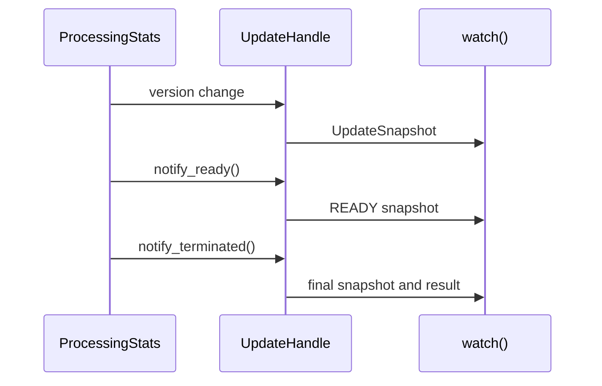

# Inspection, Progress, and Telemetry

## Summary

CocoIndex exposes persisted app state through inspection APIs and execution progress through separate statistics handles. Inspection reads LMDB records; progress reports activity from a running operation. Optional terminal reporting renders those statistics, while anonymous usage telemetry is controlled separately. [python/cocoindex/_internal/inspect_api.py:60-90] [rust/core/src/engine/stats.rs:39-58] [rust/core/src/telemetry/mod.rs:1-6]

## Inspect persisted state

The Python `cocoindex.inspect` module exports asynchronous iterators for stable paths, path details, and target states. The `*_by_name` variants accept an environment and app name, so inspection does not require an `App` object. A missing app database produces an empty stream for these iterators. [python/cocoindex/inspect.py:1-4] [python/cocoindex/_internal/inspect_api.py:15-41] [rust/core/src/inspect/db_inspect.rs:504-516]

| API | Use |
| --- | --- |
| `iter_stable_paths` | Stream component and intermediate directory nodes. |
| `iter_stable_path_details` | Stream details for every path using one read transaction and shared resolver. |
| `get_stable_path_detail` / `query_stable_path_details` | Read one path or query it with optional children and parents. |
| `iter_target_states` | Stream tracked target states and their owners. |

[python/cocoindex/_internal/inspect_api.py:15-27] [python/cocoindex/_internal/inspect_api.py:60-112] [python/cocoindex/_internal/inspect_api.py:135-146]

`StablePathDetail` includes the processor name, version, target-state summaries, and whether component memoization is present. The stream runs its read transaction on a dedicated thread and sends results over a channel because the transaction and cursor are not `Send`. [rust/core/src/inspect/db_inspect.rs:343-352] [rust/core/src/inspect/db_inspect.rs:472-492]

Target-state entries are in fingerprint order, not a global human-meaningful order. Readable path segments can fall back to fingerprints, and `dangling` identifies an owner-index entry without a matching item in the owner’s tracking information. Use `readable_segments` instead of splitting `readable_path`: a key can itself contain `/`. [rust/core/src/inspect/db_inspect.rs:648-670]

## Watch execution progress

`App.update()` returns an awaitable `UpdateHandle`; its `stats()` gives the latest snapshot and `watch()` yields changes. `stats()` returns `None` before the handle has started, and `watch()` is unavailable for preview updates. Errors are raised by the iterator. [python/cocoindex/_internal/app.py:52-57] [python/cocoindex/_internal/app.py:85-106]

```python
class ComponentStats(NamedTuple):
    """Per-processor stats group, mirroring Rust's ProcessingStatsGroup."""

    num_execution_starts: int
    num_unchanged: int
    num_adds: int
    num_deletes: int
    num_reprocesses: int
    num_errors: int
```

[python/cocoindex/_internal/update_stats.py:54-62]

`UpdateStats.by_component` holds these counters by processor; `total` aggregates them. Finished work includes errors, while in-progress work is starts minus finished, bounded at zero. [python/cocoindex/_internal/update_stats.py:64-96]



Readiness means initial processing has caught up; live components can update statistics afterward. Termination uses a separate sentinel, checked before version deduplication, so the final result is not missed. [rust/core/src/engine/stats.rs:39-46] [rust/core/src/engine/stats.rs:100-117] [python/cocoindex/_internal/app.py:108-133]

`coco.stats_group(title)` creates a separately aggregated scope for mounts and returns a `StatsGroupHandle` with `stats()` and `watch()`. The group becomes ready after registration closes and its members reach initial readiness; in live mode, termination can occur later. Rust exposes corresponding detailed snapshots and `changed()` on its update and group handles. [python/cocoindex/_internal/component_ctx.py:453-462] [rust/core/src/engine/component.rs:510-530] [rust/sdk/cocoindex/src/app.rs:836-855] [rust/sdk/cocoindex/src/app.rs:913-932]

## Terminal reporting and telemetry

For blocking Python updates, `report_to_stdout=True` enables progress output; a positive `timedelta` sets the refresh interval. `show_progress()` provides an async display for an update handle. The core uses a PTY display for a Unix TTY and plain scrolling output otherwise; only one root `show_progress` can run at a time. Stats-group reports use plain output. [python/cocoindex/_internal/app.py:162-173] [python/cocoindex/_internal/app.py:322-336] [python/cocoindex/_internal/update_stats.py:13-28] [rust/core/src/engine/progress_display.rs:233-265] [rust/core/src/engine/progress_display.rs:602-615]

Telemetry is active only in release builds. Set `COCOINDEX_DISABLE_USAGE_TRACKING` to any nonempty value other than `0` before initialization to disable it; `COCOINDEX_APPLICATION_FOR_TRACKING` optionally adds an application label. Events are sent asynchronously to the Scarf gateway with a five-second request timeout; failures are logged, and tracking becomes a no-op after runtime shutdown. [rust/core/src/telemetry/mod.rs:18-21] [rust/core/src/telemetry/mod.rs:42-74] [rust/core/src/telemetry/mod.rs:77-95] [rust/core/src/telemetry/mod.rs:112-127]

## Terms

- **StablePathDetail**: Persisted metadata and target-state summaries for a stable path. [rust/core/src/inspect/db_inspect.rs:343-352]
- **UpdateSnapshot**: A statistics snapshot, status, and optional update result. [python/cocoindex/_internal/update_stats.py:99-102]
- **StatsGroupHandle**: A handle for separately aggregated statistics within a `stats_group` scope. [python/cocoindex/_internal/update_stats.py:152-157]