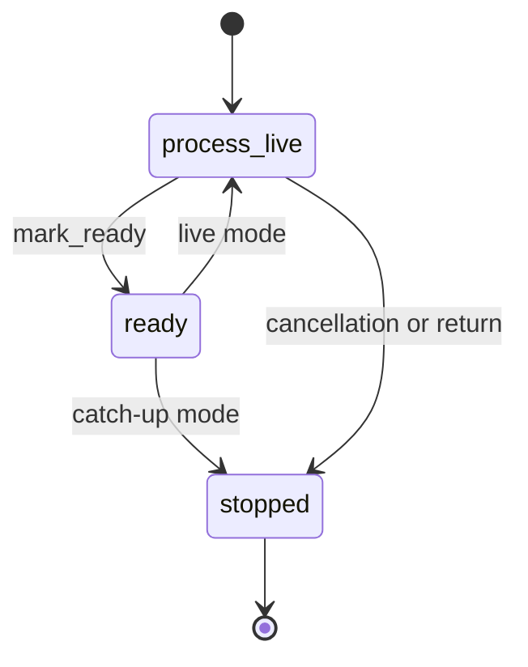

# Live Component Lifecycle

## Summary

A `LiveComponent` provides `process()` for a full pass and `process_live()` for coordinating that pass and subsequent changes. In catch-up mode, `mark_ready()` ends the live task; in live mode, it releases readiness while the task can continue reacting to changes. The core controller coordinates full and keyed updates and drains work during cancellation. [python/cocoindex/_internal/live_component.py:203-207] [rust/core/src/engine/live_component.rs:814-838]

## Mounting and readiness

Mounting creates a controller and readiness handle, then starts `process_live()` with a `LiveComponentOperator`. The app’s `live` setting propagates to children. A caller can await the mount handle’s `ready()` without waiting for a live component to terminate. [python/cocoindex/_internal/api.py:312-338] [python/cocoindex/_internal/api.py:151-166] [docs/src/content/docs/programming_guide/live_mode.mdx:19-41]



`mark_ready()` is idempotent. In catch-up mode it cancels the component’s token and suspends until the engine drops `process_live`; code after that call does not run. A normal early return also resolves readiness, while a failure before readiness is reported to the parent; a failure after readiness is logged. [rust/core/src/engine/live_component.rs:814-838] [rust/core/src/engine/live_component.rs:843-870]

In live mode, the app signals initial readiness after the root run, but waits for active descendants before signaling termination. Enabling live mode alone does not watch a source: a component must actually react to changes. See [Live Maps and Change Feeds](live-maps-and-change-feeds.md) for the feed adapters. [rust/core/src/engine/app.rs:155-175] [docs/src/content/docs/programming_guide/live_mode.mdx:12-17]

## Full and keyed updates

| Operator method | Effect |
|---|---|
| `update_full()` | Runs `process()` as a complete reconciliation pass and waits for readiness. |
| `update(subpath, ...)` | Dispatches a child update at a stable subpath. |
| `delete(subpath)` | Dispatches child deletion and target cleanup. |
| `mark_ready()` | Signals that initial catch-up is complete. |

A full pass serializes with other full passes, waits for currently processing keyed operations, and gates queued operations while `process()` runs. Its declarations define the complete desired state, allowing children no longer declared to be cleaned up. [rust/core/src/engine/live_component.rs:577-630] [rust/sdk/cocoindex/src/live_component.rs:218-225]

Keyed operations run on per-subpath drain tasks. If several operations for the same subpath are queued before execution, the newest replaces the older queued operation; a superseded handle resolves successfully. Python returns a handle whose `ready()` can be awaited; the Rust SDK’s `update` and `delete` await the underlying handle themselves. [rust/core/src/engine/live_component.rs:186-193] [rust/core/src/engine/live_component.rs:635-657] [python/cocoindex/_internal/live_component.py:360-371] [rust/sdk/cocoindex/src/live_component.rs:255-293]

Python prohibits `coco.mount`, `mount_each`, and `use_mount` directly inside `process_live`: use the operator so child work participates in its cancellation cascade. Those mount calls are allowed inside `process()` invoked by `update_full()`. [python/cocoindex/_internal/live_component.py:50-67] [python/cocoindex/_internal/live_component.py:84-97]

## Periodic refresh

`coco.auto_refresh` wraps a processor as a live component. Its actual loop runs a full pass, marks readiness, then sleeps after each completed cycle before starting another: [python/cocoindex/_internal/live_component.py:659-674]

```python
        async def process(self) -> None:
            result: Any = process_fn(*self._args, **self._kwargs)
            if inspect.isawaitable(result):
                await result

        async def process_live(self, operator: LiveComponentOperator) -> None:
            await operator.update_full()
            await operator.mark_ready()
            while True:
                await asyncio.sleep(sleep_seconds)
                await operator.update_full()
```

The interval is a fixed delay, so cycles do not overlap. Catch-up runs the processor once and ignores the interval. Python routes errors from `process()` through the parent’s exception handler chain; the refresh loop can continue after a failed cycle. [python/cocoindex/_internal/live_component.py:628-640] [python/tests/core/test_auto_refresh.py:127-170]

## Cancellation and shutdown

Each controller has a child of the app cancellation token. Cancellation stops `process_live` and drains in-flight keyed operations; remounting the same live component first cancels and drains its prior incarnation. A remount proceeds after a 30-second drain timeout, so an orphaned drain can temporarily continue until a later full reconciliation. [rust/core/src/engine/live_component.rs:96-130] [rust/core/src/engine/live_component.rs:399-419]

Dropping an app cancels and snapshots its live controllers, drains them before deleting the root and clearing app state, and applies a per-component timeout. Python detaches the operator when `process_live` exits, so retained operators cannot issue later work. [rust/core/src/engine/app.rs:192-204] [rust/core/src/engine/app.rs:255-273] [python/cocoindex/_internal/live_component.py:119-134]

## Terms

- **LiveComponent**: A component with full-pass and continuous-processing methods.
- **LiveComponentOperator**: The interface for updating children, running full passes, and signaling readiness.
- **Catch-up mode**: An update that finishes after initial processing.
- **Live mode**: An update that permits components to keep processing changes after readiness.
- **`auto_refresh`**: A wrapper that repeats full passes at a fixed delay.