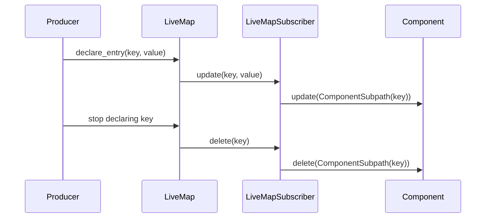

# Live Maps and Change Feeds

## Summary

`LiveMapFeed` delivers keyed changes to downstream processing components; `LiveMapView` also supports a scan of current items. `mount_each` connects those items to components identified by their keys. The in-memory `LiveMap` is both a target for producers and a view for consumers, so target-state ownership controls when entries appear and disappear. [python/cocoindex/_internal/live_component.py:470-495] [python/cocoindex/resources/live_map.py:231-241]

## Feed and view contracts

| Interface | Capability | Use |
|---|---|---|
| `LiveMapFeed` | `watch(subscriber)` delivers changes without requiring a snapshot. | Streaming sources such as Kafka. |
| `LiveMapView` | Adds iteration in Python or `scan()` in Rust. | Sources that can enumerate current state. |
| `LiveMapSubscriber` | Translates keyed updates, deletes and full scans into live component operations. | The bridge to per-item processing. |

Feeds permit one active watcher; fan-out belongs above the feed. In Python, a watch-only feed requires live mode, while a view can also be processed by a full scan. [python/cocoindex/_internal/live_component.py:470-495] [python/cocoindex/_internal/live_component.py:587-612] [rust/sdk/cocoindex/src/live_component.rs:541-571]

`mount_each` creates an internal live component for a feed. Its subscriber maps each key to a component subpath: `update` runs the item processor, `delete` removes the child, and `update_all` triggers a full pass. See [Component Mounting and Identity](component-mounting-and-identity.md) for path and readiness semantics. [python/cocoindex/_internal/api.py:450-471] [python/cocoindex/_internal/api.py:493-504] [python/cocoindex/_internal/live_component.py:498-539]



The entry reaches the map through target reconciliation; removal follows ownership cleanup. The subscriber then translates map changes into child operations. [python/cocoindex/resources/live_map.py:168-187] [python/cocoindex/_internal/live_component.py:527-539]

## Producing and consuming a LiveMap

Create the map inside a component, declare entries from producers, and pass it to `mount_each`. This test waits for the producer before starting the consumer’s scan: [python/tests/resources/test_live_map.py:122-131]

```python
    @coco.fn
    async def app_main() -> None:
        lm: LiveMap[str, Val] = await LiveMap.create()
        handle = await coco.mount(produce, lm, {"a": "1", "b": "2", "c": "3"})
        await handle.ready()
        await coco.mount_each(process_entry, lm)
```

`create()` mounts a backing target container; `declare_entry()` declares a child target state owned by the calling component. An entry is removed when its owner stops declaring it or disappears. The sink emits an upsert only when the value differs by `==`, and emits a delete only when the key exists. Python keys must be `StableKey`s; values need equality comparison but need not be hashable. [python/cocoindex/resources/live_map.py:168-187] [python/cocoindex/resources/live_map.py:231-241] [python/cocoindex/resources/live_map.py:271-282]

The map is in memory, not durable map storage. A fresh Python map starts empty on each creation and is refilled by declarations; a restart test verifies both refilling and removal of a previously declared entry. Keep a reference to the Python map while producers and consumers run: its registry is weak, and reconciliation fails if the map has been collected. [python/tests/resources/test_live_map.py:224-255] [python/cocoindex/resources/live_map.py:190-202]

## Snapshot and subscription ordering

Python `LiveMap.watch()` arms its queue **before** requesting `update_all()`. The scan copies entries and records the current sequence number; after `mark_ready()`, the watcher discards queued changes already represented in that snapshot. Later changes are delivered one at a time, waiting for each returned handle to become ready. The watcher is cleared even on cancellation or failure. [python/cocoindex/resources/live_map.py:284-324]

Rust’s `mount_each_live` adapter normally scans and marks ready before calling `watch`. Rust `LiveMap` checks whether the map changed between that scan and queue activation; if so, it rescans, then filters queued changes covered by the scan sequence. A durable feed may opt to skip the initial scan in live mode if it replays its backlog itself; catch-up still scans. [rust/sdk/cocoindex/src/live_component.rs:549-562] [rust/sdk/cocoindex/src/live_component.rs:618-635] [rust/sdk/cocoindex/src/resources/live_map.rs:184-229]

Both implementations reject a second concurrent watch and release the watcher when the first ends. Rust stores string keys and requires values to satisfy `LiveMapValue`, including serialization, cloning and equality. For lifecycle and catch-up details, see [Live Component Lifecycle](live-component-lifecycle.md). [python/cocoindex/resources/live_map.py:297-300] [rust/sdk/cocoindex/src/resources/live_map.rs:116-124] [rust/sdk/cocoindex/src/resources/live_map.rs:197-211] [rust/sdk/cocoindex/src/resources/live_map.rs:45-55]

## Terms

- **LiveMapFeed**: A single-subscriber source of keyed changes.
- **LiveMapView**: A feed that also exposes a current-state scan.
- **LiveMapSubscriber**: The adapter that turns feed changes into component operations.
- **LiveMap**: An in-memory target and view whose entries are owned by declaring components.