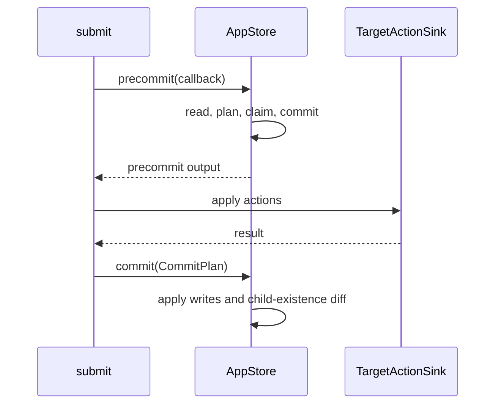

# LMDB Transactions and Write Batching

## Summary

Each `Storage` owns a single-writer batcher that coalesces concurrent transaction bodies into LMDB write transactions. Bodies must be safe to replay: the batcher can rerun them after another body fails or after a map resize. Submission uses separate precommit and commit transactions, with external sink actions between them. [rust/core/src/state_store/storage.rs:120-138] [rust/core/src/state_store/submit_session.rs:36-60]

## Batched writes

`Storage::run_txn` runs the first caller immediately and queues concurrent callers for a later batch. Bodies in a batch execute sequentially against the same transaction, amortizing commit and fsync costs. Ordinary app-store writes use this path; bypassing it loses batching. [rust/core/src/state_store/storage.rs:439-446] [rust/core/src/state_store/app_store.rs:77-91]

```rust
pub async fn run_txn<T, F>(&self, body: F) -> Result<T>
where
    T: Send + 'static,
    F: for<'a, 'env> Fn(&'a mut WriteTxn<'env>) -> BoxFuture<'a, Result<T>>
        + Send
        + Sync
        + 'static,
{
```

[rust/core/src/state_store/storage.rs:473-480]

The closure is `Fn` because it may execute more than once. Clone captures inside it and return results rather than accumulating external side effects: aborting LMDB does not undo those effects. Only the last execution’s output reaches the caller. [rust/core/src/state_store/storage.rs:125-138] [rust/core/src/state_store/storage.rs:456-463]

LMDB has no savepoints. If one body fails, the transaction aborts, the failing caller receives its error, preceding successful bodies rerun and commit, and later bodies continue in order. Transaction-level failures, such as a failed commit, reach every body in that transaction. [rust/core/src/state_store/storage.rs:179-195] [rust/core/src/state_store/storage.rs:203-235]

## Thread affinity and resizing

An LMDB write transaction must begin and end on the same OS thread. Moving it between Tokio workers can leave the writer lock held and block later writes. `TxnRunner` therefore runs the entire batch on a blocking-pool thread and uses `block_on` to poll its bodies there. Bodies should await only work belonging inside the transaction, because the writer lock remains held. [rust/core/src/state_store/storage.rs:319-337] [rust/core/src/state_store/storage.rs:465-468]

On `MDB_MAP_FULL`, whether raised by a body or commit, the runner drops the transaction and retries all its bodies after doubling the page-aligned map size. The initial map size is therefore not a fixed cap. [rust/core/src/state_store/storage.rs:244-278] [rust/core/src/state_store/storage.rs:281-306]

Every participating transaction holds a read guard on `EnvSlot`; resizing and closing take its write guard. Resize waits until those transactions have ended before calling `Env::resize`. Keep read transactions short: a long-lived reader delays resizing. [rust/core/src/state_store/txn.rs:1-7] [rust/core/src/state_store/txn.rs:25-32] [rust/core/src/state_store/app_store.rs:94-101]

## Submission plans



`PrecommitSession` exists only inside one precommit attempt. The callback reads current tracking and ownership, reconciles, and returns a `PrecommitWritePlan`. Claims are deferred until the callback returns a plan: if it returns `None` for `PendingRetry`, that body contributes no writes, allowing other bodies in the batch to commit. [rust/core/src/state_store/submit_session.rs:193-208] [rust/core/src/state_store/submit_session.rs:380-403]

After precommit commits, sink actions run outside the transaction. The final `CommitPlan` applies tracking records, owner changes, function memo writes and deletes, user state, and an optional child-existence reconciler in one transaction. Owner deletion checks that the component still owns the target. If sink application or final commit fails, the engine clears the stage marker. [rust/core/src/state_store/submit_session.rs:325-350] [rust/core/src/state_store/submit_session.rs:466-469] [rust/core/src/state_store/submit_session.rs:501-519] [rust/core/src/engine/execution.rs:1910-1955]

Reconciliation itself can run again during a precommit retry. Provider-generation updates are buffered until precommit succeeds, avoiding repeated `OnceLock` updates. For ownership and external action semantics, see [Ownership, Submission, and Cleanup](ownership-submission-and-cleanup.md). [rust/core/src/engine/execution.rs:843-850] [rust/core/src/engine/execution.rs:1016-1024]

The [state-store benchmark](benchmarks/state_store/README.md) exercises cold updates, warm memo hits, and drops with a no-op target, isolating state-store traffic from external I/O. [benchmarks/state_store/README.md:3-19]

## Terms

- **WriteTxn**: The transaction wrapper passed to batched write bodies. [rust/core/src/state_store/txn.rs:52-57]
- **PrecommitSession**: Transaction-scoped state for precommit reads and deferred claims. [rust/core/src/state_store/submit_session.rs:193-209]
- **CommitPlan**: Final tracking, ownership, memo, and user-state changes applied by `AppStore::commit`. [rust/core/src/state_store/submit_session.rs:325-350]