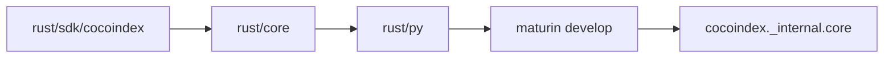

# Local Setup and Builds

## Summary

Install Rust and uv, enable prek, and build the Python extension with Maturin from the repository root. Rebuild the extension after Rust changes. For examples, `coco-dev-run` runs their commands with the local checkout installed as an editable dependency. [docs/src/content/docs/contributing/setup_dev_environment.mdx:10-56] [docs/src/content/docs/contributing/setup_dev_environment.mdx:58-77]

## Set up the checkout

1. Install Rust and uv. The workspace declares Rust 1.91.1, and the Python project requires Python 3.11 or later. [docs/src/content/docs/contributing/setup_dev_environment.mdx:12-34] [Cargo.toml:15-18] [pyproject.toml:5-11]
2. From the repository root, run `uv run prek install` to enable commit hooks. Optionally run `uv sync --all-extras` to install all optional dependencies. [docs/src/content/docs/contributing/setup_dev_environment.mdx:36-48]
3. Run `uv run maturin develop` to build and install the extension locally. Repeat it after changing Rust code. [docs/src/content/docs/contributing/setup_dev_environment.mdx:50-56]

The workspace contains the core, Python binding and Rust SDK crates. Maturin builds `rust/py` as the Python module `cocoindex._internal.core`; editable builds use the dev profile. [Cargo.toml:1-13] [rust/py/Cargo.toml:1-9] [pyproject.toml:59-69]



[rust/py/Cargo.toml:15-20] [pyproject.toml:59-69] [Cargo.toml:1-11]

## Dependencies and build variants

Optional dependencies are grouped by integration, including `postgres`, `lancedb`, `sentence_transformers` and `kafka`. The project also defines development and CI dependency groups. Installing all extras is convenient for broad work, while an example’s own project can declare the integrations it needs. [pyproject.toml:71-99] [pyproject.toml:142-164] [examples/text_embedding/pyproject.toml:1-12]

The Python binding enables `abi3` by default. For free-threaded Python, `dev/run_maturin_develop.sh` detects the interpreter and passes `--no-default-features`; `COCOINDEX_FREE_THREADED=1` can force that mode. The prek build hook uses this wrapper. [rust/py/Cargo.toml:11-13] [dev/run_maturin_develop.sh:4-8] [dev/run_maturin_develop.sh:14-29] [.pre-commit-config.yaml:66-71]

## Run an example against the checkout

Source `.env.lib_debug` at the repository root, then run an example from its directory. The helper selects the root `.python-version` when present, otherwise Python 3.11, and passes the checkout to `uv run --with-editable`. It also sets tracing and development server environment variables. [.env.lib_debug:1-20]

```sh
. ./.env.lib_debug
cd examples/text_embedding
coco-dev-run cocoindex update main
```

[docs/src/content/docs/contributing/setup_dev_environment.mdx:62-75]

Each example can need its own services and configuration. For `text_embedding`, start PostgreSQL with pgvector and copy `.env.example` to `.env`; the template sets both `COCOINDEX_DB` and `POSTGRES_URL`. See [Example Application Patterns](example-application-patterns.md) for other runnable pipelines. [examples/text_embedding/README.md:89-102] [examples/text_embedding/.env.example:1-7]

If Cargo tests fail because embedded Python cannot find `encodings`, the setup guide recommends `dev/run_cargo_test.sh`, which supplies Python paths for the command. See [Testing and Performance](testing-and-performance.md) for test workflows and [Contribution and Quality Checks](contribution-and-quality-checks.md) for pre-submission checks. [docs/src/content/docs/contributing/setup_dev_environment.mdx:79-99]

## Terms

- **`maturin develop`**: Builds and installs the Rust-backed Python extension for local development. [docs/src/content/docs/contributing/setup_dev_environment.mdx:50-56]
- **`coco-dev-run`**: Runs an example command with the repository as an editable dependency. [.env.lib_debug:10-20]
- **`abi3`**: Default PyO3 feature for the Python binding, disabled by the wrapper for free-threaded builds. [rust/py/Cargo.toml:11-13] [dev/run_maturin_develop.sh:4-8]