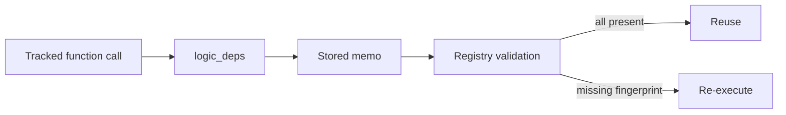

# Logic Change Detection

## Summary

Logic fingerprints let memoized work detect changes in the code and declared values it depended on. The engine stores those fingerprints with memo entries and validates them against the current logic registry before reuse. Tracking modes control how nested function dependencies reach callers; mounted child components propagate dependencies through the component tree. [rust/core/src/engine/execution.rs:81-108] [docs/src/content/docs/programming_guide/function.mdx:134-142]

## Fingerprint inputs

Python normally fingerprints a canonical AST, excluding decorators, docstrings, formatting and comments. If source is unavailable, it falls back to a bytecode hash. The module and qualified name distinguish identical bodies in different functions. [python/cocoindex/_internal/function.py:623-678]

| Option | Effect |
|---|---|
| `version` | Replaces source tracking with an explicit integer; body edits require a version bump to invalidate dependent memos. |
| `deps` | Folds external values into the fingerprint through the memo-key pipeline. |
| `logic_tracking` | Controls which function logic is recorded and propagated. |

For example, this test function declares a module-level prompt as a dependency: [python/tests/core/mod_logic_deps_v1.py:20-24]

```python
@coco.fn(memo=True, deps=_PROMPT)
def transform_memo_deps(key: str, value: str) -> str:
    assert _metrics is not None
    _metrics.increment("transform_memo_deps")
    return f"deps: {value}"
```

`deps` is snapshotted at decoration time, typically during import. Pass values that change per call or per instance as arguments instead. Combining `deps` with `logic_tracking=None` raises `ValueError`. [python/cocoindex/_internal/function.py:2073-2094]

Rust’s `#[cocoindex::function]` similarly computes a body hash or uses an explicit `version`; its tracking modes are spelled `"full"`, `"self"`, and `"none"`. [rust/sdk/cocoindex_macros/src/lib.rs:358-362] [rust/sdk/cocoindex_macros/src/lib.rs:446-457]

## Validation and propagation



A component memo must match its processor fingerprint and retain valid logic and target-provider dependencies. Function memos also validate stored logic dependencies. A missing fingerprint makes the stored entry stale; other memo validation rules are covered in [Memoization and State Reuse](memoization-and-state-reuse.md). [rust/core/src/engine/execution.rs:81-108] [rust/core/src/engine/context.rs:453-474]

The core registry counts registrations, so dropping one of several objects with the same fingerprint does not remove it prematurely. Python wrappers register when constructed and unregister when destroyed. Rust macros contribute entries to a link-time slice, registered once at app or environment startup. Validation accepts fingerprints in either the global registry or the environment’s logic set. [rust/core/src/engine/logic_registry.rs:10-25] [rust/core/src/engine/logic_registry.rs:39-59] [python/cocoindex/_internal/function.py:732-756] [rust/sdk/cocoindex/src/logic.rs:22-54]

| Python `logic_tracking` | Nested function behavior |
|---|---|
| `"full"` | Tracks the function and transitively offered child logic. |
| `"self"` | Tracks its own logic but does not propagate its callees’ logic through the function. |
| `None` | Tracks neither its own function logic nor its callees’ through that function. |

These modes govern nested function calls. Mounted child-component dependencies propagate through the component tree independently, including when a child memo is reused. Context-change dependencies also propagate regardless of function tracking mode. [docs/src/content/docs/programming_guide/function.mdx:134-145] [rust/core/src/engine/component.rs:668-695] [rust/core/src/engine/context.rs:1278-1285]

An existing memo records only dependencies offered when it was written. Adding tracking later cannot invalidate an entry that never recorded the new fingerprint; bump a memoized caller’s `version` or change its memo key to store a fresh entry. [python/cocoindex/_internal/function.py:2063-2072]

## Callbacks across tracking boundaries

`coco.logic_propagated_to_callers(fn)` carries the logic a callback already offers through `"self"` or `None` frames to the function that wrapped it, recording it in intervening memo entries. It does not itself make the callback tracked. The owner’s mode determines whether that logic propagates further upward. [python/cocoindex/_internal/logic_propagated_to_callers.py:149-169]

The wrapper is valid only during its owner’s call; invoking it later raises `RuntimeError`. A plain callable that returns an awaitable is rejected because its body would execute outside the collector frame. `logic_tracked` remains a deprecated alias. [python/cocoindex/_internal/logic_propagated_to_callers.py:85-97] [python/cocoindex/_internal/logic_propagated_to_callers.py:114-140] [python/cocoindex/_internal/logic_propagated_to_callers.py:211-225]

## Terms

- **Logic fingerprint**: An identity derived from a function’s logic and declared dependencies.
- **`logic_deps`**: Fingerprints stored with a memo for later validation.
- **`logic_tracking`**: The mode controlling function-logic propagation.
- **`deps`**: External values included in a Python function’s logic fingerprint.
- **`logic_propagated_to_callers`**: A callback wrapper that carries offered logic through intermediate tracking boundaries.