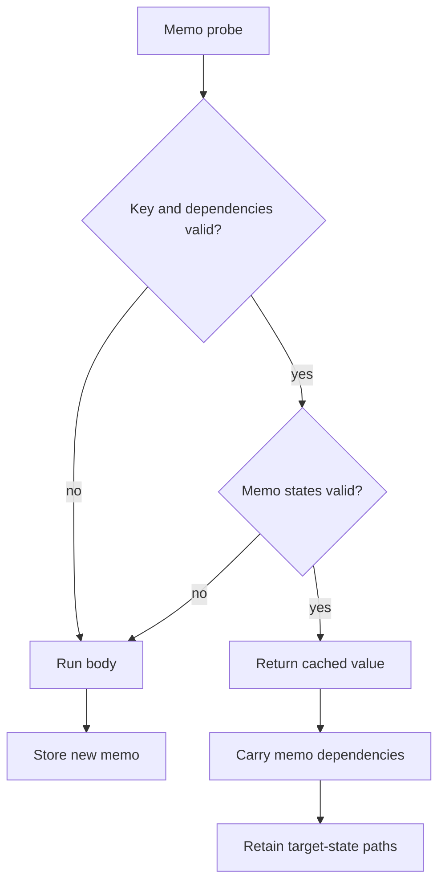

# Memoization and State Reuse

## Summary

CocoIndex can reuse a whole component execution or an individual function call when its memo key and tracked dependencies remain valid. A cache hit skips the body, but the engine retains its target declarations and carries dependencies into enclosing memos. External state can invalidate a matching key or be refreshed without rerunning the body. [rust/core/src/engine/component.rs:650-700] [rust/core/src/engine/function.rs:11-27]

## Two levels of reuse

| Level | Cache scope | Cache hit |
|---|---|---|
| Component | The component at its stable path | Returns the stored result without processing or submitting the component again. |
| Function | Calls within a component, keyed by call fingerprint | Returns the stored value while preserving memo dependencies and target-state paths. |

A Python function decorated with `@coco.fn(memo=True)` can use either path: mounting it supplies a component memo fingerprint; calling it inside a component reserves a function memo entry. A memoized function call that mounts children raises an error: mount the function itself as a component, or disable its function memoization. [python/cocoindex/_internal/function.py:832-845] [python/cocoindex/_internal/function.py:950-972] [rust/core/src/engine/function.rs:111-124]

A component hit requires a matching processor fingerprint, valid logic dependencies and valid target-provider generations. A normal hit avoids execution; `full_reprocess` skips the previous-run fast path. Concurrent runs serialize on the component build permit and recheck for a memo stored while they waited. [rust/core/src/engine/execution.rs:100-115] [rust/core/src/engine/component.rs:1129-1146] [rust/core/src/engine/component.rs:1163-1193]

## Keys and state validation

Python call fingerprints include function identity, positional arguments and sorted keyword arguments. Values can supply `__coco_memo_key__()` or use a registered key function. A per-function `memo_key` can transform a parameter or exclude it with `None`; excluded information cannot invalidate the memo through that key. [python/cocoindex/_internal/memo_fingerprint.py:301-328] [python/cocoindex/_internal/memo_fingerprint.py:387-416] [python/cocoindex/_internal/function.py:450-460]

A stable identity can be paired with a separate freshness check. This test object keys by name and version, then validates external state independently: [python/tests/core/test_memo_state_validation.py:38-46]

```python
    def __coco_memo_key__(self) -> object:
        return (self.name, self.version)

    def __coco_memo_state__(self, prev_state: Any) -> coco.MemoStateOutcome:
        # State changed → not reusable (simple case matching prior behavior)
        memo_valid = (
            not coco.is_non_existence(prev_state) and self.state_value == prev_state
        )
        return coco.MemoStateOutcome(state=self.state_value, memo_valid=memo_valid)
```

On a matching memo, state functions receive the stored state and return a new state plus `memo_valid`. All checks must allow reuse. The state may change while the result remains valid—for example, a file timestamp changes but its content fingerprint does not—so the engine stores the refreshed state without rerunning the body. Tracked context values can also supply state checks. [python/cocoindex/_internal/function.py:186-226] [python/cocoindex/_internal/function.py:334-367] [rust/core/src/engine/component.rs:673-688]

If validation requires a function to rerun and its new dependencies are known only after execution, `recollect_after_run=True` requests another state collection. This option is supported for memoized functions, not memoized components. [python/cocoindex/_internal/typing.py:71-85] [python/cocoindex/_internal/function.py:1013-1023]

Rust’s `MemoInput` separates `write_memo_key` from optional async `memo_state`. The SDK’s `memo_key` projection or skip override replaces the parameter’s normal identity and suppresses its type-owned state validation. Manual `Ctx::memo` blocks do not automatically track their closure’s logic. [rust/sdk/cocoindex/src/memo.rs:1-29] [rust/sdk/cocoindex/src/memo.rs:49-75]

## What a cache hit preserves



Function memo entries record target-state paths, nested memo dependencies, provider generations, logic dependencies and state alongside the return value. On a hit, the caller records the cached memo dependency and provider generations. During finalization, the engine walks reachable memo dependencies and marks their target-state paths as contained, preventing cleanup of declarations whose bodies did not run. [rust/core/src/engine/function.rs:11-27] [python/cocoindex/_internal/function.py:885-898] [rust/core/src/engine/execution.rs:2142-2202]

Component hits similarly report their stored logic and provider dependencies to the parent, so a rebuilt parent does not lose dependencies from a reused subtree. Concurrent function calls for the same fingerprint hold a write lock through validation and possible execution, preventing duplicate re-execution for that key. [rust/core/src/engine/component.rs:691-700] [rust/core/src/engine/function.rs:31-40]

Logic fingerprints and their propagation have additional rules; see [Logic Change Detection](logic-change-detection.md).

## Terms

- **Memo key**: A fingerprint identifying inputs for a reusable call or component execution.
- **Memo state**: Stored validation data checked after a key match.
- **`MemoStateOutcome`**: A state function’s new state and reuse decision.
- **Dependency memo entry**: A nested memo referenced so its cached declarations remain reachable.