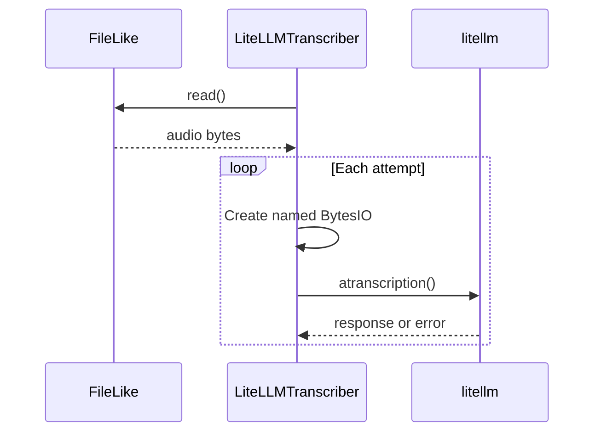

# Model Calls and Multimodal Processing

## Summary

Python’s `LiteLLMEmbedder` and `LiteLLMTranscriber` route hosted text embedding and audio transcription requests through LiteLLM. Rust’s feature-gated `ops::api` uses HTTP directly for OpenAI-compatible embeddings, transcription, and JSON chat. Examples also show direct model calls for paper metadata and local CLIP processing for image search. [python/cocoindex/ops/litellm.py:1-5] [rust/sdk/cocoindex/src/ops/api.rs:1-14] [rust/sdk/cocoindex/src/ops/mod.rs:14-18]

## Hosted operations

| Operation | Python | Rust |
|---|---|---|
| Text embeddings | `LiteLLMEmbedder.embed()` batches concurrent calls and returns a NumPy `float32` vector. | `ApiEmbedder.embed()` or `embed_batch()` sends texts to `/embeddings` and returns `Vec<f32>`. |
| Audio transcription | `LiteLLMTranscriber.transcribe()` reads a `FileLike` and calls LiteLLM. | `ApiTranscriber.transcribe()` or `transcribe_bytes()` uploads multipart audio to `/audio/transcriptions`. |
| JSON chat | The paper metadata example calls an OpenAI client directly. | `ApiChatClient.chat_json()` requests a JSON object and returns the assistant content as a string. |

[rust/sdk/cocoindex/src/ops/api.rs:120-149] [rust/sdk/cocoindex/src/ops/api.rs:264-301] [rust/sdk/cocoindex/src/ops/api.rs:384-414] [python/cocoindex/ops/litellm.py:482-545] [python/cocoindex/ops/litellm.py:604-654] [examples/paper_metadata/main.py:130-158]

Rust clients default to the OpenAI base URL and `OPENAI_API_KEY`; their builders allow a different compatible endpoint or key. Python passes provider options such as `api_key` and `api_base` through to LiteLLM. For local models and vector schema details, see [Embedding Models and Vector Types](embedding-models-and-vector-types.md). [rust/sdk/cocoindex/src/ops/api.rs:225-255] [python/cocoindex/ops/litellm.py:340-357]

## Embedding requests

Python memoizes individual `embed` calls and groups concurrent calls with the same `input_type` into batches of up to 64. Both implementations discover vector dimensions by embedding `"hello"` and cache the result. Python validates response counts and indices, rejecting mixed indexed and unindexed results; Rust sorts and validates indices when every item has one, otherwise retaining response order. [python/cocoindex/ops/litellm.py:466-500] [python/cocoindex/ops/litellm.py:525-555] [python/cocoindex/ops/litellm.py:296-325] [rust/sdk/cocoindex/src/ops/api.rs:152-162] [rust/sdk/cocoindex/src/ops/api.rs:199-219]

Text beginning with `gs://`, `files/`, or a base64 `data:` prefix receives a leading space in Python. This prevents LiteLLM from interpreting corpus text as a media reference. For embedding failures other than timeouts and global credential or model errors, Python requests smaller batches so a payload limit or problematic input can be isolated. [python/cocoindex/ops/litellm.py:266-293] [python/cocoindex/ops/litellm.py:504-523]

## Audio and retries

The audio example memoizes a processing function that transcribes each file and declares a row keyed by filename: [examples/audio_to_text/main.py:31-37] [examples/audio_to_text/main.py:49-60]

```python
@coco.fn(memo=True)
async def process_file(
    file: localfs.File,
    table: postgres.TableTarget[AudioTranscription],
) -> None:
    transcript = await _transcriber.transcribe(file)
    table.declare_row(
        row=AudioTranscription(
            filename=str(file.file_path.path),
            text=transcript,
        ),
    )
```

[examples/audio_to_text/main.py:49-60]

Python reads the whole audio file once, then makes a fresh named buffer for each attempt so a retry does not upload a buffer already read to EOF. Constructor options bound the request and provide defaults; per-call options can override provider arguments, but not `timeout`. Rust likewise rebuilds its multipart request on each attempt. [python/cocoindex/ops/litellm.py:604-654] [rust/sdk/cocoindex/src/ops/api.rs:264-295]

The retry policies differ. Python retries classified transient failures with exponential backoff inside a deadline—ten minutes by default—but treats timeouts as terminal. Rust retries HTTP 429, server errors, connection errors, and timeouts up to three times after the first attempt, honoring a bounded `Retry-After`. [python/cocoindex/ops/litellm.py:204-263] [python/cocoindex/ops/litellm.py:40-44] [rust/sdk/cocoindex/src/ops/api.rs:34-70]



[python/cocoindex/ops/litellm.py:634-654]

## JSON and image examples

The paper metadata example extracts first-page PDF text, asks a chat model for a JSON object, and validates the returned content as `PaperMetadataModel`. The built-in Rust `ApiChatClient` also requests JSON-object output, but returns the raw content for its caller to interpret. For the structured pair-resolver built on these model calls, see [Entity Resolution](entity-resolution.md). [examples/paper_metadata/main.py:122-158] [rust/sdk/cocoindex/src/ops/api.rs:384-414]

The image-search example loads a CLIP model and processor, converts image bytes to RGB, and declares Qdrant points containing image vectors. Its search endpoint embeds text with the same model and queries those vectors. [examples/image_search/pipeline.py:48-75] [examples/image_search/pipeline.py:88-101] [examples/image_search/api.py:69-83]

## Terms

- **LiteLLMEmbedder**: Python wrapper for hosted text embeddings and vector schema discovery. [python/cocoindex/ops/litellm.py:328-338]
- **LiteLLMTranscriber**: Python wrapper that transcribes `FileLike` audio through LiteLLM. [python/cocoindex/ops/litellm.py:564-568]
- **ApiChatClient**: Rust client that requests JSON-object chat responses from a compatible HTTP endpoint. [rust/sdk/cocoindex/src/ops/api.rs:340-346] [rust/sdk/cocoindex/src/ops/api.rs:384-392]