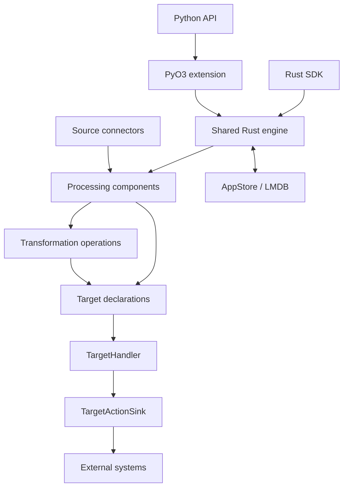

# Overview

CocoIndex builds incremental data pipelines: an app reads sources, transforms their content, and declares the external state that should exist. Its shared Rust engine reuses valid prior work, reconciles target declarations, and persists tracking for later updates. Python and native Rust interfaces provide separate ways to program that engine. [examples/text_embedding/main.py:91-130] [rust/core/src/engine/execution.rs:81-111] [rust/core/src/engine/profile.rs:35-46]

## How the main parts fit

An `App` starts with a root processing component. Pipeline code mounts children for keyed inputs, calls transformation operations, and declares target states through connectors. An `Environment` supplies storage, target providers, and host runtime context; each app opens its own `AppStore`. [rust/core/src/engine/app.rs:87-105] [rust/core/src/engine/environment.rs:17-28] [examples/text_embedding/main.py:104-123]



The language adapters select processors, values, handlers, and sinks through `EngineProfile`. Sources and operations feed processing; target handlers determine actions, and sinks apply them. Persistent state connects one execution to the next. [rust/core/src/engine/profile.rs:35-46] [rust/py/src/profile.rs:13-24] [rust/sdk/cocoindex/src/profile.rs:31-43] [rust/core/src/state_store/submit_session.rs:36-57]

| Part | Responsibility |
|---|---|
| Python API and extension | Expose Python pipeline programming and adapt Python execution and values to core. |
| Native Rust SDK | Adapt Rust processors, context resources, values, and target implementations directly to core. |
| Shared engine | Coordinate components, memo reuse, reconciliation, and submission. |
| Connectors | Supply source inputs or implement target-specific reconciliation and writes. |
| Operations | Produce transformed values such as chunks and embeddings. |
| Persistent state | Retain memos, user state, target tracking, and child-component existence. |

These responsibilities are reflected in the two profile implementations, the example pipeline, and the persisted record types. [rust/py/src/profile.rs:13-24] [rust/sdk/cocoindex/src/profile.rs:31-43] [examples/text_embedding/main.py:91-123] [rust/core/src/state/db_schema.rs:63-90]

## A pipeline in practice

The text-embedding example uses one memoized processor per file. It reads Markdown, splits it into chunks, and maps a chunk processor over them:

```python
@coco.fn(memo=True)
async def process_file(
    file: FileLike,
    table: postgres.TableTarget[DocEmbedding],
) -> None:
    text = await file.read_text()
    chunks = _splitter.split(
        text, chunk_size=2000, chunk_overlap=500, language="markdown"
    )
    id_gen = IdGenerator()
    await coco.map(process_chunk, chunks, file.file_path.path, id_gen, table)
```

[examples/text_embedding/main.py:91-101]

The app creates a PostgreSQL table target, declares a vector index, walks the source directory, and passes keyed files to `mount_each`. This places incremental boundaries around individual files rather than requiring the application to maintain its own update queue. Follow [Declarative Processing Model](declarative-processing-model.md) for the complete path through these concepts. [examples/text_embedding/main.py:104-123]

## What to understand early

**Reuse depends on validity, not merely a previous result.** Component memoization checks the processor fingerprint, logic dependencies, and target-provider dependencies before accepting stored work. Start with [Memoization and State Reuse](memoization-and-state-reuse.md) when investigating unexpected recomputation. [rust/core/src/engine/execution.rs:81-111]

**External writes and internal commits are separate stages.** Submission records claims in precommit, applies sink actions, and then commits finalized tracking. A `TargetHandler.reconcile` call must remain free of side effects because it can run more than once. Read [Target Reconciliation](target-reconciliation.md) before implementing a target connector. [rust/core/src/state_store/submit_session.rs:41-60] [python/cocoindex/_internal/target_state.py:526-554]

**Live sources have different contracts.** `LiveMapFeed` provides changes without a scannable snapshot; `LiveMapView` adds current-state iteration. Feeds permit one active watcher, so downstream fan-out belongs above that interface. See [Live Maps and Change Feeds](live-maps-and-change-feeds.md). [python/cocoindex/_internal/live_component.py:470-495]

## Where to read next

Choose a section by the question you need to answer:

| Section | Read it for |
|---|---|
| [System Architecture](system-architecture.md) | The declarative model, shared engine, and language boundaries. |
| [Incremental Execution](incremental-execution.md) | App updates, mounting, function execution, memoization, and live processing. |
| [Target Reconciliation](target-reconciliation.md) | Declarations, ownership, external actions, and cleanup. |
| [Source and Target Connectors](source-and-target-connectors.md) | Integration capabilities and system-specific reads and writes. |
| [Transformation and Intelligence](transformation-and-intelligence.md) | Splitting, code analysis, embeddings, model calls, and entity resolution. |
| [Runtime and Shared Mechanisms](runtime-and-shared-mechanisms.md) | Environments, resources, persistence, concurrency, and operational visibility. |
| [Development](development.md) | Building, testing, contributing, examples, and releases. |
| [Glossary](glossary.md) | Quick definitions while reading implementation pages. |

The implementation separates engine contracts, pipeline composition, reconciliation, operations, and persistent records; contributor checks cover both Python and Rust consumers. [rust/core/src/engine/profile.rs:35-46] [examples/text_embedding/main.py:91-123] [rust/core/src/state_store/submit_session.rs:36-60] [rust/core/src/state/db_schema.rs:63-90] [AGENTS.md:49-59]

For a first change, follow the example closest to your workload, then read its subsystem page. Python packages the engine as `cocoindex._internal.core` through Maturin; core API changes also require checking the native Rust SDK and standalone consumers. [pyproject.toml:59-69] [AGENTS.md:59]