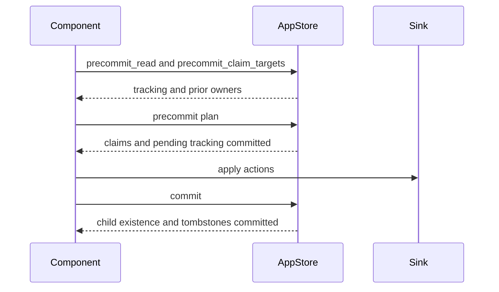

# Ownership, Submission, and Cleanup

## Summary

A component’s submission claims target states, applies external actions, and then commits finalized tracking. Ownership is recorded before sink application, so interrupted submissions can leave several possible previous states for the next reconciliation. Disappearing components are cleaned up through durable tombstones. [rust/core/src/state_store/submit_session.rs:29-60] [rust/core/src/state/db_schema.rs:397-425]

## Submission order

The store keeps both component tracking and an inverted index from `TargetStatePath` to its owning component. Submission uses these records to coordinate ownership before touching external systems. [rust/core/src/state/db_schema.rs:420-439]



The engine drives this sequence after the processor runs. Precommit and final commit use separate transactions; sink actions run between them. [rust/core/src/state_store/submit_session.rs:29-60]

1. `precommit_read` reads the component’s tracking and pending token. The engine claims only paths absent from its existing tracking; `precommit_claim_targets` reads their prior owners and those owners’ tracking. [rust/core/src/state_store/submit_session.rs:96-153]
2. The engine reconciles declarations and prepares tracking changes. If it can proceed, the precommit transaction writes claims, new tracking, and updates to displaced owners. Claims are deferred until this decision because LMDB has no per-body savepoints. [rust/core/src/state_store/submit_session.rs:254-260] [rust/core/src/state_store/submit_session.rs:425-450]
3. The engine builds child handlers and applies sink actions. It then commits finalized tracking, ownership cleanup, memo and user-state changes, and the child-existence diff. Child handlers are fulfilled after commit. [rust/core/src/engine/execution.rs:1910-1963] [rust/core/src/state_store/submit_session.rs:466-469]

For handler and sink behavior during application, see [Custom Target Handlers and Sinks](custom-target-handlers-and-sinks.md). Transaction batching is covered in [LMDB Transactions and Write Batching](lmdb-transactions-and-write-batching.md).

## Ownership transfer and failures

When a new component claims a path owned by another, the engine takes the matching prior tracking item and removes that path from the old owner’s tracking. The new owner can reconcile against the old value, while later cleanup of the old owner cannot treat the transferred item as its own. [rust/core/src/engine/execution.rs:1068-1105]

A claimant encountering a live in-process update to the contested item backs off and retries. The retry is bounded: after eight attempts the submission reports an error. [rust/core/src/engine/execution.rs:928-980] [rust/core/src/engine/execution.rs:1750-1762] [rust/core/src/engine/execution.rs:1864-1879]

A sink or commit failure clears the live stage marker, but the earlier claim and possible tracking states can remain. The transfer test shows that a subsequent healthy update reconciles against both the old applied value and the attempted new value. The engine’s missing-state calculation is separate: for example, a recorded deletion makes the target potentially absent. [rust/core/src/engine/execution.rs:1939-1955] [python/tests/core/test_ownership_transfer.py:530-557] [rust/core/src/engine/execution.rs:1119-1137]

## Cleanup

When a declaration disappears, the engine reconciles its tracked entry with no desired value. A removed container’s deletion action subsumes its children, so stale child entries are pruned instead of receiving individual delete actions. [rust/core/src/engine/execution.rs:1303-1314] [rust/core/src/engine/execution.rs:1326-1365]

Commit protects transferred ownership with an explicit check:

```rust
let still_ours = app_store
    .read_target_state_owner_in_txn(wtxn, target_path)
    .await?
    .is_some_and(|info| info.component_path == component_path);
if still_ours {
    app_store
        .delete_target_state_owner(wtxn, target_path)
        .await?;
}
```

This prevents an old component’s cleanup from deleting the new owner’s index entry. [rust/core/src/state_store/submit_session.rs:506-519]

For disappeared components, the commit transaction compares declared child paths with persisted child-existence rows. It removes missing entries and writes tombstones for component leaves, descending through directory nodes as needed. After commit, the engine reads tombstones and launches child deletion; failed descendant cleanup leaves tombstones for a later retry. [rust/core/src/state_store/submit_session.rs:578-594] [rust/core/src/engine/execution.rs:663-688] [rust/core/src/engine/component.rs:1354-1369]

## Terms

- **Inverted tracking**: The index mapping a target-state path to its owning component. [rust/core/src/state/db_schema.rs:420-425]
- **Precommit**: The transaction that prepares tracking and claims before sink actions run. [rust/core/src/state_store/submit_session.rs:41-51]
- **Tombstone**: A durable marker for a disappeared component awaiting cleanup. [rust/core/src/state_store/submit_session.rs:578-594]