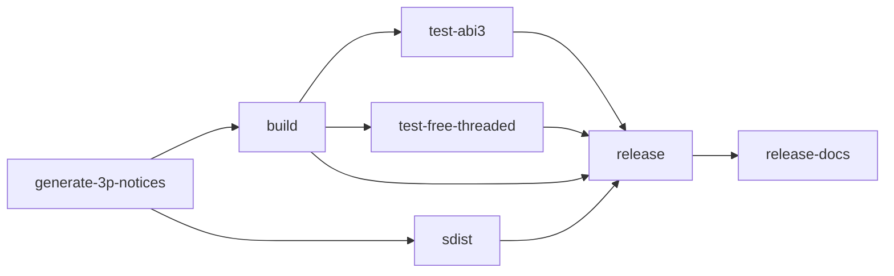

# Packaging and Releases

## Summary

Maturin packages the Python library with its Rust extension. A `v*` tag triggers version synchronization, wheel and source distribution builds, import checks, and publication to PyPI; a successful release then deploys the docs. A manual run on a branch builds and validates artifacts without publishing them. [.github/workflows/release.yml:1-11] [.github/workflows/release.yml:203-244]

## Package configuration

`pyproject.toml` points Maturin at the `cocoindex_py` crate and installs its PyO3 extension as `cocoindex._internal.core`. Normal builds use the release profile; editable builds use the dev profile. The package also installs the `cocoindex` CLI entry point. [pyproject.toml:56-69]

```toml
[project.scripts]
cocoindex = "cocoindex.cli:cli"

[tool.maturin]
bindings = "pyo3"
python-source = "python"
module-name = "cocoindex._internal.core"
features = ["pyo3/extension-module"]
include = ["THIRD_PARTY_NOTICES.html"]
# Point to the crate within the workspace
manifest-path = "rust/py/Cargo.toml"
```

[pyproject.toml:56-66]

## Version synchronization

`update_version.py` reads `GITHUB_REF` and acts only on `refs/tags/v<version>`. It sets the Cargo workspace version, writes both `__version__` and `CORE_VERSION` to Python’s `_version.py`, and replaces the dynamic Python project version with the PyPI-compatible value. Without a matching tag, it exits successfully without changes. [.github/scripts/update_version.py:25-28] [.github/scripts/update_version.py:85-103] [.github/scripts/update_version.py:107-134]

| Tag version | Cargo and `CORE_VERSION` | Python package version |
|---|---|---|
| `1.0.0` | `1.0.0` | `1.0.0` |
| `1.0.0-alpha.1` | `1.0.0-alpha.1` | `1.0.0a1` |
| `1.0.0-beta.2` | `1.0.0-beta.2` | `1.0.0b2` |
| `1.0.0-rc.1` | `1.0.0-rc.1` | `1.0.0rc1` |

[.github/scripts/update_version.py:36-62] [.github/scripts/update_version.py:125-134]

The Python package checks the extension’s reported version against `CORE_VERSION` when the extension exposes a version. A mismatch raises a diagnostic error; mixed installations or a stale extension are possible causes. [python/cocoindex/_version_check.py:8-18] [python/cocoindex/_version_check.py:21-45]

## Build, validate, publish

The release jobs generate third-party notices before building wheels and the source distribution. Publication waits for both builds and the wheel import checks. [.github/workflows/release.yml:17-45] [.github/workflows/release.yml:178-206]



[.github/workflows/release.yml:43-45] [.github/workflows/release.yml:142-144] [.github/workflows/release.yml:159-161] [.github/workflows/release.yml:178-180] [.github/workflows/release.yml:203-206] [.github/workflows/release.yml:240-244]

| Artifact | Build and validation |
|---|---|
| Standard wheels | ABI3 wheels for Linux, macOS and Windows; the Linux x86-64 wheel is installed and imported on Python 3.11–3.14. |
| Free-threaded wheels | Python 3.14t wheels built with `--no-default-features`; the Linux x86-64 wheel is installed and imported on a verified free-threaded interpreter. |
| Source distribution | Built by Maturin and uploaded as a workflow artifact. |

[.github/workflows/release.yml:49-108] [.github/workflows/release.yml:142-175] [.github/workflows/release.yml:178-201]

The extension’s default `abi3` feature targets Python 3.11 and later; the free-threaded build disables default features. After validation, the tag-only `release` job generates artifact attestations and uploads the artifacts to PyPI with `--skip-existing`. [.github/workflows/release.yml:82-108] [rust/py/Cargo.toml:11-13] [.github/workflows/release.yml:203-238]

For local builds, see [Local Setup and Builds](local-setup-and-builds.md). For operating applications, see [Environment Configuration and Lifecycle](environment-configuration-and-lifecycle.md) and [App Execution and CLI](app-execution-and-cli.md).

## Terms

- **ABI3**: PyO3’s stable-ABI feature used by the standard extension builds. [rust/py/Cargo.toml:11-13]
- **`CORE_VERSION`**: Rust version recorded in the Python package for checking the loaded extension. [.github/scripts/update_version.py:85-91] [python/cocoindex/_version_check.py:8-18]
- **sdist**: Source distribution built and uploaded alongside wheels. [.github/workflows/release.yml:178-201]