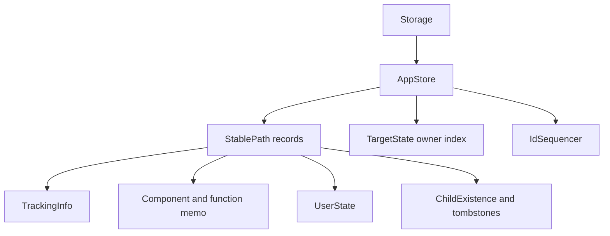

# Persistent State and User State

## Summary

An environment’s LMDB `Storage` contains a named `AppStore` for each app. The store holds component paths, target ownership and tracking records, memoized values, and component-owned user state. Stable paths let later runs find the records belonging to the same component. [rust/core/src/state_store/storage.rs:343-345] [rust/core/src/state_store/storage.rs:502-509] [rust/core/src/state/db_schema.rs:63-90]

## App stores and records

`AppStore` wraps a named LMDB database and its parent `Storage`. Its `*_in_txn` reads see uncommitted writes in the supplied transaction; standalone reads open a fresh snapshot. The underlying database stores opaque bytes, with logical keys defined by `db_schema`. [rust/core/src/state_store/app_store.rs:1-15] [rust/core/src/state_store/app_store.rs:40-53]



[rust/core/src/state/db_schema.rs:63-90] [rust/core/src/state/db_schema.rs:157-181]

| Record | Purpose |
| --- | --- |
| `TrackingInfo` | Component version, processor name, target-state items, and pending process token. |
| `TargetState` | Inverted index from target path to owning component. |
| `ChildExistence` / `ChildComponentTombstone` | Record child paths and pending component cleanup. |
| `ComponentMemoization` / `FunctionMemoization` | Store return values and dependencies needed for reuse. |
| `UserState` | Store opaque values keyed by component path, state kind, and stable key. |

[rust/core/src/state/db_schema.rs:63-90] [rust/core/src/state/db_schema.rs:263-321] [rust/core/src/state/db_schema.rs:420-451]

A target-state item can contain multiple versioned states during a submission or after an interrupted attempt; after successful commit it has at most one. These records support reconciliation and recovery; see [Ownership, Submission, and Cleanup](ownership-submission-and-cleanup.md). [rust/core/src/state/db_schema.rs:363-381] [rust/core/src/state/db_schema.rs:397-416]

Component and function memo records include return values, logic dependencies, tracked states, and target-provider generations. Function records also retain declared target paths and dependency memo entries. Their reuse rules are covered in [Memoization and State Reuse](memoization-and-state-reuse.md). [rust/core/src/state/db_schema.rs:270-321]

## Explicit user state

`coco.use_state()` declares a value owned by the current component and stable key. The first run receives the initial value; later runs receive the previous committed value. Different component paths have independent state, and deleting a component removes its state. [python/cocoindex/_internal/api.py:796-819] [python/tests/core/test_use_state.py:103-139]

```python
@coco.fn
def _process_item(item: str) -> None:
    handle = coco.use_state("counter", 0)
    _captured[item] = handle.value
    handle.value = handle.value + 1
```

[python/tests/core/test_use_state.py:53-57]

A normal build prefetches function memos and regular user state together. At commit, keys declared through `use_state` survive; previously stored keys not redeclared in that build are deleted. With `full_reprocess`, prefetch is skipped and existing regular state is cleared before newly declared values are written. [rust/core/src/engine/context.rs:499-519] [rust/core/src/engine/context.rs:860-893]

Python serializes the final value at commit, so repeated assignments do not each serialize it, and serialization errors surface at commit. An optional `type_hint` controls decoding. Python rejects duplicate keys, use inside a `component_subpath` block, and use inside an inline memoized function: a cache hit could otherwise skip the declaration. [python/cocoindex/_internal/api.py:810-829] [python/cocoindex/_internal/api.py:834-848] [python/tests/core/test_use_state.py:170-173]

The Rust SDK provides `Ctx::use_state(key, initial_value)` and `StateHandle::value()` / `set()`. It accepts string keys or `StableKey`, requires Serde serialization and deserialization, and uses MessagePack. [rust/sdk/cocoindex/src/ctx.rs:607-632] [rust/sdk/cocoindex/src/user_state.rs:42-47] [rust/sdk/cocoindex/src/user_state.rs:76-95]

`StateKind::Live` is reserved for live-component machinery and is isolated from the regular state flush. Whole-component deletion clears both kinds. See [Live Component Lifecycle](live-component-lifecycle.md) for the live processing model. [rust/core/src/state/db_schema.rs:20-35] [rust/core/src/engine/execution.rs:470-477]

Writes and commit plans are explained in [LMDB Transactions and Write Batching](lmdb-transactions-and-write-batching.md); value encoding is covered in [Types, Serialization, and Fingerprints](types-serialization-and-fingerprints.md).

## Terms

- **AppStore**: The per-app LMDB database handle within a `Storage`. [rust/core/src/state_store/app_store.rs:44-53]
- **TrackingInfo**: A component’s persisted version and target-state tracking records. [rust/core/src/state/db_schema.rs:434-451]
- **StateHandle**: The API handle used to read and update component-owned user state. [python/cocoindex/_internal/api.py:752-757]