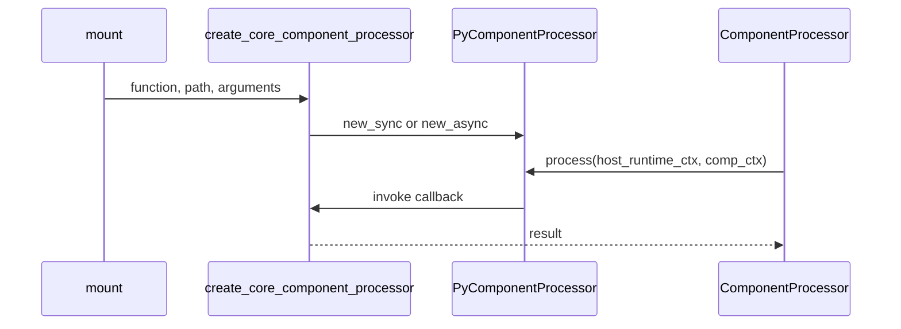

# Processing Functions

## Summary

`@coco.fn` wraps Python functions so their calls participate in change detection and can optionally be memoized. It preserves whether the original function is synchronous or asynchronous; `@coco.fn.as_async` always exposes an async interface. When mounted, a function is adapted to the shared engine’s `ComponentProcessor` interface. [docs/src/content/docs/programming_guide/function.mdx:12-23] [python/cocoindex/_internal/function.py:2163-2180] [rust/py/src/component.rs:86-105]

## Calling and mounting

A decorated function can be called normally or used as a component processor. This test uses a memoized method as a helper within another decorated method: [python/tests/core/test_function_class_methods.py:34-48]

```python
class Processor:
    """Test class with regular instance methods."""

    def __init__(self, prefix: str):
        self.prefix = prefix

    @coco.fn(memo=True)
    def transform(self, entry: SourceDataEntry) -> str:
        _metrics.increment("call.transform")
        return f"{self.prefix}: {entry.content}"
```

`memo=True` enables reuse; outside a component context, a direct call still executes but bypasses memoization. A directly called memoized function cannot mount child components. The same function can instead be mounted as a component, whose memo can cover its children. Add return annotations when cached values need reconstruction as their original types. [python/cocoindex/_internal/function.py:794-809] [docs/src/content/docs/programming_guide/function.mdx:65-73]

Logic tracking and caching are separate: a decorated non-memoized function can contribute logic dependencies to a memoized caller. See [Logic Change Detection](logic-change-detection.md) and [Memoization and State Reuse](memoization-and-state-reuse.md) for their rules. [docs/src/content/docs/programming_guide/function.mdx:36-48]

## Sync, async, and methods

| Interface | Execution |
|---|---|
| `@coco.fn` on `def` | Returns a synchronous `SyncFunction`. |
| `@coco.fn` on `async def` | Returns an `AsyncFunction`. |
| `@coco.fn.as_async` | Returns an `AsyncFunction` for either kind of body. |
| `function.as_async()` | Provides an async call without changing the primary interface. |

For an unscheduled async wrapper, an async body is awaited directly; a sync body runs through `asyncio.to_thread`. Batching and runners require `@coco.fn.as_async`; passing them to `@coco.fn` raises `ValueError`. See [Concurrency, Batching, and Rate Limits](concurrency-batching-and-rate-limits.md) for scheduling details. [python/cocoindex/_internal/function.py:1954-2002] [python/cocoindex/_internal/function.py:1522-1534] [python/cocoindex/_internal/function.py:2100-2106]

Descriptor binding creates a wrapper that inserts the instance as the first argument for calls and mounted processors. Consequently, `self` participates in memoization unless customized; `memo_key={"self": ...}` can select the instance state relevant to the result. The tests also cover static and class methods. [python/cocoindex/_internal/function.py:1066-1100] [python/cocoindex/_internal/function.py:1152-1187] [python/tests/core/test_function_class_methods.py:126-146] [python/tests/core/test_function_class_methods.py:200-207]

A batched Python body receives a list and runs outside the calling components. Resolve context values before calling it and pass them as arguments. The first input is batched; other arguments, including method `self`, select which calls can share a batch. [docs/src/content/docs/programming_guide/function.mdx:346-357] [docs/src/content/docs/programming_guide/function.mdx:378-395]

## Processor adapters



`create_core_component_processor` uses a decorated function’s `_core_processor` when present; otherwise it builds an adapter for a plain sync or async function. The Python callback enters component context before invoking the body. The PyO3 processor stores the callback, optional memo fingerprint and state handler, and implements core’s `ComponentProcessor` trait by returning a future with a `PyStoredValue`. [python/cocoindex/_internal/function.py:2231-2277] [python/cocoindex/_internal/function.py:590-620] [rust/py/src/component.rs:42-97]

Core’s trait also exposes processor information and optional memo-state validation. This boundary lets the engine drive execution without knowing the host language’s callable or value representation. [rust/core/src/engine/component.rs:63-101]

## Rust functions

`#[cocoindex::function]` provides the corresponding Rust interface: it generates logic tracking, with optional memoization and batching. A memoized function requires `&Ctx` and runs its body with a memo-scoped context; a non-memoized function without `&Ctx` gets a logic hash and registration but no dependency-tracking wrapper. [rust/sdk/cocoindex_macros/src/lib.rs:1027-1045] [rust/sdk/cocoindex_macros/src/lib.rs:263-266] [rust/sdk/cocoindex_macros/src/lib.rs:1164-1186]

## Terms

- **`@coco.fn`**: Python decorator for tracked processing functions.
- **`SyncFunction` / `AsyncFunction`**: Python wrappers selected according to the callable’s execution interface.
- **Bound method**: A function wrapper that supplies its instance when called or mounted.
- **`ComponentProcessor`**: The shared engine interface for executing a component’s processor.