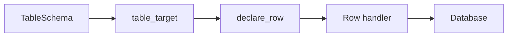

# Relational Database Connectors

## Summary

PostgreSQL, SQLite, and Doris all provide table targets in Python and Rust; PostgreSQL also provides a table source. Target schemas define keyed rows, while connector-specific handlers turn changed and missing declarations into database mutations. [rust/sdk/cocoindex/src/connectors/postgres.rs:1-6] [rust/sdk/cocoindex/src/connectors/sqlite.rs:1-5] [rust/sdk/cocoindex/src/connectors/doris.rs:1-5]

## Source and target roles

| Connector | Source | Target connection |
|---|---|---|
| PostgreSQL | Table snapshot in a read-only repeatable-read transaction; no live notifications. | Python uses an `asyncpg.Pool`. |
| SQLite | — | Python uses a thread-safe `ManagedConnection`. |
| Doris | — | Python uses `ManagedConnection` with Doris connection settings. |

PostgreSQL’s `items(key)` converts snapshot rows to stable-key pairs for `mount_each`. Rust’s `read_table` returns a vector of rows from the same isolation level. [python/cocoindex/connectors/postgres/_source.py:1-5] [python/cocoindex/connectors/postgres/_source.py:133-153] [python/cocoindex/connectors/postgres/_target.py:1577-1594] [python/cocoindex/connectors/sqlite/_target.py:68-77] [python/cocoindex/connectors/doris/_target.py:434-458] [rust/sdk/cocoindex/src/connectors/postgres.rs:1973-1984]

## Table and row synchronization

The Python connectors’ `TableSchema` types map columns to database types and list primary-key columns. `from_class` derives columns from a record type, with connector-specific type and vector overrides. [python/cocoindex/connectors/postgres/_target.py:329-393] [python/cocoindex/connectors/sqlite/_target.py:301-363] [python/cocoindex/connectors/doris/_target.py:330-374]

Each declared row becomes a child target keyed by its primary-key values. For example, Doris uses: [python/cocoindex/connectors/doris/_target.py:1333-1344]

```python
    def declare_row(self: "DorisTableTarget[RowT]", *, row: RowT) -> None:
        row_dict = self._row_to_dict(row)
        pk_values = tuple(row_dict[pk] for pk in self._table_schema.primary_key)
        coco.declare_target_state(self._provider.target_state(pk_values, row_dict))

    def _row_to_dict(self, row: RowT) -> dict[str, Any]:
        out: dict[str, Any] = {}
```

[python/cocoindex/connectors/doris/_target.py:1333-1339]



All three skip unchanged rows and remove rows whose declarations disappear. SQLite batches writes in a local transaction. Doris uses SQL deletes followed by HTTP Stream Load for changed rows; those are separate operations. PostgreSQL’s source and target paths are detailed in [PostgreSQL Source and Target](source-and-target-connectors-postgres.md). [rust/sdk/cocoindex/src/connectors/sqlite.rs:1-5] [python/cocoindex/connectors/sqlite/_target.py:450-474] [python/cocoindex/connectors/doris/_target.py:874-910]

Table replacement is destructive, while non-additive column changes can invalidate child rows as lossy. `managed_by` controls table ownership; the connector-specific pages cover the supported schema transitions. [python/cocoindex/connectors/sqlite/_target.py:1024-1031] [python/cocoindex/connectors/doris/_target.py:1254-1269]

## Vector and other indexes

| Connector | Index support |
|---|---|
| PostgreSQL | pgvector `ivfflat` and `hnsw` attachments; named SQL command attachments can manage other objects. [python/cocoindex/connectors/postgres/_target.py:1503-1517] [python/cocoindex/connectors/postgres/_target.py:1547-1559] |
| SQLite | sqlite-vec vector columns and `vec0` virtual tables; virtual-table writes use delete then insert. [python/cocoindex/connectors/sqlite/_target.py:122-137] [python/cocoindex/connectors/sqlite/_target.py:493-512] |
| Doris | ANN vector and inverted full-text indexes are declared with the table. [python/cocoindex/connectors/doris/_target.py:717-735] [python/cocoindex/connectors/doris/_target.py:767-800] |

Read [SQLite and Doris Targets](source-and-target-connectors-sqlite-and-doris.md) for extension requirements, schema changes, and write behavior.

## Terms

- **`TableSchema`**: Column definitions and primary-key fields used by a table target. [python/cocoindex/connectors/postgres/_target.py:329-335]
- **`managed_by`**: The setting controlling whether CocoIndex manages table DDL. [rust/sdk/cocoindex/src/connectors/sqlite.rs:3-5]