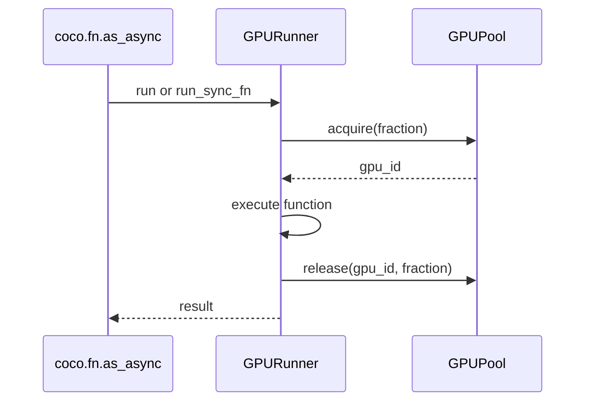

# Execution Runners and GPU Pools

## Summary

A Python `Runner` chooses where a function executes; `GPURunner` also reserves capacity from a shared GPU pool. GPU work runs in-process by default, with synchronous functions offloaded to threads. An optional subprocess mode uses a single spawned worker and has limitations for multiple GPUs. [python/cocoindex/_internal/runner.py:37-46] [python/cocoindex/_internal/runner.py:99-109] [python/cocoindex/_internal/runner.py:346-393]

## Runner dispatch

Use a runner with `@coco.fn.as_async`, whether the underlying function is synchronous or asynchronous. The decorator routes synchronous bodies to `run_sync_fn()` and asynchronous bodies to `run()`; `@coco.fn` rejects a runner because it lacks the required async interface. [python/cocoindex/_internal/function.py:1596-1615] [python/cocoindex/_internal/function.py:2096-2106]

```python
@coco.fn.as_async(runner=coco.GPU)
def _gpu_work(x: int) -> int:
    import time

    seen_gpus.append(coco.current_gpu())
    seen_threads.append(__import__("threading").get_ident())
    time.sleep(0.05)
    return x + 1

results = await asyncio.gather(_gpu_work(10), _gpu_work(20))
```

[python/tests/core/test_gpu_pool.py:127-142]

Each runner lazily owns a `BatchQueue`. With both batching and a runner, functions share that queue; batches are currently serialized through it, limiting multi-GPU parallelism. Runner-only functions use per-function queues and let the GPU pool control concurrency. See [Concurrency, Batching, and Rate Limits](concurrency-batching-and-rate-limits.md) for the batching mechanism. [python/cocoindex/_internal/runner.py:37-65] [python/cocoindex/_internal/function.py:1713-1732]

## GPU allocation

`coco.GPU` requests one GPU; `coco.GPU(0.5)` creates a runner requesting half of one. Fractions must be greater than zero and at most one. Each runner call acquires one GPU before execution and releases its fraction in `finally`. [python/cocoindex/_internal/runner.py:295-322] [python/cocoindex/_internal/runner.py:340-368]



The pool tracks capacity from 0 to 1 per GPU. It chooses a GPU with sufficient remaining capacity, or queues the request. Queued requests reserve the most available GPUs abstractly, allowing other requests to use unreserved capacity; cancellation while waiting returns acquired capacity and processes the queue. [rust/utils/src/gpu_pool.rs:20-28] [rust/utils/src/gpu_pool.rs:105-145] [rust/utils/src/gpu_pool.rs:63-84]

Two half-GPU calls can run concurrently on one GPU; a third waits until capacity is released. The pool accounts for requested capacity—it does not itself divide GPU memory. [python/tests/core/test_gpu_pool.py:205-222] [rust/utils/src/gpu_pool.rs:20-24]

The default pool is shared across GPU runners and created lazily. `configure_gpu_pool(num_gpus)` replaces it and must be called before GPU functions run. Otherwise, detection uses the following order. [python/cocoindex/_internal/runner.py:257-273] [rust/utils/src/gpu_pool.rs:287-305]

| Priority | Source |
| --- | --- |
| 1 | `COCOINDEX_NUM_GPUS` |
| 2 | Number of entries in `CUDA_VISIBLE_DEVICES` |
| 3 | `nvidia-smi` |
| 4 | Fallback to one GPU |

[rust/utils/src/gpu_pool.rs:298-319] [rust/utils/src/gpu_pool.rs:343-356]

In-process functions can read the assigned ID with `coco.current_gpu()` or `coco.current_gpus()`, and the request with `coco.current_gpu_fraction()`. Outside the GPU context, these return `None`, an empty list, and `None`, respectively. [python/cocoindex/_internal/runner.py:219-250]

## Execution modes

| Mode | Async body | Sync body |
| --- | --- | --- |
| In-process | Runs on the event loop. | Runs in a dedicated thread pool. |
| Subprocess | Runs with `asyncio.run()` in the worker. | Runs in the worker. |

[python/cocoindex/_internal/runner.py:174-181] [python/cocoindex/_internal/runner.py:346-393]

Set `COCOINDEX_RUN_GPU_IN_SUBPROCESS=1` before the runner’s first use to enable subprocess mode; the runner caches that choice. The function and arguments must be picklable. The shared process pool uses one spawned worker and is restarted if it breaks. [python/cocoindex/_internal/runner.py:99-127] [python/cocoindex/_internal/runner.py:184-202] [python/cocoindex/_internal/runner.py:324-330]

Subprocess mode does not set `CUDA_VISIBLE_DEVICES` per assignment: with multiple GPUs, calls run on the same GPU regardless of the pool’s assigned ID, and the runner warns. Use in-process mode for multi-GPU assignment. [python/cocoindex/_internal/runner.py:401-415]

## Terms

- **Runner**: An object that executes synchronous and asynchronous function bodies in a chosen context. [python/cocoindex/_internal/runner.py:37-46]
- **GPUPool**: A shared capacity tracker that grants and queues GPU reservations. [rust/utils/src/gpu_pool.rs:20-29]
- **GPU fraction**: The capacity requested from one GPU for a runner call. [python/cocoindex/_internal/runner.py:295-303]