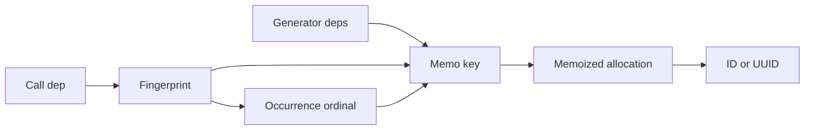

# Stable ID Generation

## Summary

CocoIndex memoizes generated IDs and UUIDs so a component can reuse them across incremental runs. The simple functions map a dependency to one value; generators add occurrence ordinals when repeated dependencies need distinct values. Integer IDs come from an app-level sequencer that reserves ranges in batches. [python/cocoindex/resources/id.py:1-15] [rust/core/src/engine/id_sequencer.rs:1-7]

## Choose an API

| Python API | Behavior within a component |
| --- | --- |
| `await generate_id(dep)` | Reuses one integer for the same dependency. |
| `generate_uuid(dep)` | Reuses one UUID for the same dependency. |
| `await IdGenerator(deps).next_id(dep)` | Uses a distinct integer for each occurrence. |
| `UuidGenerator(deps).next_uuid(dep)` | Uses a distinct UUID for each occurrence. |

[python/cocoindex/resources/id.py:30-41] [python/cocoindex/resources/id.py:60-70] [python/cocoindex/resources/id.py:126-135] [python/cocoindex/resources/id.py:190-200]

The Python UUID APIs are synchronous; integer allocation is asynchronous. The Rust SDK exposes asynchronous versions of both, taking a `Ctx` and serializable dependencies. [python/cocoindex/resources/id.py:30-31] [python/cocoindex/resources/id.py:60-61] [rust/sdk/cocoindex/src/resources/id.rs:16-36]

## Memoized identity

The simple functions allocate only when their memoized call needs a result: integers use the default sequencer, while UUIDs use random UUID v4 generation. The resulting value is reused with the same dependency in the same component. This keeps stable target keys from changing on every reprocessing run. [python/cocoindex/resources/id.py:30-31] [python/cocoindex/resources/id.py:56-61] [python/cocoindex/resources/id.py:86-86] [docs/src/content/docs/common_resources/id_generation.mdx:8-10]

The Rust implementation makes the dependency fingerprint and memo key explicit:

```rust
pub async fn generate_id<D: Serialize + ?Sized>(ctx: &Ctx, dep: &D) -> Result<u64> {
    let dep_fp = memo_fingerprint(dep)?;
    let key = ("cocoindex_generate_id", dep_fp);
    ctx.memo(&key, |ctx| async move { ctx.next_raw_id().await })
        .await
}
```

[rust/sdk/cocoindex/src/resources/id.rs:12-21]

Stability depends on the component’s memo state: untouched function-memo entries are removed during a build’s flush. Python’s synchronous decorated functions also execute without memoization outside a component context. See [Memoization and State Reuse](memoization-and-state-reuse.md) for cache lifecycle details. [rust/core/src/engine/context.rs:340-350] [rust/core/src/engine/context.rs:391-395] [python/cocoindex/_internal/function.py:802-809]

## Repeated dependencies

Each generator tracks an ordinal per dependency fingerprint. Its memoized allocation uses the constructor `deps` fingerprint, the call’s `dep` fingerprint, and that ordinal. Repeating the same sequence in the same component reuses the results; the ordinal distinguishes duplicate inputs within that sequence. [python/cocoindex/resources/id.py:122-149] [rust/sdk/cocoindex/src/resources/id.rs:84-99]



Use distinct constructor dependencies for separate generators in one component: two fresh generators with the same `deps` start their ordinals at zero and can address the same memo entries. Python generators are `NotMemoKeyable`, and Rust generators are not `Clone`, because copying or memoizing their mutable ordinal state would make allocation misleading. [python/cocoindex/resources/id.py:89-104] [python/cocoindex/_internal/memo_fingerprint.py:177-193] [rust/sdk/cocoindex/src/resources/id.rs:44-55]

## Integer allocation

`IdSequencerManager` maintains a buffer per sequencer key. When empty, it reserves a consecutive range through `Storage::run_txn`; the stored counter advances before IDs are served from memory. Ranges start at two IDs and double up to 256, reducing database transactions. IDs start at 1; 0 is reserved. [rust/core/src/engine/id_sequencer.rs:25-29] [rust/core/src/engine/id_sequencer.rs:60-65] [rust/core/src/engine/id_sequencer.rs:88-132] [rust/core/src/state_store/app_store.rs:746-761]

A brief map lock finds the sequencer; a per-key async mutex serializes allocations for that key while different keys can proceed independently. Reserved ranges and previews can leave gaps: preview allocates new IDs, but its new IDs are not the ones promised for the next update. [rust/core/src/engine/id_sequencer.rs:68-75] [python/tests/resources/test_id.py:81-109]

## Terms

- **Occurrence ordinal**: The per-dependency call count included in a generator’s memo key. [python/cocoindex/resources/id.py:141-149]
- **IdSequencerManager**: The per-app manager that reserves and serves integer ID ranges. [rust/core/src/engine/id_sequencer.rs:68-78]