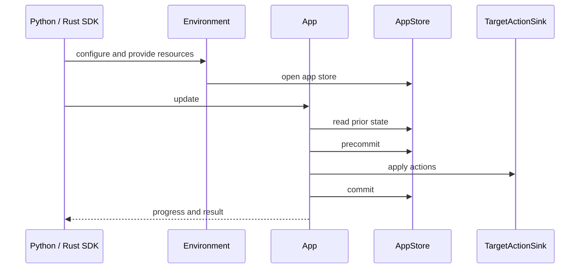

# Runtime and Shared Mechanisms

## Summary

An environment supplies the storage, resources, and runtime context that apps need across updates. Each app has its own LMDB namespace, while component execution uses shared mechanisms for resource tracking, admission, batching, cancellation, and progress reporting. The engine persists the information needed to reuse work and reconcile targets on later runs. [rust/core/src/engine/environment.rs:17-34] [rust/sdk/cocoindex/src/app.rs:70-98]

## From environment to update

1. **Open an environment and provide resources.** Python resolves a lazy default environment or uses an explicit `Environment`; the Rust SDK builds an environment and can create multiple apps from it. The shared core environment opens storage and retains provider registries, logic fingerprints, and a process token. [python/cocoindex/_internal/environment.py:238-269] [rust/sdk/cocoindex/src/app.rs:70-98] [rust/core/src/engine/environment.rs:42-58]

2. **Bind an app to its store.** Core registers the app name within the environment, opens its named `AppStore`, and creates the root component. Apps in one environment share resources but have separate database namespaces. [rust/core/src/engine/app.rs:91-105] [rust/sdk/cocoindex/src/app.rs:76-98]

3. **Start an update.** Python adapts the main function and its arguments into a core processor; Rust wraps a closure receiving `Ctx`. Both pass options and host context to the same core update mechanism. The core starts the root component and returns an operation handle. [python/cocoindex/_internal/app.py:294-314] [rust/sdk/cocoindex/src/app.rs:537-589] [rust/core/src/engine/app.rs:150-188]

4. **Reuse or execute component work.** A component can reuse a valid memo. When it executes, admission limits in-flight work, and its prior function memos and user state are prefetched into a per-build cache. The processor can retrieve resources, call functions, mount children, and declare target states. [rust/core/src/engine/component.rs:1180-1216] [rust/core/src/engine/component.rs:1231-1237]

5. **Submit and observe.** Precommit reads and plans tracking changes; sink actions run; a final commit records completed state. Progress handles expose versioned statistics while inspection reads persisted paths and ownership. Stopping the default environment runs lifespan cleanup and closes storage. [rust/core/src/state_store/submit_session.rs:36-60] [rust/core/src/engine/stats.rs:39-46] [rust/core/src/inspect/db_inspect.rs:27-34] [python/cocoindex/_internal/environment.py:474-489]



[rust/core/src/engine/app.rs:91-105] [rust/core/src/engine/component.rs:1231-1237] [rust/core/src/state_store/submit_session.rs:36-57]

The Python update signature exposes the main operational choices:

```python
def update(
    self,
    *,
    full_reprocess: bool = False,
    live: bool = False,
    preview: bool = False,
) -> UpdateHandle[R]:
```

[python/cocoindex/_internal/app.py:271-277]

## Key entry points

| Type or function | Responsibility | Definition |
| --- | --- | --- |
| `Environment<Prof>` | Own shared core storage and registries. | [rust/core/src/engine/environment.rs:17-48] |
| `EnvironmentBuilder` | Configure Python settings, resources, and exception handling. | [python/cocoindex/_internal/environment.py:113-141] |
| `EnvironmentBuilder::build` | Open a Rust SDK environment and register context state. | [rust/sdk/cocoindex/src/app.rs:192-226] |
| `Ctx::get_key` | Retrieve a Rust resource and record a tracked dependency. | [rust/sdk/cocoindex/src/ctx.rs:562-585] |
| `Storage::run_txn` | Batch replay-safe LMDB write bodies. | [rust/core/src/state_store/storage.rs:439-468] |
| `ProcessingStats` | Maintain versioned progress and termination notifications. | [rust/core/src/engine/stats.rs:39-58] |
| `show_progress` | Render an operation’s progress to a terminal or plain output. | [rust/core/src/engine/progress_display.rs:233-265] |

## Shared mechanisms

**Resources and identity.** Python’s `ContextKey` and Rust’s named keys identify provided resources; change-tracked reads add dependencies to memo validation. Component context also carries the execution identity needed by APIs such as target declaration. Stable generated IDs use memoization and the app’s ID sequencer to preserve identity across runs. Read [Context, Resources, and Identity](context-resources-and-identity.md) and [Stable ID Generation](runtime-and-shared-mechanisms-stable-id-generation.md). [python/cocoindex/_internal/component_ctx.py:395-424] [rust/core/src/engine/id_sequencer.rs:1-7]

**Persistence and representation.** An `AppStore` holds component and function memos, target tracking, child existence, and explicit user state under stable paths. Values need language-specific serialization, while fingerprints identify memo inputs and dependencies. The Python target-state codec separately holds eligible values and actions compactly in memory during submission. Read [Persistent State and User State](persistent-state-and-user-state.md), [Types, Serialization, and Fingerprints](types-serialization-and-fingerprints.md), and [LMDB Transactions and Write Batching](lmdb-transactions-and-write-batching.md). [rust/core/src/state/db_schema.rs:63-90] [rust/core/src/state/db_schema.rs:270-291] [python/cocoindex/_internal/target_state_codec.py:1-10]

**Concurrency and failure boundaries.** Component admission lends a parent token to a child so a full pool does not deadlock nested work. Batch queues coalesce concurrent work; rate limiters pace outbound requests. Runners choose execution contexts, including GPU resources. Deadlines are cooperative checkpoints, while app cancellation and background exception handlers have their own propagation rules. Read [Concurrency, Batching, and Rate Limits](concurrency-batching-and-rate-limits.md), [Execution Runners and GPU Pools](runtime-and-shared-mechanisms-execution-runners-and-gpu-pools.md), and [Deadlines, Cancellation, and Failures](deadlines-cancellation-and-failures.md). [rust/core/src/engine/admission.rs:1-19] [rust/utils/src/ratelimit.rs:74-91] [python/cocoindex/_internal/deadline.py:35-58]

**Operations and lifecycle.** Statistics distinguish initial readiness from full termination, which matters for live updates. Inspection exposes stored paths and target owners; terminal reporting displays progress, and release-build usage telemetry has an opt-out. Read [Inspection, Progress, and Telemetry](inspection-progress-and-telemetry.md) and [Environment Configuration and Lifecycle](environment-configuration-and-lifecycle.md). [rust/core/src/engine/stats.rs:39-46] [rust/core/src/engine/stats.rs:100-117] [rust/core/src/inspect/db_inspect.rs:648-665] [rust/core/src/telemetry/mod.rs:1-6]

## Terms

- **Environment**: Shared storage and runtime context from which apps are created. [rust/core/src/engine/environment.rs:17-22]
- **AppStore**: An app’s named persistent store within an environment. [rust/core/src/engine/app.rs:91-103]
- **ProcessingStats**: Versioned execution statistics with readiness and termination notifications. [rust/core/src/engine/stats.rs:39-58]