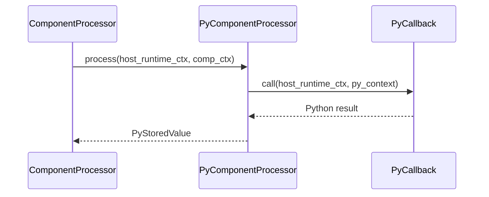

# Shared Engine and Language Boundaries

## Summary

The shared Rust engine is parameterized by `EngineProfile`, which supplies host-specific contexts, processors, values, target handlers, and action sinks. The Python extension and native Rust SDK implement that contract separately, so the engine can run the same execution and reconciliation machinery with either host. [rust/core/src/engine/profile.rs:35-46] [rust/py/src/profile.rs:13-24] [rust/sdk/cocoindex/src/profile.rs:28-43]

## The profile contract

`EngineProfile` defines the types the engine needs without prescribing how a language represents them:

```rust
pub trait EngineProfile: Debug + Clone + PartialEq + Eq + Hash + Default + 'static {
    type HostRuntimeCtx: Clone + Send + Sync + Eq + Hash + 'static;
    type HostCtx: Send + Sync + 'static;

    type ComponentProc: ComponentProcessor<Self>;
    type FunctionData: Clone + Send + Sync + Persist + 'static;

    type TargetHdl: TargetHandler<Self>;
    type TargetStateTrackingRecord: Send + Persist + 'static;
    type TargetAction: Send + Sync + 'static;
    type TargetActionSink: TargetActionSink<Self>;
    type TargetStateValue: Send + 'static;
}
```

[rust/core/src/engine/profile.rs:35-47]

| Contract | Python: `PyEngineProfile` | Rust: `RustProfile` |
|---|---|---|
| Runtime and host context | `PyAsyncContext`, `Py<PyAny>` | `()`, `ContextStore` |
| Processor and function data | `PyComponentProcessor`, `PyStoredValue` | `BoxedProcessor`, `Value` |
| Target handler and sink | `PyTargetHandler`, `PyTargetActionSinkInner` | `BoxedHandler`, `BoxedSink` |
| Tracking record, action, desired value | `PyStoredValue`, `PyTargetAction`, `PyTargetStateValue` | `Value`, `Action`, `Value` |

[rust/py/src/profile.rs:13-24] [rust/sdk/cocoindex/src/profile.rs:31-43]

The Python-facing `core` module registers PyO3 classes and functions for apps, processors, mounts, contexts, and target declarations. Its `core.pyi` stub describes this extension boundary; the native SDK instead wraps core types directly. [rust/py/src/lib.rs:26-53] [python/cocoindex/_internal/core.pyi:440-467] [rust/sdk/cocoindex/src/profile.rs:8-16]

## Processing calls

Both processors satisfy a contract that receives a host runtime context and a `ComponentProcessorContext`, then returns a future of profile-specific function data. The contract also exposes an optional memo fingerprint and state validation. [rust/core/src/engine/component.rs:63-101]



[rust/py/src/component.rs:86-97]

Python creates processors with either a synchronous or asynchronous callback. `PyComponentProcessor` wraps the core context for Python and converts the callback result to `PyStoredValue`; synchronous callbacks run on the runtime’s blocking pool. `PyAsyncContext` carries Python event-loop task locals. [rust/py/src/component.rs:51-82] [rust/py/src/runtime.rs:101-104] [rust/py/src/runtime.rs:141-154]

The Rust SDK’s `BoxedProcessor` holds a type-erased `FnOnce` returning a future. It takes the closure when processing starts, passes it a cloned core context, and converts SDK errors to core errors; attempting to consume it again produces an error. [rust/sdk/cocoindex/src/profile.rs:90-105] [rust/sdk/cocoindex/src/profile.rs:140-157]

## Values and reconciliation

`Persist` requires conversion to and from bytes, but each profile chooses its representation. Python’s `PyStoredValue` caches an object and/or bytes, serializing on demand and lazily deserializing bytes when Python requests the object. Rust’s `Value` holds MessagePack bytes produced from Serde values. See [Types, Serialization, and Fingerprints](types-serialization-and-fingerprints.md). [rust/core/src/engine/profile.rs:9-13] [rust/py/src/value.rs:46-72] [rust/py/src/value.rs:89-130] [rust/sdk/cocoindex/src/profile.rs:46-61]

Target reconciliation crosses the boundary in two stages. A handler receives a desired value and prior tracking records and returns an action; a sink applies actions to the external system. Reconciliation can be retried inside precommit and must have no side effects. Sink actions must tolerate retries because the engine can retry subsets of a failed batch. [rust/core/src/engine/target_state.rs:461-468] [rust/core/src/engine/target_state.rs:144-154]

`PyTargetHandler` calls the Python handler’s `reconcile` method. Plain target data may be held encoded and decoded for that call; the sink decodes actions for each callback invocation. The Rust profile delegates to `BoxedHandler` and `BoxedSink` closures, passing `ContextStore` to the sink so it can resolve resources. See [Custom Target Handlers and Sinks](custom-target-handlers-and-sinks.md). [rust/py/src/target_state.rs:458-489] [rust/py/src/target_state.rs:255-275] [rust/sdk/cocoindex/src/profile.rs:291-305] [rust/sdk/cocoindex/src/profile.rs:320-328]

## Terms

- **EngineProfile**: The core trait selecting host-specific execution and reconciliation types. [rust/core/src/engine/profile.rs:35-46]
- **Persist**: The core interface for converting a value to and from bytes. [rust/core/src/engine/profile.rs:9-13]
- **HostRuntimeCtx**: Profile-specific runtime context passed to processors and sinks. [rust/core/src/engine/component.rs:69-73] [rust/core/src/engine/target_state.rs:157-162]
- **HostCtx**: Profile-specific host context passed to action sinks. [rust/core/src/engine/target_state.rs:157-162]