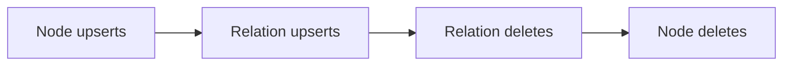

# Neo4j and FalkorDB Targets

## Summary

Both connectors model nodes as records under a label and edges as records under a relationship type. Their Python sinks order changes across tables, while the Rust SDK shares target handlers and Cypher generation through `cypher_graph`. [python/cocoindex/connectors/neo4j/_target.py:544-559] [python/cocoindex/connectors/falkordb/_target.py:481-492] [rust/sdk/cocoindex/src/cypher_graph.rs:1576-1585]

## Declare nodes and relationships

A Python `TableTarget` declares a node using the row’s primary-key field; `declare_row` aliases `declare_record`. A `RelationTarget` takes endpoint IDs and an optional record. Its key comes from the record’s primary key, or defaults to a string derived from the endpoint labels and IDs. [python/cocoindex/connectors/neo4j/_target.py:1371-1379] [python/cocoindex/connectors/neo4j/_target.py:1454-1465] [python/cocoindex/connectors/neo4j/_target.py:1495-1514]

```python
rel_table.declare_relation(
    from_id=from_id,
    to_id=to_id,
    record=RelRow(id=f"{from_id}->{to_id}", predicate="connects"),
)
```

This test declares the endpoint records before declaring the relation. [python/tests/connectors/test_neo4j_target.py:1070-1079]

Cypher uses `MERGE` for nodes, both endpoints, and the relationship; relationship writes leave endpoint properties to their own handlers. Node deletion uses `DETACH DELETE`, which also removes incident edges. Record fingerprints suppress unchanged writes. [python/cocoindex/connectors/neo4j/_cypher.py:92-119] [python/cocoindex/connectors/neo4j/_cypher.py:135-160] [python/cocoindex/connectors/neo4j/_target.py:946-950]

## Ordering and failure boundaries

Python record handlers for the same database or graph share a sink. Each batch is grouped in this order to keep endpoint and edge operations compatible: [python/cocoindex/connectors/neo4j/_target.py:544-553] [python/cocoindex/connectors/falkordb/_target.py:481-492]



Neo4j applies ordered chunks in transactions, retries transient failures, and splits a chunk when it exceeds the transaction memory limit. Earlier committed chunks remain in place if a later one fails. FalkorDB issues a separate query for each action because it does not support multi-statement Cypher transactions. [python/cocoindex/connectors/neo4j/_target.py:555-559] [python/cocoindex/connectors/neo4j/_target.py:593-651] [python/cocoindex/connectors/falkordb/_target.py:488-528]

## Schema and indexes

Both Python `TableSchema` types have one primary-key field, defaulting to `id`, and can infer columns from record classes. Schema changes are tracked even though the connectors do not issue incremental property DDL; non-insert field changes cause lossy child invalidation so records are re-upserted. [python/cocoindex/connectors/neo4j/_target.py:422-472] [python/cocoindex/connectors/falkordb/_target.py:358-408] [python/cocoindex/connectors/neo4j/_target.py:1184-1191]

| System | Supporting artifacts | Vector index |
|---|---|---|
| Neo4j | Node uniqueness constraint; relationship property index. | Named index; cosine or euclidean distance. |
| FalkorDB | Node and relationship indexes and uniqueness constraints, created best-effort. | Identified by label and field; also supports `ip`. |

Vector indexes are target attachments. A changed dimension or metric causes drop and recreation; Python validates a positive dimension. [python/cocoindex/connectors/neo4j/_target.py:1257-1288] [python/cocoindex/connectors/falkordb/_target.py:1139-1194] [python/cocoindex/connectors/neo4j/_target.py:1398-1415] [python/cocoindex/connectors/falkordb/_target.py:1357-1374] [python/cocoindex/connectors/falkordb/_target.py:653-674]

Removing a system-managed table deletes **all** nodes with its label, including attached relationships, or all relationships of its type, regardless of who wrote them. Use a user-managed table for a shared label. [python/cocoindex/connectors/neo4j/_target.py:1291-1303]

## Shared Rust implementation

`graph_target_api!` generates the two connectors’ public target APIs around shared `cypher_graph` handlers. Each `Graph` implements `CypherExecutor`: Neo4j binds Bolt parameters, while FalkorDB supplies values in a `CYPHER` parameter header. Identifiers are validated because they cannot be bound as values. [rust/sdk/cocoindex/src/cypher_graph.rs:1576-1585] [rust/sdk/cocoindex/src/connectors/neo4j.rs:69-81] [rust/sdk/cocoindex/src/connectors/falkordb.rs:69-88] [python/cocoindex/connectors/falkordb/_cypher.py:38-47]

Rust derives relation keys from the endpoint tables and typed IDs. Its shared record sink applies actions in the order received; the Python batch ordering above should not be assumed for this path. Rust also exposes a secondary node-index attachment alongside vector indexes. [rust/sdk/cocoindex/src/cypher_graph.rs:351-381] [rust/sdk/cocoindex/src/cypher_graph.rs:1203-1214] [rust/sdk/cocoindex/src/cypher_graph.rs:1608-1627]

## Terms

- **`TableTarget`**: A target for records under a node label. [python/cocoindex/connectors/falkordb/_target.py:1300-1303]
- **`RelationTarget`**: A target for edges under a relationship type. [python/cocoindex/connectors/falkordb/_target.py:1385-1388]
- **`CypherExecutor`**: The Rust interface through which shared handlers execute dialect-specific Cypher. [rust/sdk/cocoindex/src/cypher_graph.rs:25-40]