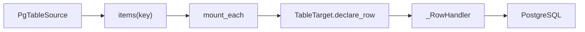

# PostgreSQL Source and Target

## Summary

PostgreSQL sources enumerate a consistent table snapshot and let callers supply stable keys for per-row processing. Targets reconcile keyed rows, table schema, pgvector indexes, and SQL command attachments. [python/cocoindex/connectors/postgres/_source.py:111-153] [python/cocoindex/connectors/postgres/_target.py:1024-1066]

## Read a snapshot

`PgTableSource.fetch_rows()` returns a synchronous or asynchronous `RowFetcher`. Its async iterator validates identifiers and runs a cursor inside a read-only `repeatable_read` transaction. `row_type` selects and constructs record fields; it cannot be combined with `row_factory`. The source does not provide live change notifications. [python/cocoindex/connectors/postgres/_source.py:1-4] [python/cocoindex/connectors/postgres/_source.py:111-142] [python/cocoindex/connectors/postgres/_source.py:195-231]

`items(key)` pairs each row with a caller-derived stable key. The example uses a composite key to mount processing components: [examples/postgres_source/main.py:113-123]

```python
    source = postgres.PgTableSource(
        coco.use_context(SOURCE_POOL),
        table_name="source_products",
        row_type=SourceProduct,
    )

    await coco.mount_each(
        process_product,
        source.fetch_rows().items(lambda p: (p.product_category, p.product_name)),
        target_table,
    )
```

[examples/postgres_source/main.py:113-123]

Rust’s `read_table` also uses a read-only repeatable-read transaction, but fetches the snapshot into a `Vec`; `read_table_items` applies a key function to those rows. [rust/sdk/cocoindex/src/connectors/postgres.rs:1937-1992] [rust/sdk/cocoindex/src/connectors/postgres.rs:1995-2030]

## Reconcile tables and rows



`TableSchema` describes columns and primary-key fields; Python can infer it from a record type, including `PgType` or vector-schema overrides. `declare_row` encodes values, strips NUL characters, and keys the declaration by its primary-key tuple. [python/cocoindex/connectors/postgres/_target.py:329-393] [python/cocoindex/connectors/postgres/_target.py:1469-1500]

The Python row handler fingerprints desired values and skips unchanged rows. It sends `INSERT ... ON CONFLICT` upserts and keyed deletes in parallel chunks; eligible PostgreSQL types use an `unnest` statement, while other types use multi-row `VALUES`. These chunks acquire pool connections independently. [python/cocoindex/connectors/postgres/_target.py:825-867] [python/cocoindex/connectors/postgres/_target.py:869-880] [python/cocoindex/connectors/postgres/_target.py:914-963] [python/cocoindex/connectors/postgres/_target.py:1036-1066]

Table DDL for a Python table action is transactional. The handler creates the requested schema and, when needed, the database-wide pgvector extension. Table replacement invalidates rows destructively; non-additive column changes are lossy. For a column type change, Python tries `ALTER TYPE` in a savepoint, then falls back to dropping and adding the column if conversion fails. [python/cocoindex/connectors/postgres/_target.py:1181-1226] [python/cocoindex/connectors/postgres/_target.py:1238-1270] [python/cocoindex/connectors/postgres/_target.py:1346-1370] [python/cocoindex/connectors/postgres/_target.py:1418-1425]

Rust similarly recreates a table on a primary-key signature change. Its system-managed table path also compares existing columns against `information_schema`; see [State Diffs and Schema Evolution](state-diffs-and-schema-evolution.md) for the shared invalidation model. [rust/sdk/cocoindex/src/connectors/postgres.rs:617-675] [rust/sdk/cocoindex/src/connectors/postgres.rs:1111-1121]

## Indexes and SQL attachments

`declare_vector_index` attaches an `ivfflat` or `hnsw` pgvector index to the table, with a metric-specific operator class. A changed specification drops and recreates the index; its drop is schema-qualified so a non-default table schema does not depend on `search_path`. [python/cocoindex/connectors/postgres/_target.py:1503-1545] [python/cocoindex/connectors/postgres/_target.py:521-563]

`declare_sql_command_attachment` provides a named setup command and optional teardown command for other database objects. Setup runs on creation or change; teardown runs on removal or before changed setup. Both attachments are also exposed by Rust. [python/cocoindex/connectors/postgres/_target.py:1547-1571] [rust/sdk/cocoindex/src/connectors/postgres.rs:384-425]

## Terms

- **`RowFetcher`**: A PostgreSQL table iterator that reads rows from a repeatable-read snapshot. [python/cocoindex/connectors/postgres/_source.py:80-89] [python/cocoindex/connectors/postgres/_source.py:133-138]
- **SQL command attachment**: A named setup and optional teardown declaration associated with a target table. [python/cocoindex/connectors/postgres/_target.py:1547-1564]