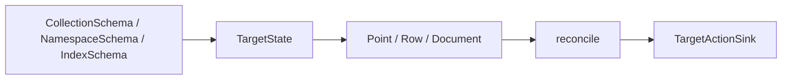

# Qdrant, Turbopuffer and Valkey Targets

## Summary

These connectors reconcile keyed points, rows, or documents beneath a managed collection, namespace, or search index. Each tracks record content to skip unchanged writes and deletes records whose declarations disappear. [python/cocoindex/connectors/qdrant/_target.py:288-315] [python/cocoindex/connectors/turbopuffer/_target.py:316-345] [python/cocoindex/connectors/valkey/_target.py:325-371]

## Containers and vector schemas

| Connector | Container and child | Python vector definition |
|---|---|---|
| Qdrant | Collection and `PointStruct` | One unnamed dense vector or named dense, multivector, and sparse definitions. |
| Turbopuffer | Namespace and `Row` | One unnamed or several named vectors, with one distance metric for the namespace. |
| Valkey | Search index and `Document` | One vector field plus optional text, tag, or numeric payload indexes. |

Qdrant sparse vectors must be named; dense and sparse names share a namespace. Turbopuffer rejects an empty named-vector schema and reserves `id` for the row identifier. Valkey supports HNSW or flat indexing. [python/cocoindex/connectors/qdrant/_target.py:53-82] [python/cocoindex/connectors/qdrant/_target.py:181-208] [python/cocoindex/connectors/turbopuffer/_target.py:101-105] [python/cocoindex/connectors/turbopuffer/_target.py:127-155] [python/cocoindex/connectors/valkey/_target.py:66-98]

Vector definitions resolve schema providers before the container is declared. In the Qdrant example, the embedder supplies the vector schema, and the mounted collection becomes the target passed to file processing: [python/cocoindex/connectors/qdrant/_target.py:114-129] [examples/text_embedding_qdrant/main.py:91-106]

```python
    target_collection = await qdrant.mount_collection_target(
        QDRANT_DB,
        collection_name=QDRANT_COLLECTION,
        schema=await qdrant.CollectionSchema.create(
            vectors=qdrant.QdrantVectorDef(schema=EMBEDDER)
        ),
    )
```

[examples/text_embedding_qdrant/main.py:93-99]

## Synchronization



Each container supplies a child handler for its records. A changed child produces an upsert, an absent child produces a delete, and a matching fingerprint produces no action. For the general ownership mechanism, see [Target Reconciliation](target-reconciliation.md). [python/cocoindex/connectors/qdrant/_target.py:288-315] [python/cocoindex/connectors/turbopuffer/_target.py:391-400] [python/cocoindex/connectors/valkey/_target.py:325-371]

Qdrant batches point upserts and deletes separately; Python validates point IDs as unsigned 64-bit integers or UUIDs before declaration. Turbopuffer sends row upserts and deletes in a namespace write, with the vector schema and distance metric. Named-vector rows must provide all declared vectors, and attributes cannot collide with vector fields or `id`. [python/cocoindex/connectors/qdrant/_target.py:256-285] [python/cocoindex/connectors/qdrant/_target.py:738-765] [python/cocoindex/connectors/turbopuffer/_target.py:199-230] [python/cocoindex/connectors/turbopuffer/_target.py:289-314]

Valkey stores each document as a hash under `index_name:document_id`, with the vector encoded as float32 bytes. Each upsert atomically deletes and recreates the hash, preventing removed payload fields from lingering. [python/cocoindex/connectors/valkey/_target.py:260-274] [python/cocoindex/connectors/valkey/_target.py:313-323]

## Container changes

Python defaults to system management. A replacement invalidates children destructively: Qdrant replaces the collection, Turbopuffer clears the namespace, and Valkey drops the index and purges hashes under its prefix before recreation. These operations can affect data beyond individual declarations. [python/cocoindex/connectors/qdrant/_target.py:475-506] [python/cocoindex/connectors/turbopuffer/_target.py:402-417] [python/cocoindex/connectors/turbopuffer/_target.py:446-456] [python/cocoindex/connectors/valkey/_target.py:415-440]

The Rust SDK also offers all three targets with managed options. Its Qdrant API has separate declarations for single, multi-, and named-vector points; Turbopuffer has single- and named-vector row declarations. Rust Valkey documents use string IDs and optional string payloads. [rust/sdk/cocoindex/src/connectors/qdrant.rs:761-827] [rust/sdk/cocoindex/src/connectors/turbopuffer.rs:660-702] [rust/sdk/cocoindex/src/connectors/valkey.rs:302-305]

## Terms

- **`CollectionTarget`**: A Qdrant target whose children are points. [python/cocoindex/connectors/qdrant/_target.py:515-521]
- **`NamespaceTarget`**: A Turbopuffer target whose children are rows. [python/cocoindex/connectors/turbopuffer/_target.py:479-483]
- **`IndexTarget`**: A Valkey search-index target whose children are documents. [python/cocoindex/connectors/valkey/_target.py:610-613]