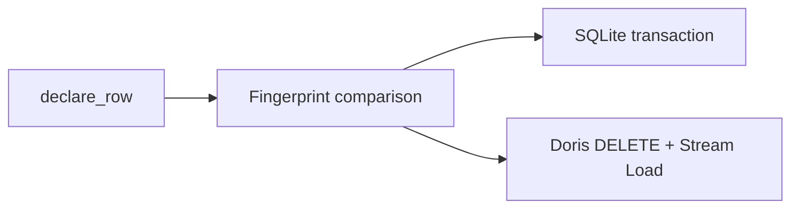

# SQLite and Doris Targets

## Summary

SQLite and Doris targets reconcile declared rows under a table keyed by a `TableSchema` primary key. SQLite applies row batches in a local transaction; Doris deletes matching keys before loading changed rows because its tables use the `DUPLICATE KEY` model. [python/cocoindex/connectors/sqlite/_target.py:450-474] [python/cocoindex/connectors/doris/_target.py:874-896]

## Tables and rows

Both Python connectors derive schemas from record types and declare each row under its primary-key tuple. SQLite rejects missing or `None` primary-key values; an omitted nullable non-key field becomes `NULL`. `managed_by` controls table ownership, with system management as the default. [python/cocoindex/connectors/sqlite/_target.py:337-363] [python/cocoindex/connectors/sqlite/_target.py:1075-1095] [python/cocoindex/connectors/doris/_target.py:1254-1270] [python/cocoindex/connectors/doris/_target.py:1333-1336]



Both row handlers fingerprint desired values, skip unchanged rows, and emit deletes for missing declarations. SQLite batches regular-table inserts using `ON CONFLICT`; `vec0` virtual tables instead use `DELETE` followed by `INSERT`. Its `ManagedConnection` holds an exclusive write lock for the transaction. [python/cocoindex/connectors/sqlite/_target.py:68-104] [python/cocoindex/connectors/sqlite/_target.py:493-541] [python/cocoindex/connectors/doris/_target.py:913-940]

Doris sends DDL and deletes over its MySQL protocol and ingests JSON batches with HTTP Stream Load. Delete and load are separate operations: an update removes existing keys before inserting their replacements. [rust/sdk/cocoindex/src/connectors/doris.rs:7-17] [python/cocoindex/connectors/doris/_target.py:883-910]

## Schema changes

Both table handlers compare the primary table state and non-key column states. Replacing a table is destructive; non-additive column changes are marked lossy so child rows can be reconciled again. [python/cocoindex/connectors/sqlite/_target.py:1004-1031] [python/cocoindex/connectors/doris/_target.py:1202-1229]

SQLite adds columns and attempts to drop or replace them in place. Its drop path ignores `OperationalError`, so an unsupported drop can leave the old column present. Doris applies non-key additions and deletions, ignoring only recognized benign DDL errors and propagating other failures. [python/cocoindex/connectors/sqlite/_target.py:793-826] [python/cocoindex/connectors/sqlite/_target.py:835-872] [python/cocoindex/connectors/doris/_target.py:1047-1098]

## Vector and other indexes

| | SQLite | Doris |
|---|---|---|
| Vector support | `sqlite-vec` vector columns or a `vec0` virtual table | ANN indexes declared in table DDL |
| Configuration | `Vec0TableDef` identifies partition and auxiliary columns | `VectorIndexDef` selects HNSW or IVF and metric; `InvertedIndexDef` configures full-text indexing |
| Key restriction | `vec0` requires one `INTEGER` primary key and at least one `float[N]` vector | Table DDL uses `DUPLICATE KEY` and hash distribution |

SQLite’s `load_vec="auto"` tries the extension without failing if unavailable, but creating a table with vector columns requires it. Auxiliary `vec0` columns cannot be used in KNN `WHERE` filters. [python/cocoindex/connectors/sqlite/_target.py:122-137] [python/cocoindex/connectors/sqlite/_target.py:1119-1155] [python/cocoindex/connectors/sqlite/_target.py:1281-1301] [python/cocoindex/connectors/sqlite/_target.py:764-771]

Doris indexes are part of the table declaration, as in this test: [python/tests/connectors/test_doris_target.py:425-441]

```python
        table = await coco.use_mount(
            coco.component_subpath("setup", "table"),
            doris.declare_table_target,
            DORIS_DB_KEY,
            table_name,
            await doris.TableSchema.from_class(VectorRow, primary_key=["id"]),
            vector_indexes=[
                doris.VectorIndexDef(
                    field_name="embedding",
                    index_type="hnsw",
                    metric_type="l2_distance",
                )
            ],
        )
```

[python/tests/connectors/test_doris_target.py:426-439]

The Python Doris tracking signature records indexed **field names**, rather than all index options. Index declarations are used when creating the table; changing only an option is therefore not represented in that signature. [python/cocoindex/connectors/doris/_target.py:991-1009] [python/cocoindex/connectors/doris/_target.py:1144-1154]

Rust exposes both targets, including `Vec0TableDef` for SQLite and vector and inverted index options for Doris. [rust/sdk/cocoindex/src/connectors/sqlite.rs:1-13] [rust/sdk/cocoindex/src/connectors/doris.rs:491-496]

## Terms

- **`Vec0TableDef`**: SQLite virtual-table configuration for sqlite-vec. [python/cocoindex/connectors/sqlite/_target.py:122-137]
- **Stream Load**: Doris’s HTTP bulk ingestion path for rows. [python/cocoindex/connectors/doris/_target.py:565-570]