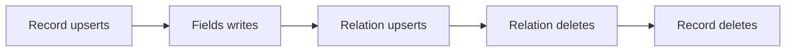

# SurrealDB Target

## Summary

SurrealDB targets declare tables, records, relations, and vector indexes as target states. Python supports separate field groups on a record and batches record actions across tables; the Rust SDK provides its own record and relation APIs. [python/cocoindex/connectors/surrealdb/_target.py:1293-1319] [python/cocoindex/connectors/surrealdb/_target.py:596-609] [rust/sdk/cocoindex/src/connectors/surrealdb.rs:214-251]

## Tables and records

A Python `ConnectionFactory` identifies the database by URL, namespace, and database name, and reuses an authenticated connection per event loop. `mount_table_target` returns a ready `TableTarget`; `declare_table_target` returns a pending one. Table names and field names used in SurrealQL are validated. [python/cocoindex/connectors/surrealdb/_target.py:107-155] [python/cocoindex/connectors/surrealdb/_target.py:83-92] [python/cocoindex/connectors/surrealdb/_target.py:1524-1549]

`declare_record(row=...)` uses the row’s `id` as its target key; `declare_row` is an alias. In Rust, `declare_record` takes an explicit ID, while `declare_row` extracts a scalar `id` from the serialized row. [python/cocoindex/connectors/surrealdb/_target.py:1293-1299] [rust/sdk/cocoindex/src/connectors/surrealdb.rs:226-251]

| Python declaration | Ownership and write behavior |
|---|---|
| `declare_record` | Owns the record identity; `UPSERT ... MERGE` preserves fields written by others. Removing the declaration deletes the record. |
| `declare_fields` | Owns a named `(id, group)` field set on an existing record. Removing the group or shrinking it unsets its formerly owned fields. |

Field-group writes fail if the record does not exist, so they can be retried after it is created. Tracking records retain field names as well as a fingerprint; this lets reconciliation remove old fields without wiping foreign ones. [python/cocoindex/connectors/surrealdb/_target.py:819-847] [python/cocoindex/connectors/surrealdb/_target.py:873-933] [python/tests/connectors/test_surrealdb_target.py:2318-2332]

The Rust record sink uses `UPSERT ... CONTENT` for normal records, rather than Python’s `MERGE`. Do not assume Python’s field-sharing behavior when using that SDK. [rust/sdk/cocoindex/src/connectors/surrealdb.rs:1614-1643]

## Relations and action ordering

`RelationTarget.declare_relation` connects endpoint records. With one allowed table on each side, Python selects them automatically; polymorphic relations require the relevant table argument. An explicit record `id` identifies the edge; otherwise Python derives one from endpoint table names and IDs. Tuple and list IDs become SurrealDB array record IDs. [python/cocoindex/connectors/surrealdb/_target.py:95-99] [python/cocoindex/connectors/surrealdb/_target.py:1407-1437] [python/cocoindex/connectors/surrealdb/_target.py:1469-1485]

```python
likes_target = await coco.use_mount(
    coco.component_subpath("setup", "likes"),
    surrealdb.mount_relation_target,
    SURREAL_DB_KEY,
    "likes",
    person_target,
    post_target,
    likes_schema,
)
```

The test then declares each edge with `from_id`, `to_id`, and a relation record. [python/tests/connectors/test_surrealdb_target.py:859-874]

Python relations are single-owner: a changed edge is deleted and recreated with `RELATE`. Record handlers sharing a `ConnectionFactory` share a sink, which sorts actions so endpoint writes precede relation writes and relation deletes precede record deletes. [python/cocoindex/connectors/surrealdb/_target.py:849-868] [python/cocoindex/connectors/surrealdb/_target.py:596-631]



Python applies the sorted actions in transactions of at most 500 actions. A failed chunk rolls back; earlier chunks remain committed, and retryable conflicts are retried. Table DDL is separately ordered with normal-table creation before relation-table creation and relation removal before normal-table removal. [python/cocoindex/connectors/surrealdb/_target.py:551-570] [python/cocoindex/connectors/surrealdb/_target.py:596-609] [python/cocoindex/connectors/surrealdb/_target.py:665-672] [python/cocoindex/connectors/surrealdb/_target.py:1148-1168]

## Schema and indexes

A Python `TableSchema` can be built from explicit `ColumnDef` values or inferred from a dataclass, `NamedTuple`, or Pydantic model, with type or vector-schema overrides. Supplying a schema creates a `SCHEMAFULL` table; omitting it creates `SCHEMALESS`. `managed_by=SYSTEM` is the default; a user-managed table leaves table DDL to the user. [python/cocoindex/connectors/surrealdb/_target.py:425-477] [python/cocoindex/connectors/surrealdb/_target.py:1189-1217] [python/cocoindex/connectors/surrealdb/_target.py:1504-1521] [python/tests/connectors/test_surrealdb_target.py:1904-1911]

Python tracks the table’s main shape separately from individual fields. Replacing the main shape causes destructive child invalidation; changing or removing existing fields causes lossy invalidation so child state can be reconciled again. See [State Diffs and Schema Evolution](state-diffs-and-schema-evolution.md) for the shared mechanism. [python/cocoindex/connectors/surrealdb/_target.py:996-1023] [python/cocoindex/connectors/surrealdb/_target.py:1089-1119]

`declare_vector_index` declares an attachment keyed by index name. Python requires a dimension, defaults to HNSW and cosine distance, and defines or removes the index as its specification changes. Rust also attaches indexes to tables, but its default method is `mtree`; user-managed Rust indexes do not receive DDL. [python/cocoindex/connectors/surrealdb/_target.py:1340-1365] [python/cocoindex/connectors/surrealdb/_target.py:708-728] [rust/sdk/cocoindex/src/connectors/surrealdb.rs:288-309] [rust/sdk/cocoindex/src/connectors/surrealdb.rs:1421-1427]

## Terms

- **`TableTarget`**: A provider for records and vector-index attachments in a table. [python/cocoindex/connectors/surrealdb/_target.py:1270-1277] [python/cocoindex/connectors/surrealdb/_target.py:1364-1365]
- **`RelationTarget`**: A provider for edges between endpoint records. [python/cocoindex/connectors/surrealdb/_target.py:1376-1379]
- **Fields mode**: A named group of fields managed on an existing record. [python/cocoindex/connectors/surrealdb/_target.py:1301-1309]