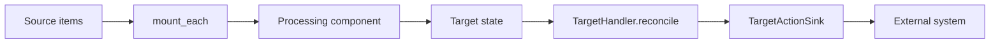

# Source and Target Connectors

## Summary

A connector adapts an external system to a CocoIndex pipeline as a source, a target, or both. Sources enumerate keyed inputs or deliver live changes; targets declare desired external state and reconcile it against tracked prior state. The shared engine coordinates processing and ownership, while each connector supplies the system-specific reads, schema operations, and writes. [docs/src/content/docs/connectors/index.mdx:8-13] [python/cocoindex/_internal/target_state.py:526-554]

## From source to target

A typical pipeline first provides connection resources, mounts a target container, and then processes keyed source items. The LanceDB example provides a connection and embedder in lifespan, mounts a table, walks Markdown files, and calls `mount_each` on the walker’s items. [examples/text_embedding_lancedb/main.py:56-63] [examples/text_embedding_lancedb/main.py:98-114]

```python
    files = localfs.walk_dir(
        sourcedir,
        recursive=True,
        path_matcher=PatternFilePathMatcher(included_patterns=["**/*.md"]),
        live=True,  # source supports live watch; pass -L to `cocoindex update` to actually run live
    )
    await coco.mount_each(process_file, files.items(), target_table)
```

[examples/text_embedding_lancedb/main.py:108-114]

Each source key identifies an independent processing component. In the example, `process_file` reads and splits a file; `process_chunk` embeds each chunk and declares a row. A target declaration records the desired value under a stable key—it does not itself issue the database write. [python/cocoindex/_internal/api.py:450-471] [examples/text_embedding_lancedb/main.py:66-95] [python/cocoindex/_internal/target_state.py:614-628]



A container target, such as a table, has its own handler and supplies a child handler for rows. `mount_target` waits for the container to be applied before returning its child provider. A row handler compares desired state with previous tracking records and returns an action and sink when needed; for example, LanceDB skips an unchanged row and emits a delete when a previously tracked row disappears. [python/cocoindex/_internal/api.py:642-659] [python/cocoindex/connectors/lancedb/_target.py:991-1005] [python/cocoindex/connectors/lancedb/_target.py:677-719]

Container schema changes can affect children: LanceDB replaces the table for incompatible column changes and marks its rows destructively invalidated. Connector actions have different external effects: a database row may be upserted or deleted, whereas removing a Kafka message declaration normally emits a tombstone. See [Target Reconciliation](target-reconciliation.md) for ownership and commit details. [python/cocoindex/connectors/lancedb/_target.py:1233-1259] [python/cocoindex/connectors/kafka/_target.py:104-124]

## Built-in integrations

| Family | Sources | Targets | Detail |
|---|---|---|---|
| Files | Local filesystem, S3, Azure Blob, OCI Object Storage, Google Drive | Local filesystem | [Filesystem and File Resources](filesystem-and-file-resources.md); [Cloud File Sources](cloud-file-sources.md) |
| Relational and warehouse | PostgreSQL | PostgreSQL, SQLite, Doris, BigQuery, Snowflake | [Relational Database Connectors](relational-database-connectors.md); [Warehouse Connectors](warehouse-connectors.md) |
| Vector and key-value | — | LanceDB, zvec, Qdrant, Turbopuffer, Valkey | [Vector and Key-Value Targets](vector-and-key-value-targets.md) |
| Graph | — | Neo4j, FalkorDB, SurrealDB | [Graph Database Targets](graph-database-targets.md) |
| Streaming | Kafka, Iggy | Kafka, Iggy | [Streaming Connectors](streaming-connectors.md) |

The repository’s connector overview lists these roles and groups. [docs/src/content/docs/connectors/index.mdx:15-28] [docs/src/content/docs/connectors/index.mdx:34-67]

Python provides all of the integrations in the table. Rust exposes feature-gated connector modules for S3, OCI, Google Drive, PostgreSQL, SQLite, Doris, LanceDB, Qdrant, Turbopuffer, Valkey, the three graph targets, Kafka, and Iggy; its filesystem resources are under `resources::fs`. [rust/sdk/cocoindex/src/connectors/mod.rs:3-32] [rust/sdk/cocoindex/src/resources/fs.rs:63-68]

## Live sources

A snapshot source enumerates current inputs during an update. PostgreSQL, for example, reads a repeatable-read snapshot and has no change notifications. For continuous processing, local filesystem watching and OCI’s optional event stream expose live views; Kafka and Iggy expose streams and keyed maps. [python/cocoindex/connectors/postgres/_source.py:1-5] [python/cocoindex/connectors/postgres/_source.py:133-153] [python/cocoindex/connectors/localfs/_source.py:164-172] [python/cocoindex/connectors/oci_object_storage/_source.py:254-259] [python/cocoindex/connectors/kafka/_source.py:461-495] [python/cocoindex/connectors/iggy/_source.py:539-562]

Live readiness marks the catch-up boundary. Python Kafka tracks downstream readiness handles and advances offsets only through completed messages in order. Feed watches are single-subscriber: `SingleWatcherGuard` rejects a concurrent watch and resets after exit. Rust Kafka and Iggy also expose scan-and-watch views; Rust filesystem live watching requires the `fs_live` feature. [python/cocoindex/connectors/kafka/_source.py:94-131] [python/cocoindex/connectorkits/__init__.py:10-23] [python/cocoindex/connectorkits/__init__.py:33-35] [rust/sdk/cocoindex/src/connectors/kafka.rs:506-514] [rust/sdk/cocoindex/src/connectors/iggy.rs:437-444] [rust/sdk/cocoindex/src/resources/fs.rs:67-84]

## Key APIs and helpers

| Type or function | Role and defining file |
|---|---|
| `DirWalker.items`, `PgTableSource.fetch_rows` | Produce keyed files or database rows for processing. [python/cocoindex/connectors/localfs/_source.py:164-178] [python/cocoindex/connectors/postgres/_source.py:241-253] |
| `mount_target`, `TargetStateProvider` | Apply a container and obtain the provider used to declare keyed children. [python/cocoindex/_internal/api.py:642-659] [python/cocoindex/_internal/target_state.py:557-576] |
| `TargetHandler`, `TargetReconcileOutput`, `TargetActionSink` | Compare desired and previous state and describe the action, sink, tracking record, and possible child invalidation. [python/cocoindex/_internal/target_state.py:508-554] |
| `ManagedBy`, `resolve_system_transition`, `diff` | Distinguish user- and system-managed containers and derive a transition action. [python/cocoindex/connectorkits/target.py:10-14] [python/cocoindex/connectorkits/statediff.py:112-124] [python/cocoindex/connectorkits/statediff.py:147-164] |
| `fingerprint_object`, `sync_to_async_iter`, `PerLoopConnections` | Support change detection, adaptation of synchronous iterators, and reuse of loop-bound connections. [python/cocoindex/connectorkits/fingerprint.py:33-38] [python/cocoindex/connectorkits/async_adapters.py:24-40] [python/cocoindex/connectorkits/_per_loop_connections.py:31-43] |

For implementation details, continue to [PostgreSQL Source and Target](source-and-target-connectors-postgres.md) or [SQLite and Doris Targets](source-and-target-connectors-sqlite-and-doris.md); [LanceDB and zvec Targets](source-and-target-connectors-lancedb-and-zvec.md) or [Qdrant, Turbopuffer and Valkey Targets](source-and-target-connectors-qdrant-turbopuffer-and-valkey.md); and [Neo4j and FalkorDB Targets](source-and-target-connectors-cypher-graph-targets.md) or [SurrealDB Target](source-and-target-connectors-surrealdb.md).

## Terms

- **Source**: A connector role that supplies external inputs to processing. [docs/src/content/docs/connectors/index.mdx:8-10]
- **Target**: A connector role that keeps external state aligned with declarations. [docs/src/content/docs/connectors/index.mdx:8-11]
- **Tracking record**: Connector-provided prior-state information used during reconciliation. [python/cocoindex/_internal/target_state.py:508-523]