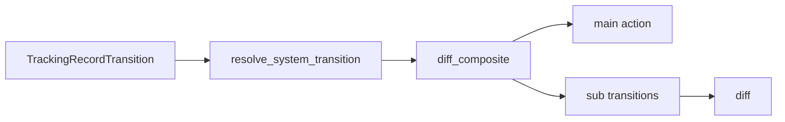

# State Diffs and Schema Evolution

## Summary

Connectors compare desired tracking records with possible previous records to choose actions that bring external state into sync. Shared diff helpers account for incomplete previous state and user-managed resources. Container handlers also report schema changes that may invalidate their children. [python/cocoindex/connectorkits/statediff.py:86-96] [rust/core/src/engine/target_state.rs:449-458]

## Tracking record transitions

A `TrackingRecordTransition` carries the desired record, all possible previous records, and whether the external state may be missing. Python uses `NON_EXISTENCE` for a desired deletion; Rust uses `None`. The engine can set `prev_may_be_missing` after a full reprocess, a provider schema-version mismatch, or a previously recorded deletion. Multiple previous records alone do not imply that state is missing. [python/cocoindex/connectorkits/statediff.py:86-96] [rust/sdk/cocoindex/src/statediff.rs:69-74] [rust/core/src/engine/execution.rs:1119-1137]

```python
class TrackingRecordTransition(_Generic[_TrackingRecordT], _NamedTuple):
    """A bundle of desired vs previously observed state, with completeness info.

    `diff()` takes a `TrackingRecordTransition[T]` and returns the action needed to make
    state converge to `desired` (given the observed `prev` and whether it might
    be incomplete).
    """

    desired: _TrackingRecordT | _coco.NonExistenceType
    prev: _Collection[_TrackingRecordT]
    prev_may_be_missing: bool
```

[python/cocoindex/connectorkits/statediff.py:86-96]

`diff()` evaluates the following conditions in order. A `None` transition also produces no action. [python/cocoindex/connectorkits/statediff.py:167-184]

| Condition | Result |
|---|---|
| Desired is absent and any previous record exists | `delete` |
| Desired is absent and no previous record exists | No action |
| Any previous record differs from desired | `replace` |
| Previous state cannot be missing | No action |
| No previous record exists and state may be missing | `insert` |
| Known records match but state may be missing | `upsert` |

## Managed resources and composite records

`MutualTrackingRecord` tags a record as system-managed or user-managed. `resolve_system_transition()` skips a user-managed desired resource. For deletion, it also skips when there are no previous records or any previous record is user-managed; otherwise, it passes only system-managed records to the diff. This policy avoids deleting a resource that may belong to the user. [python/cocoindex/connectorkits/statediff.py:99-144]

`CompositeTrackingRecord` separates a `main` record from keyed `sub` records. `diff_composite()` returns a main action and a transition for each observed or desired sub-key. It marks a sub-record as potentially missing if the main record is replaced, the original transition may be missing, or that sub-key is absent from any previous composite record. Deleting the whole composite returns a main delete with no individual sub-transitions. [python/cocoindex/connectorkits/statediff.py:56-73] [python/cocoindex/connectorkits/statediff.py:214-249]



The managed-resource resolution is optional; connectors that use it can pass its result into the composite diff and then diff each sub-transition. [python/cocoindex/connectors/sqlite/_target.py:1004-1022]

## Schema changes and children

SQLite illustrates how a connector interprets a composite schema diff: the main record captures table structure, while keyed sub-records allow column-level changes. A main replacement recreates the table; an insert or replacement already builds the desired columns. An upsert can encounter an existing table with an older column set, so column transitions still need reconciliation. [rust/sdk/cocoindex/src/statediff.rs:126-139] [rust/sdk/cocoindex/src/connectors/sqlite.rs:572-590]

The SQLite handler marks table replacement as **destructive** and column actions other than a pure insert as **lossy**. A pure column addition leaves child invalidation unset. These are connector decisions based on the effects of its actions. [rust/sdk/cocoindex/src/connectors/sqlite.rs:592-616]

| Child invalidation | Engine effect |
|---|---|
| Destructive | Assigns a fresh provider ID, separating the recreated container from old child tracking. |
| Lossy | Keeps the provider ID and increments its schema version; old child records may now be missing. |
| None | Keeps the existing generation. |

The engine also records provider generations as memo dependencies, so a changed generation prevents reuse of declarations that may no longer match the target. See [Target Declarations and Hierarchies](target-declarations-and-hierarchies.md) for provider details and [Memoization and State Reuse](memoization-and-state-reuse.md) for cache validation. [rust/core/src/engine/execution.rs:1200-1246] [rust/core/src/engine/execution.rs:1126-1137] [rust/core/src/state/target_state_path.rs:78-94]

## Terms

- **TrackingRecordTransition**: Desired and possible previous tracking records, with missing-state information. [python/cocoindex/connectorkits/statediff.py:86-96]
- **MutualTrackingRecord**: A tracking record tagged with its management policy. [python/cocoindex/connectorkits/statediff.py:99-109]
- **CompositeTrackingRecord**: A main record and keyed sub-records compared separately. [python/cocoindex/connectorkits/statediff.py:56-73]
- **Child invalidation**: A parent handler’s signal that its action destroyed or may have damaged child state. [docs/src/content/docs/advanced_topics/custom_target_connector.mdx:349-357]