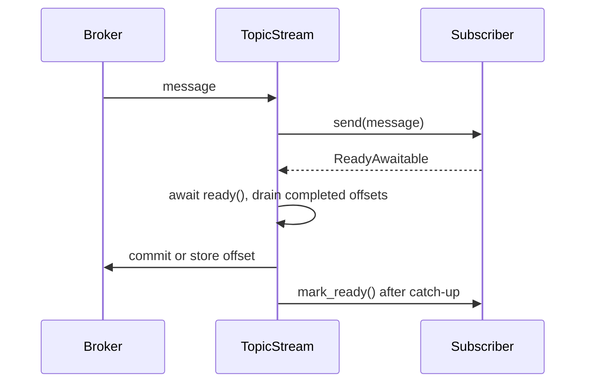

# Streaming Connectors

## Summary

Kafka and Iggy expose messages as streams or keyed change feeds, and can send messages from declared target states. Python source connectors wait for downstream readiness before advancing offsets; the Rust SDK instead builds snapshot views and resumes watching from their scan positions. [python/cocoindex/connectors/kafka/_source.py:318-331] [rust/sdk/cocoindex/src/connectors/kafka.rs:506-514]

## Source views

| API | Kafka | Iggy |
|---|---|---|
| `topic_as_stream` | Python delivers raw messages; `payloads()` yields bytes and filters tombstones. | Python delivers raw `ReceiveMessage` objects and offers a payload view. |
| `topic_as_map` | Uses message keys; null keys are skipped and null values delete keys. | Requires a key extractor; an optional predicate identifies deletions. |

Both Python map feeds adapt messages into updates or deletes suitable for `mount_each()`. Kafka also accepts a custom deletion predicate. [python/cocoindex/connectors/kafka/_source.py:264-271] [python/cocoindex/connectors/kafka/_source.py:407-435] [python/cocoindex/connectors/iggy/_source.py:440-467]

For example, the Kafka map API takes an unsubscribed consumer with auto-commit disabled:

```python
def topic_as_map(
    consumer: AIOConsumer,
    topics: list[str],
    *,
    is_deletion: IsDeleteFn | None = None,
) -> _TopicMapFeed:
```

[python/cocoindex/connectors/kafka/_source.py:484-489] [python/cocoindex/connectors/kafka/_source.py:493-506]

## Catch-up and offsets

Python tracks each delivered message until the subscriber’s `ReadyAwaitable` completes. Completed offsets drain in delivery order: a later completed message cannot advance the offset past an earlier unfinished one. Kafka commits the next offset; Iggy stores the last consumed offset. [python/cocoindex/connectors/kafka/_source.py:94-138] [python/cocoindex/connectors/iggy/_source.py:99-136]



Readiness follows the tracked offset reaching the initial high watermark; the broker commit or store is scheduled asynchronously, so `mark_ready()` does not wait for that operation to finish. Kafka obtains watermarks for initially assigned partitions and discards their pending tracking on revocation. [python/cocoindex/connectors/kafka/_source.py:119-145] [python/cocoindex/connectors/kafka/_source.py:175-178] [python/cocoindex/connectors/kafka/_source.py:282-310]

Python Iggy consumes a selected partition. For a multi-partition topic, callers must supply its `initial_high_watermark`: the Python SDK cannot infer per-partition watermarks. Iggy disables auto-commit and suppresses duplicate offsets observed within a watch. [python/cocoindex/connectors/iggy/_source.py:290-317] [python/cocoindex/connectors/iggy/_source.py:351-369]

A Python `TopicStream` allows one active `watch()`, including watches through its views. A concurrent watch raises `RuntimeError`; the guard resets on exit, including cancellation. For the general feed contract, see [Live Maps and Change Feeds](live-maps-and-change-feeds.md). [python/cocoindex/connectors/kafka/_source.py:241-262] [python/cocoindex/connectorkits/__init__.py:33-56]

## Rust source views

Rust keyed maps implement `LiveMapView`: `scan` builds the latest value per key, records where it stopped, and `watch` tails from there. Kafka scans all partitions from their earliest retained offsets; Iggy’s keyed map covers one partition. Rust’s `topic_as_stream` is also a map view, using stable `partition:offset` keys for individual payloads; its Iggy stream covers all partitions. [rust/sdk/cocoindex/src/connectors/kafka.rs:640-675] [rust/sdk/cocoindex/src/connectors/iggy.rs:437-444] [rust/sdk/cocoindex/src/connectors/iggy.rs:618-637]

## Message targets

A message key identifies a declared target state. Both connectors fingerprint values and skip unchanged declarations; a changed declaration produces a message, while a disappeared declaration produces a deletion action. Topics are user-managed. [python/cocoindex/connectors/kafka/_target.py:104-140] [python/cocoindex/connectors/kafka/_target.py:213-244] [python/cocoindex/connectors/iggy/_target.py:228-257]

Kafka defaults to a null-value tombstone and waits for delivery futures. Iggy has no tombstone: deleting a previously declared state requires `deletion_value_fn`, or reconciliation raises an error. Iggy sends the resulting value as a payload; its target key is CocoIndex’s stable identity. [python/cocoindex/connectors/kafka/_target.py:84-102] [python/cocoindex/connectors/kafka/_target.py:114-124] [python/cocoindex/connectors/iggy/_target.py:98-112] [python/cocoindex/connectors/iggy/_target.py:124-136]

## Terms

- **High watermark**: The initial offset boundary used to determine source catch-up. [python/cocoindex/connectors/kafka/_source.py:90-92]
- **Tombstone**: A Kafka message with a null value, interpreted by the map feed as a deletion. [python/cocoindex/connectors/kafka/_source.py:431-435]
- **ReadyAwaitable**: The downstream handle whose readiness permits an offset to be marked complete. [python/cocoindex/connectors/kafka/_source.py:94-117]