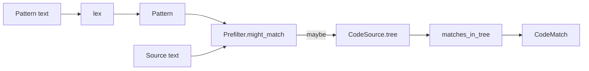

# Structural Matching and Prefilters

## Summary

Structural matching searches source code with by-example patterns and metavariables. The pattern is lexed into a flat sequence, while the source is parsed with tree-sitter; captures align to syntax nodes. A conservative prefilter can reject impossible matches before parsing, and `index_terms` supports external search indexes. [rust/code_match/README.md:3-5] [rust/code_match/src/prefilter.rs:1-14]

## Compile and match

A reusable `CodePattern` compiles both the pattern and its prefilter once. `match_source` accepts text or a `CodeSource`; `match_code` is a one-shot convenience that recompiles each time. A matching `CodeSource` grammar lets the matcher reuse its cached parse; otherwise the pattern’s grammar is used to parse the text. See [Code Parsing and Context Views](code-parsing-and-context-views.md) for shared source handling. [python/cocoindex/ops/code.py:115-157] [python/cocoindex/ops/code.py:207-220] [rust/code_match/src/matcher.rs:192-210]

```rust
use cocoindex_code_match::{lang, Pattern};

let cfg = lang::typescript();
let pat = Pattern::compile(r"console.log(\(ARGS*\))", &cfg).unwrap();

let src = r#"console.log("hi", x);"#;
for m in pat.matches(src) {
    println!("{} -> ARGS = {:?}", m.text, m.capture_text("ARGS"));
    // console.log("hi", x) -> ARGS = Some("\"hi\", x")
}
```

[rust/code_match/README.md:9-20]

The matcher flattens candidate nodes into leaves and node spans, then matches the pattern with dynamic programming. Python’s `CodeMatch` exposes the matched node kind, position-tracked chunks, and captures keyed by name. Comments are skipped during matching. [rust/code_match/src/matcher.rs:1-11] [python/cocoindex/ops/code.py:94-112] [python/tests/ops/test_code.py:181-188]



[rust/code_match/src/lexer.rs:1-4] [rust/code_match/src/matcher.rs:162-188] [python/cocoindex/ops/code.py:148-157]

## Metavariables and languages

The default sigil is `\`. Captures bind source text; repeating a name requires the captured text to be equal. Regex constraints are anchored to the entire captured node, and malformed regexes fail compilation. [rust/code_match/src/lexer.rs:6-38] [rust/code_match/src/matcher.rs:1-8]

| Pattern | Meaning |
|---|---|
| `\X` or `\_` | One named or anonymous node |
| `\(X*\)` or `\(X+\)` | Zero or more, or one or more, same-level sibling nodes |
| `\(X?\)` | Zero or one node |
| `\(X:/set_.*/\)` | One node whose text matches the regex |
| `\{{ ... \}}` | A node containing a descendant matching the inner pattern |

[rust/code_match/src/lexer.rs:6-21] [rust/code_match/src/lexer.rs:26-38]

Each `LangConfig` combines a registry grammar with language-specific tokenizers. This distinction matters for literal syntax: for example, languages differ in how quotes escape. Operators come from the grammar, while string-like pattern items match whole nodes. Language aliases and extensions resolve through the shared registry; a registered language can still lack a structural matcher. Unknown or unsupported languages and malformed patterns raise errors through the Python API. [rust/code_match/src/config.rs:241-250] [rust/code_match/src/lexer.rs:59-78] [rust/code_match/src/lang/mod.rs:70-77] [python/tests/ops/test_code.py:91-109]

## Prefilters and index terms

`Prefilter` extracts required literals as a conjunction of clauses: every clause must hold, but a clause may contain alternative terms. Identifiers and string-content runs use word boundaries; literals extracted from regex constraints use substring checks. The filter may pass a non-match, but must not reject a true match. A pattern with no extractable terms always passes. [rust/code_match/src/prefilter.rs:1-14] [rust/code_match/src/prefilter.rs:25-50] [rust/code_match/src/prefilter.rs:164-169]

`min_len` drops short terms; Python `CodePattern` defaults to three characters. If any alternative in a clause is too short, the entire clause is dropped to preserve soundness. Optional or zero-or-more regex captures cannot contribute required literals because they may match nothing. [python/cocoindex/ops/code.py:122-136] [rust/code_match/src/prefilter.rs:65-70] [rust/code_match/src/prefilter.rs:99-119]

`index_terms` traverses the source AST for deduplicated identifiers and string-content words, skipping comments. External FTS or n-gram indexes can use those terms with pattern clauses; use the same `min_len` for both sides. Python rejects unknown or non-tree-sitter languages rather than silently indexing nothing. `match_file` skips non-UTF-8 files and returns `None` for files with no match, while other I/O errors propagate. [rust/code_match/src/prefilter.rs:207-217] [python/cocoindex/ops/code.py:223-235] [python/cocoindex/ops/code.py:159-165]

## Terms

- **CodePattern**: Compiled structural pattern and prefilter reusable across sources. [python/cocoindex/ops/code.py:115-120]
- **Metavariable**: Pattern item that matches syntax nodes and can bind their text. [rust/code_match/src/lexer.rs:6-16]
- **Prefilter**: Conservative required-content check run before precise matching. [rust/code_match/src/prefilter.rs:1-9]
- **Index terms**: Deduplicated source identifiers and string-content words used to build an external prefilter index. [rust/code_match/src/prefilter.rs:207-217]