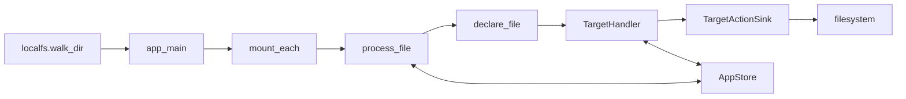

# System Architecture

## Summary

CocoIndex pipelines declare the derived state that should exist in external systems. A shared Rust engine runs processing components, reuses valid prior work, reconciles their declarations, and records enough state to handle later updates and cleanup. Python and native Rust APIs adapt their values and callbacks to that engine; connectors provide source access and target-specific actions. [docs/src/content/docs/programming_guide/core_concepts.mdx:31-33] [rust/core/src/engine/profile.rs:35-46]

## A pipeline update

The filesystem example expresses a pipeline as ordinary Python functions:

```python
@coco.fn(memo=True)
async def process_file(file: FileLike, outdir: pathlib.Path) -> None:
    html = _markdown_it.render(await file.read_text())
    outname = "__".join(file.file_path.path.parts) + ".html"
    localfs.declare_file(outdir / outname, html, create_parent_dirs=True)


@coco.fn
async def app_main(sourcedir: pathlib.Path, outdir: pathlib.Path) -> None:
    files = localfs.walk_dir(
        sourcedir,
        path_matcher=PatternFilePathMatcher(included_patterns=["**/*.md"]),
        live=True,
    )
    await coco.mount_each(process_file, files.items(), outdir)
```

[examples/files_transform/main.py:11-25]

An update follows the same broad sequence for other sources and targets:

1. **Start the app.** Python’s `App` binds a main function and its arguments. `update()` constructs a processor at the root stable path and passes it to the core app. The update can request a full reprocess, live operation, or a preview. [python/cocoindex/_internal/app.py:184-190] [python/cocoindex/_internal/app.py:271-313]
2. **Read and partition the source.** The main function enumerates files and uses `mount_each` to create independent components for keyed items. For a static iterable, each item key is appended to the child path; a live feed is handled by an internal live component. [python/cocoindex/_internal/api.py:450-458] [python/cocoindex/_internal/api.py:493-520]
3. **Reuse or execute.** The engine checks a component’s memo fingerprint and, when present, validates its stored states. A valid hit can return without rerunning or submitting the component. Otherwise, the processor reads and transforms its input. [rust/core/src/engine/component.rs:650-683] [rust/core/src/engine/component.rs:1129-1146]
4. **Declare and reconcile.** `declare_file` specifies the desired file; its declaration is associated with the current component. A target handler compares a desired value with previously tracked records and returns an action, which a sink applies to the external system. [python/cocoindex/connectors/localfs/_target.py:481-496] [python/cocoindex/_internal/target_state.py:614-628] [rust/core/src/engine/target_state.rs:461-468]
5. **Record the result and clean up.** After sink application, the engine commits tracking information, memo and user-state changes, and ownership cleanup. Missing declarations or components can then be reconciled away on subsequent updates. [rust/core/src/engine/execution.rs:441-448] [rust/core/src/engine/execution.rs:1910-1949] [docs/src/content/docs/programming_guide/core_concepts.mdx:122-134]



[examples/files_transform/main.py:11-25] [rust/core/src/engine/execution.rs:430-448] [rust/core/src/engine/execution.rs:1910-1949]

Stable identity makes incremental behavior possible: an unchanged item can be matched to its prior component, while a removed item’s outputs can be found for cleanup. Memoization is conditional, not automatic for every call; the example explicitly enables it on `process_file`. [python/cocoindex/_internal/api.py:512-520] [examples/files_transform/main.py:11-15] [docs/src/content/docs/programming_guide/core_concepts.mdx:138-146]

## Shared engine and host interfaces

The workspace contains `rust/core`, the Python extension in `rust/py`, and the native SDK in `rust/sdk/cocoindex`. The engine’s `EngineProfile` selects host-specific processor, context, value, handler, and sink types, allowing both interfaces to use core execution without requiring the same language representation. [Cargo.toml:1-12] [rust/core/src/engine/profile.rs:35-46]

Python’s public package re-exports its internal API, while its extension implements `PyEngineProfile`. The Rust SDK exposes `App`, `Environment`, `Ctx`, target APIs, and procedural macros; its private `RustProfile` implements the same core contract. See [Shared Engine and Language Boundaries](shared-engine-and-language-boundaries.md) and [Native Rust SDK](native-rust-sdk.md). [python/cocoindex/__init__.py:10-15] [rust/py/src/profile.rs:13-24] [rust/sdk/cocoindex/src/lib.rs:41-47] [rust/sdk/cocoindex/src/lib.rs:90-100] [rust/sdk/cocoindex/src/profile.rs:28-43]

The engine’s environment owns storage and creates per-app stores. Persisted component memo records include return values, logic dependencies, tracked states, and target-provider dependencies; these let later runs validate reuse rather than treating a matching input key as sufficient. [rust/core/src/engine/environment.rs:42-56] [rust/core/src/engine/environment.rs:88-90] [rust/core/src/state/db_schema.rs:270-291]

Connectors supply the system-specific behavior around this shared machinery. A source such as `localfs.walk_dir` exposes files and optionally a live view; a target handler decides actions, and its sink performs external writes. A sink may receive actions from several components and must tolerate retries after a failed batch. Backend transaction support therefore matters; the architecture does not promise one transaction across all external systems. [python/cocoindex/connectors/localfs/_source.py:362-380] [rust/core/src/engine/target_state.rs:144-154] [docs/src/content/docs/programming_guide/core_concepts.mdx:74-82]

## Code map

| Type or function | Role and defining file |
|---|---|
| `App.update` | Starts a Python update: `python/cocoindex/_internal/app.py` |
| `mount_each` | Partitions keyed input into components: `python/cocoindex/_internal/api.py` |
| `EngineProfile` | Defines host-specific types for core: `rust/core/src/engine/profile.rs` |
| `ComponentProcessor` | Supplies processing and memo validation: `rust/core/src/engine/component.rs` |
| `TargetHandler`, `TargetActionSink` | Decide and apply target actions: `rust/core/src/engine/target_state.rs` |
| `Environment` | Owns storage and creates app stores: `rust/core/src/engine/environment.rs` |
| `Ctx` | Carries native Rust pipeline context: `rust/sdk/cocoindex/src/ctx.rs` |

[python/cocoindex/_internal/app.py:271-279] [python/cocoindex/_internal/api.py:450-466] [rust/core/src/engine/profile.rs:35-46] [rust/core/src/engine/component.rs:63-77] [rust/core/src/engine/target_state.rs:127-142] [rust/core/src/engine/target_state.rs:461-468] [rust/core/src/engine/environment.rs:38-48] [rust/sdk/cocoindex/src/ctx.rs:323-328]

## Read further

- [Declarative Processing Model](declarative-processing-model.md) follows a complete pipeline through components, paths, declarations, and cleanup.
- [Shared Engine and Language Boundaries](shared-engine-and-language-boundaries.md) traces Python and Rust adapters to `EngineProfile`.
- [Native Rust SDK](native-rust-sdk.md) covers `Ctx`, macros, feature gates, and Rust pipeline construction.
- [Incremental Execution](incremental-execution.md), [Target Reconciliation](target-reconciliation.md), and [Persistent State and User State](persistent-state-and-user-state.md) explain the engine’s update, submission, and storage mechanisms.

## Terms

- **App**: The top-level executable that reads sources and declares target states. [docs/src/content/docs/programming_guide/core_concepts.mdx:56-66]
- **Processing component**: A unit of work grouped with its target states. [docs/src/content/docs/programming_guide/core_concepts.mdx:74-76]
- **Target state**: A keyed desired value associated with a target provider. [python/cocoindex/_internal/target_state.py:597-611]
- **EngineProfile**: The core contract for host-specific execution and reconciliation types. [rust/core/src/engine/profile.rs:35-46]