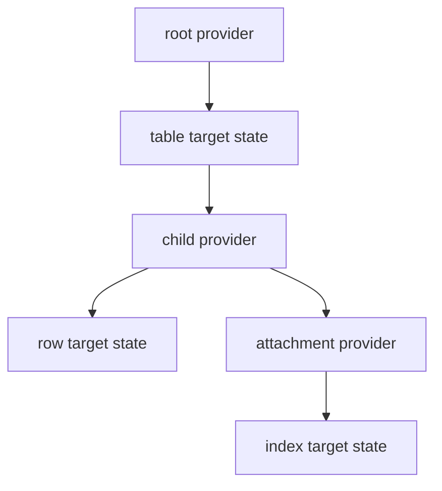

# Target Declarations and Hierarchies

## Summary

A `TargetStateProvider` associates a handler with a path and creates keyed target states. Container declarations produce child providers, while attachments add named providers for auxiliary states. Provider generations let the engine recognize when a container change invalidates previously tracked children. [rust/core/src/engine/target_state.rs:516-528] [rust/core/src/engine/execution.rs:354-396] [rust/core/src/state/target_state_path.rs:78-93]

## Providers and declarations

A root provider starts the hierarchy with a name and handler. For example, localfs registers `cocoindex/localfs`; its `DirTarget` then uses a provider to declare files or subdirectories. [python/cocoindex/connectors/localfs/_target.py:267-273] [python/cocoindex/connectors/localfs/_target.py:315-324]

```python
    def target_state(
        self: TargetStateProvider[ValueT, OptChildHandlerT],
        key: StableKey,
        value: ValueT,
    ) -> "TargetState[OptChildHandlerT]":
        return TargetState(self, key, value)
```

Creating a `TargetState` packages the provider, key, and value. `declare_target_state()` adds it to the current component’s declarations. [python/cocoindex/_internal/target_state.py:571-576] [python/cocoindex/_internal/target_state.py:597-628]

The engine builds a `TargetStatePath` by appending a fingerprint of the `StableKey` to the provider path. Declaring the same path twice in one component raises an error. A provider registry also rejects duplicate provider paths. [rust/core/src/engine/execution.rs:262-291] [rust/core/src/state/target_state_path.rs:58-63] [rust/core/src/engine/target_state.rs:745-758]

In the Rust SDK, a dynamically registered root provider exists only while a run registers it. If a later run stops registering it, the engine cannot reach its handler, so states declared through it are left in place. [rust/sdk/cocoindex/src/target_state.rs:559-576]

## Children and attachments

A container target can return a provider for states beneath it. `declare_target_state_with_child()` registers that provider lazily; the parent sink’s child-handler factory supplies its handler when the parent is reconciled. Python rejects a `NON_EXISTENCE` value for this API because a nonexistent target has no children. [rust/core/src/engine/target_state.rs:784-802] [python/cocoindex/_internal/target_state.py:631-656] [docs/src/content/docs/advanced_topics/custom_target_connector.mdx:337-345]

`mount_target()` declares the container in a child component and waits for it to apply, returning a resolved provider. Use it when the caller needs the child provider immediately; the direct declaration returns a pending provider. [python/cocoindex/_internal/api.py:642-659] [rust/sdk/cocoindex/src/target_state.rs:605-612]



An attachment provider adds a symbol-keyed namespace beneath a provider, alongside its regular children. A handler exposes supported attachment types through `attachments()`. The engine registers them when the handler is fulfilled, allowing orphaned attachments to be cleaned up even when they are no longer declared. [docs/src/content/docs/advanced_topics/custom_target_connector.mdx:540-563] [rust/core/src/engine/target_state.rs:545-557]

Call `provider.attachment(type)` on a resolved provider. Repeated lookup returns the cached provider; an unsupported type or an unfulfilled provider produces an error. The attachment inherits its parent’s provider generation. [rust/core/src/engine/target_state.rs:641-664] [rust/core/src/engine/target_state.rs:669-711]

## Provider generations

A generation contains a `provider_id` and `provider_schema_version`. The parent handler can signal that its action affects children using `child_invalidation`; the engine changes the generation accordingly. [rust/core/src/state/target_state_path.rs:78-82] [rust/core/src/engine/target_state.rs:449-458]

| Signal | Generation effect | Child consequence |
|---|---|---|
| `destructive` | Fresh provider ID | Old child tracking belongs to the previous generation. |
| `lossy` | Same ID, incremented schema version | Previous children may be missing and must be reconciled accordingly. |
| None | Existing generation retained | Normal child change detection applies. |

A fresh ID also prevents old child entries from being replayed as deletes against a recreated container. [rust/core/src/engine/execution.rs:1200-1246] [rust/core/src/engine/execution.rs:1126-1137]

Declarations record provider-generation dependencies for memo validation. A changed generation invalidates a memo entry, including for attachment declarations; a provider absent from the current registry alone is deliberately not treated as a mismatch. See [Memoization and State Reuse](memoization-and-state-reuse.md) and [State Diffs and Schema Evolution](state-diffs-and-schema-evolution.md). [rust/core/src/engine/execution.rs:292-296] [rust/core/src/engine/execution.rs:307-326] [python/tests/core/test_attachment_target_states.py:243-245]

## Terms

- **TargetStateProvider**: Associates a target-state path with a handler and creates keyed states. [python/cocoindex/_internal/target_state.py:557-576]
- **TargetStatePath**: Fingerprinted path identifying a target state within the provider hierarchy. [rust/core/src/state/target_state_path.rs:8-9] [rust/core/src/state/target_state_path.rs:58-63]
- **Attachment**: A named provider namespace for auxiliary target states. [docs/src/content/docs/advanced_topics/custom_target_connector.mdx:532-556]
- **Provider generation**: ID and schema version used to distinguish or invalidate child tracking. [rust/core/src/state/target_state_path.rs:78-93]