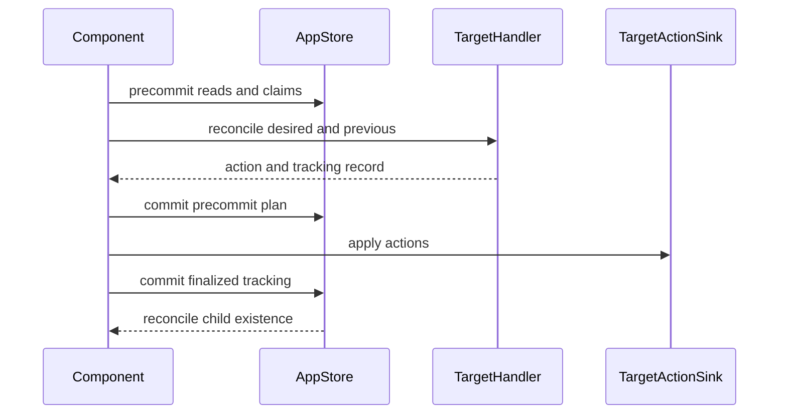

# Target Reconciliation

## Summary

A processing component declares the external state it wants; CocoIndex compares those declarations with persisted tracking and asks target handlers which actions are needed. The engine claims ownership and records pending state before applying actions, then commits finalized tracking after the sinks succeed. Missing declarations and components trigger cleanup, while retained tracking allows later updates to recover from interrupted submissions. [rust/core/src/engine/execution.rs:262-299] [rust/core/src/state_store/submit_session.rs:29-60]

## From declaration to external state

A target state has a provider, a stable key, and a desired value. The provider identifies the handler and its place in the target hierarchy; the key identifies an item beneath it. A component collects declarations during execution, and the engine rejects duplicate target-state paths within that component. [python/cocoindex/_internal/target_state.py:571-576] [rust/core/src/engine/execution.rs:262-291]

For example, localfs turns a filename and content into a file target state:

```python
        if isinstance(content, str):
            content = content.encode()
        name = str(filename) if isinstance(filename, pathlib.PurePath) else filename
        spec = _EntrySpec(entry_spec=content, create_parent_dirs=create_parent_dirs)
        # Files don't have children, but the provider type allows for them (for directories).
        # Cast is safe since file entries never produce child handlers at runtime.
        target_state = cast(
            coco.TargetState[None], self._provider.target_state(name, spec)
        )
        coco.declare_target_state(target_state)
```

[python/cocoindex/connectors/localfs/_target.py:315-324]

When the component submits, the engine compares each declaration with possible previous tracking records. The handler returns an action and a new tracking record, or `None` when no action is needed. Localfs tracks a content fingerprint and skips a file write only if all known fingerprints match and the file cannot be missing. A removed declaration is reconciled with no desired value, allowing its handler to produce a deletion action. [python/cocoindex/_internal/target_state.py:508-554] [python/cocoindex/connectors/localfs/_target.py:152-165] [rust/core/src/engine/execution.rs:1326-1365]

## Submission and failure boundaries



Precommit and final commit are separate store transactions, with external sink application between them. The claim can therefore be visible before the external action succeeds. [rust/core/src/state_store/submit_session.rs:29-60] [rust/core/src/state_store/submit_session.rs:425-450]

1. **Read and claim.** Precommit reads the component’s tracking and finds prior owners of newly claimed paths. If another in-process submission is actively changing a contested item, the claimant backs off and retries. [rust/core/src/state_store/submit_session.rs:96-153] [rust/core/src/engine/execution.rs:928-980]
2. **Reconcile and stage.** The engine computes actions and commits ownership claims and pending tracking. On transfer, it carries the prior owner’s tracking forward and removes the item from that owner’s record. [rust/core/src/engine/execution.rs:1068-1108] [rust/core/src/state_store/submit_session.rs:425-450]
3. **Apply and commit.** Sinks apply the actions. If they succeed, `AppStore::commit` finalizes tracking and the child-existence diff; child handlers are fulfilled after commit. [rust/core/src/engine/execution.rs:1910-1963] [rust/core/src/state_store/submit_session.rs:466-469]
4. **Clean up.** The child-existence diff writes tombstones for disappeared components. After commit, a sweep launches their deletion; tombstones remain available for retry if cleanup fails. [rust/core/src/state_store/submit_session.rs:578-594] [rust/core/src/engine/execution.rs:663-688]

Handlers must be side-effect free because precommit can retry them. Sinks must tolerate repeated actions: the engine can retry subsets of a failed merged batch to isolate the failing component. This does not make external writes and the store commit one transaction. [rust/core/src/engine/target_state.rs:461-470] [rust/core/src/engine/target_state.rs:144-154] [rust/core/src/engine/target_state.rs:371-389]

If application fails after precommit, the claim is not simply reverted. A subsequent run can see multiple possible previous records and reconcile again; the ownership-transfer test demonstrates recovery from that state. A cleanup commit removes an ownership entry only if it still points to the component being cleaned up, protecting a newer owner. [python/tests/core/test_ownership_transfer.py:505-512] [python/tests/core/test_ownership_transfer.py:530-557] [rust/core/src/state_store/submit_session.rs:506-519]

## Hierarchies and schema changes

Container target states provide child targets, such as rows in a table or files in a directory. Attachments add separate namespaces for auxiliary states such as indexes. A container handler can report a destructive or lossy change: the engine changes the child provider generation so affected declarations are reconsidered. [rust/core/src/engine/execution.rs:354-396] [docs/src/content/docs/advanced_topics/custom_target_connector.mdx:532-556] [rust/core/src/engine/execution.rs:1200-1246]

When a container disappears, its own removal handles its contents rather than issuing individual child deletions. Connector policy determines whether the container is destroyed or, for a user-managed container, abandoned with its contents left in place. [docs/src/content/docs/programming_guide/target_state.mdx:150-155]

## Key definitions

| Type or function | Role | Definition |
|---|---|---|
| `TargetStateProvider` | Creates keyed states and exposes attachment providers. | [python/cocoindex/_internal/target_state.py:557-586] |
| `declare_target_state` | Adds a declaration to the component’s building state. | [rust/core/src/engine/execution.rs:262-291] |
| `TargetHandler` | Compares desired and possible previous states. | [python/cocoindex/_internal/target_state.py:526-554] |
| `TargetReconcileOutput` | Carries the action, sink, tracking record, and child invalidation. | [python/cocoindex/_internal/target_state.py:508-523] |
| `TargetActionSink` | Applies actions, potentially batched across components. | [rust/core/src/engine/target_state.rs:126-162] |
| `PrecommitSession` and `AppStore::commit` | Read claims and finalize tracking around sink application. | [rust/core/src/state_store/submit_session.rs:96-153] [rust/core/src/state_store/submit_session.rs:466-477] |

For details, see [Target Declarations and Hierarchies](target-declarations-and-hierarchies.md), [Ownership, Submission, and Cleanup](ownership-submission-and-cleanup.md), [Custom Target Handlers and Sinks](custom-target-handlers-and-sinks.md), and [State Diffs and Schema Evolution](state-diffs-and-schema-evolution.md).

## Terms

- **Target state**: A keyed declaration of desired external state. [python/cocoindex/_internal/target_state.py:597-611]
- **Tracking record**: Persisted handler-defined information used to compare future declarations. [python/cocoindex/_internal/target_state.py:547-554]
- **Ownership**: The mapping from a target-state path to its declaring component. [rust/core/src/state/db_schema.rs:420-425]
- **Sink**: The executor that applies reconciled actions to an external system. [rust/core/src/engine/target_state.rs:144-162]