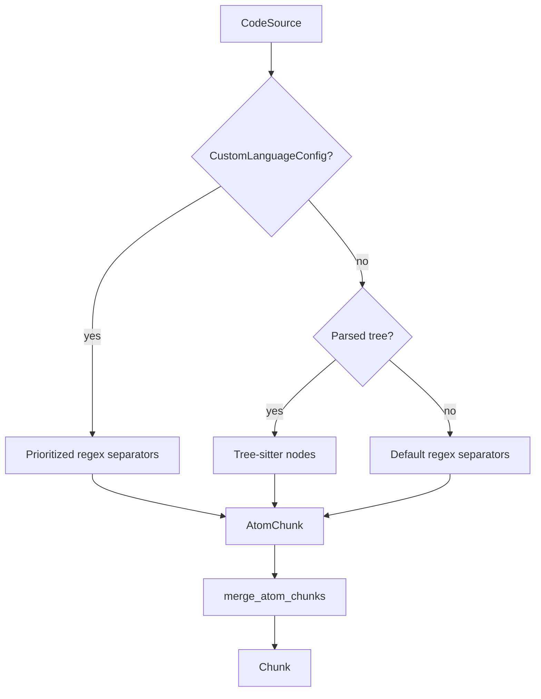

# Text Splitting and Provenance

## Summary

`SeparatorSplitter` divides text at regex matches; `RecursiveSplitter` chooses chunk boundaries using syntax or prioritized separators and a target size. Both return chunks tied to positions in the original text. Chunk sizes and overlap are measured in bytes, while output positions also include character offsets and line and column numbers. [python/cocoindex/ops/text.py:40-54] [python/cocoindex/ops/text.py:155-180] [python/cocoindex/resources/chunk.py:8-36]

## Choosing a splitter

| | `SeparatorSplitter` | `RecursiveSplitter` |
|---|---|---|
| Boundaries | Regexes OR-joined into one pattern | Tree-sitter nodes or regexes tried in priority order |
| Sizing | One chunk per resulting range | Plans chunks around a target byte size |
| Separators | Discard, retain on left, or retain on right | Used as boundaries during recursive subdivision |
| Empty and whitespace | Configurable empty chunks and trimming | Discards whitespace-only atoms and trims boundaries |

[python/cocoindex/ops/text.py:40-54] [python/cocoindex/ops/text.py:88-98] [rust/ops_text/src/split/recursive.rs:278-300]

`SeparatorSplitter` defaults to discarding separators, excluding empty chunks, and trimming ASCII whitespace. Trimming happens after separator placement, so retained whitespace separators can themselves be trimmed. An empty separator list emits the whole input subject to those options; invalid regexes fail construction. [rust/ops_text/src/split/by_separators.rs:30-36] [rust/ops_text/src/split/by_separators.rs:47-65] [rust/ops_text/src/split/by_separators.rs:80-113]

## Recursive boundaries

A recursive split descends through syntax nodes or successively finer regex separators, collecting atoms and then choosing a sequence of merged ranges. The planner weighs syntax and line-break boundaries, undersized chunks, and missing overlap. If an indivisible atom exceeds the target, it can produce a chunk larger than `chunk_size`; the size is a target, not a hard guarantee. [rust/ops_text/src/split/recursive.rs:335-395] [rust/ops_text/src/split/recursive.rs:465-487]



[rust/ops_text/src/split/recursive.rs:632-679] [rust/ops_text/src/split/recursive.rs:560-576]

Custom language names and aliases take precedence over built-in parsing. Otherwise, a tree is used when available; unknown languages, languages without grammars, and failed parses use default regex separators. Those defaults progress from paragraph and line breaks through sentence punctuation, other punctuation, and whitespace. Large terminal syntax nodes and gaps between nodes also fall back to regex subdivision. [rust/ops_text/src/split/recursive.rs:54-69] [rust/ops_text/src/split/recursive.rs:154-170] [rust/ops_text/src/split/recursive.rs:350-395] [rust/ops_text/src/split/recursive.rs:632-676]

`min_chunk_size` defaults to half the target; overlap defaults to zero and is capped at `min_chunk_size`. The planner chooses overlap at atom boundaries and assigns a cost to missing overlap, so the requested byte count is not an exact sliding-window stride. [rust/ops_text/src/split/recursive.rs:640-654] [rust/ops_text/src/split/recursive.rs:489-524]

The code-embedding example detects a language from the filename and supplies the split parameters explicitly: [examples/code_embedding/main.py:91-106]

```python
    text = await file.read_text()
    language = detect_code_language(filename=str(file.file_path.path.name))
    chunks = _splitter.split(
        text,
        chunk_size=1000,
        min_chunk_size=300,
        chunk_overlap=300,
        language=language,
    )
    id_gen = IdGenerator()
    await coco.map(process_chunk, chunks, file.file_path.path, id_gen, table)
```

[examples/code_embedding/main.py:96-106]

A Python `CodeSource` carries its own language and can share its cached parse with other consumers; supplying a separate `language` with it is invalid. Rust’s `split_source` instead ignores `config.language` and uses the source’s language. See [Code Parsing and Context Views](code-parsing-and-context-views.md). [python/cocoindex/ops/text.py:166-177] [rust/sdk/cocoindex/src/ops/text.rs:150-166]

## Positions and text

Chunk ranges start at an inclusive byte offset and end at an exclusive byte offset. The position machinery resolves endpoints in a pass over Unicode characters, producing character offsets and **1-based** line and column numbers. Byte and character offsets therefore differ for multibyte text. [rust/code_ast/src/positions.rs:5-12] [rust/code_ast/src/positions.rs:109-145]

Python copies the source slice into `Chunk.text` using character offsets. Rust’s SDK `Chunk` stores a byte range and obtains the slice on demand with `chunk.text(source)`; pass the original source. [python/cocoindex/ops/text.py:194-220] [rust/sdk/cocoindex/src/resources/chunk.rs:1-8] [rust/sdk/cocoindex/src/resources/chunk.rs:60-69]

## Terms

- **Chunk**: A source range with start and end positions. [python/cocoindex/resources/chunk.py:25-36]
- **CustomLanguageConfig**: Named, optionally aliased set of prioritized regex separators. [python/cocoindex/ops/text.py:88-98]
- **TextPosition**: Byte offset, character offset, and 1-based line and column. [python/cocoindex/resources/chunk.py:8-22]