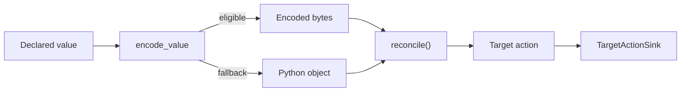

# Types, Serialization, and Fingerprints

## Summary

CocoIndex interprets Python annotations for schema and key validation, serializes values for persistent state, and fingerprints canonical values for change detection. Declared target values and actions also have a separate, temporary in-memory codec that reduces their memory cost during reconciliation. [python/cocoindex/_internal/datatype.py:191-208] [python/cocoindex/_internal/serde.py:445-460] [python/cocoindex/_internal/memo_fingerprint.py:419-429] [python/cocoindex/_internal/target_state_codec.py:1-10]

## Python types

`analyze_type_info()` unwraps `Annotated` and supported type aliases, then classifies annotations as records, sequences, mappings, unions, leaves, or `Any`. An optional type with one non-`None` member is represented as that member with `nullable=True`. Records include dataclasses, `NamedTuple`s, and Pydantic models; their fields supply names, hints, and defaults. Connectors use this information when building schemas. [python/cocoindex/_internal/datatype.py:60-63] [python/cocoindex/_internal/datatype.py:121-159] [python/cocoindex/_internal/datatype.py:205-274] [python/cocoindex/connectors/postgres/_target.py:400-405]

`TypeChecker` builds validation closures once and returns a typed value or raises `TypeError`. `StableKey` is a narrower set of values used for stable paths, including tuples of stable keys. For vector dtype interpretation, `DtypeRegistry` accepts `float32`, `float64`, and `int64`, requiring a concrete dtype. [python/cocoindex/_internal/datatype.py:66-93] [python/cocoindex/_internal/datatype.py:399-427] [python/cocoindex/_internal/typing.py:10-13]

## Durable serialization

The durable serializer selects a format using the value’s type; deserialization dispatches by the first byte and uses a type hint to reconstruct typed values. For example, `use_state(..., type_hint=Cursor)` can restore a dataclass, while omitting the hint decodes generically. [python/cocoindex/_internal/serde.py:341-355] [python/cocoindex/_internal/serde.py:388-435] [python/cocoindex/_internal/api.py:822-829]

| Route | Encoding |
| --- | --- |
| `0x01` | msgspec MessagePack for ordinary supported values |
| `0x02` | Pydantic model data encoded as MessagePack |
| `0x80` | Pickle, including legacy data and explicitly registered types |

[python/cocoindex/_internal/serde.py:341-348] [python/cocoindex/_internal/serde.py:445-460]

```python
def serialize(value: Any) -> bytes:
    """Serialize a value using the routing-byte protocol (C → B → A priority)."""
    # C: Explicit pickle (user opted in — highest priority)
    if type(value) in _SERIALIZE_BY_PICKLE_TYPES:
        return _strict_pickle_dumps(value)

    # B: Pydantic BaseModel
    if _is_pydantic_instance(value):
        payload = msgspec.msgpack.encode(
            value.model_dump(mode="json"),
            enc_hook=_enc_hook,
        )
        return b"\x02" + payload
```

[python/cocoindex/_internal/serde.py:445-457]

`@coco.serialize_by_pickle` opts a type into pickle and registers it for restricted unpickling; `@coco.unpickle_safe` only registers it. The restricted unpickler rejects globals outside its allow-list, including in MessagePack pickle extensions. A pickle decorator on a msgspec-native dataclass, `NamedTuple`, or `msgspec.Struct` may not take effect when nested, because msgspec bypasses the encoding hook. [python/cocoindex/_internal/serde.py:139-142] [python/cocoindex/_internal/serde.py:150-190] [python/cocoindex/_internal/serde.py:270-295]

## In-memory target values

The target-state codec holds eligible declared values as bytes until component commit and actions until sink application. This reduces the cost of row-shaped Python objects; handlers and sinks receive equal decoded copies. It is separate from durable serialization. [python/cocoindex/_internal/target_state_codec.py:1-10] [python/cocoindex/_internal/target_state_codec.py:27-30]



Eligible plain-data dictionaries can store their values with an interned key-schema ID. The schema table is process-local and bounded; unseen schemas fall back to whole-dict encoding once it is full. Scalars, unsupported objects, and encodings larger than 64 KiB remain Python objects. An encoded action can refer to the declared value’s encoding instead of duplicating it. [python/cocoindex/_internal/target_state_codec.py:151-157] [python/cocoindex/_internal/target_state_codec.py:218-244] [python/cocoindex/_internal/target_state_codec.py:257-290]

## Fingerprints

Python memo fingerprints canonicalize values before hashing: mappings and sets are sorted, cycles and shared references are tracked, and dataclasses include their type and fields. Custom types can provide `__coco_memo_key__` or a registered key function; a state hook can also supply state for cache validation. Unsupported objects fall back to pickle, or raise `TypeError` if that fails. [python/cocoindex/_internal/memo_fingerprint.py:131-151] [python/cocoindex/_internal/memo_fingerprint.py:283-384]

A call fingerprint includes function identity, version, arguments, and sorted keyword arguments. Plain objects have a native fast path; the shared Rust `Fingerprinter` produces a 16-byte BLAKE2b digest and writes type tags when serializing values. See [Memoization and State Reuse](memoization-and-state-reuse.md) for how the engine validates and uses these keys. [python/cocoindex/_internal/memo_fingerprint.py:387-429] [rust/utils/src/fingerprint.rs:37-46] [rust/utils/src/fingerprint.rs:127-159]

## Terms

- **StableKey**: A restricted value used to construct stable paths. [python/cocoindex/_internal/typing.py:10-13]
- **DataTypeInfo**: The analyzed core type, variant, annotations, and nullability of a Python annotation. [python/cocoindex/_internal/datatype.py:191-202]
- **Fingerprint**: A 16-byte digest used to identify values for change detection. [rust/utils/src/fingerprint.rs:37-45]